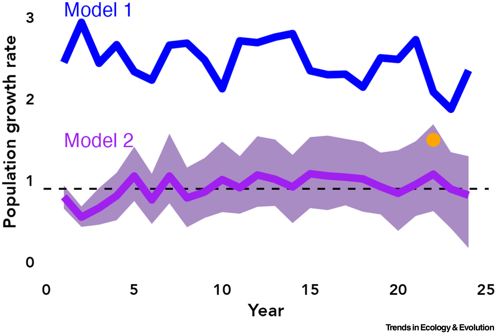
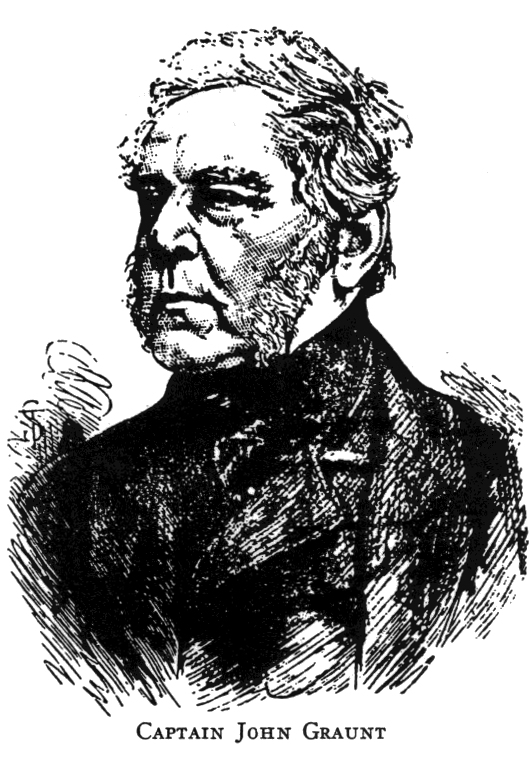
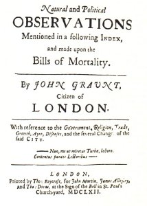
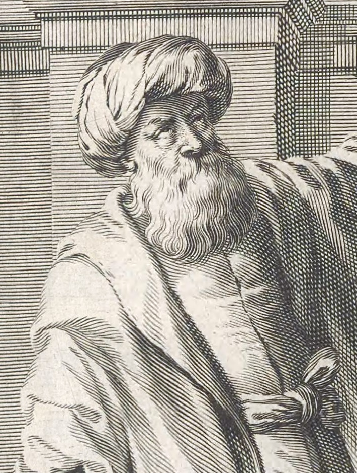
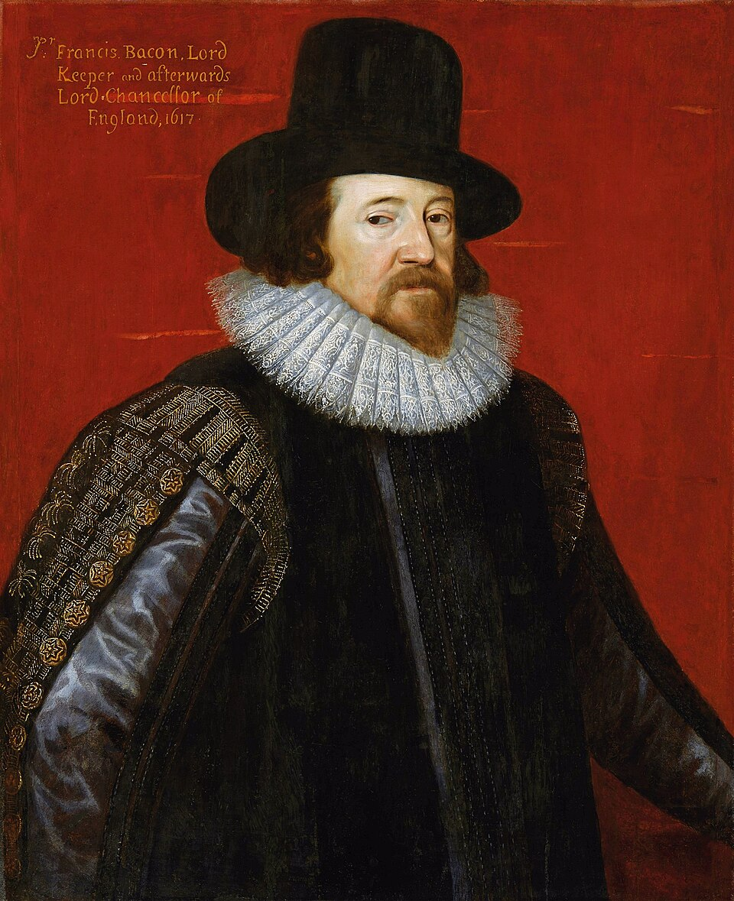
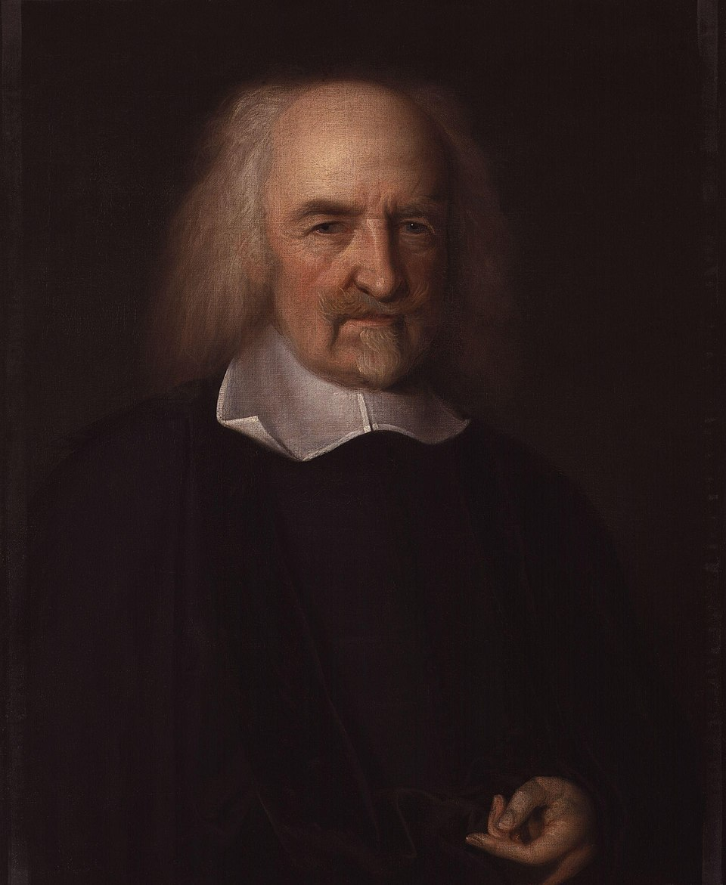
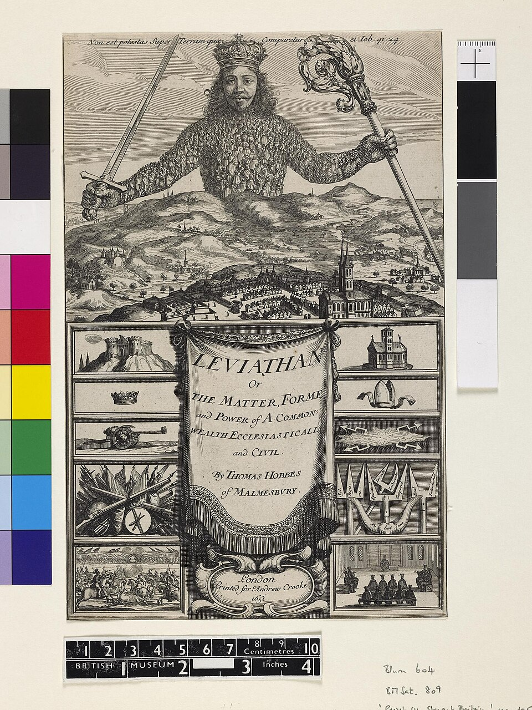

```{r}
#| label: setup
source(here::here("R/ppdac.R"))
source(here::here("R/aula01.R"))
```

## Hoje

1. A disciplina: plano e avaliação
2. O que é estatística, e de onde vem a incerteza
3. Breve histórico: da observação ao método científico
4. Áreas da estatística
5. Definições e conceitos
6. Tipos de variáveis
7. Como a estatística funciona na pesquisa biológica
8. Atividade prática

::: {.nota}
As figuras desta aula são esquemas redesenhados ou foram geradas em R
com dados simulados; as imagens históricas são de domínio público. O
código está em [`R/`](https://github.com/diogoprov/bioestatistica/tree/main/R)
no repositório da disciplina.
:::

---

## O ciclo PPDAC: o fio da disciplina

```{r}
#| fig-width: 6.4
#| fig-height: 5.1
#| out-width: "45%"
#| fig-alt: "Ciclo PPDAC com cinco etapas em círculo, cada uma com a sua cor: Problema, Plano, Dados, Análise e Conclusão."
ppdac_plot()
```

Cada aula começa dizendo em que etapa do ciclo ela está. Cada etapa tem a
sua cor, e vocês vão revê-las a disciplina inteira.

::: {.ref}
Wild, C.J. & Pfannkuch, M. 1999. *International Statistical Review* 67:223–248.
:::

# 1. A disciplina {.secao}

---

## Plano da disciplina

:::: {.columns}
::: {.column width="60%"}
- **Componente teórico**
  - Definições e conceitos
  - Medidas de tendência central e variabilidade
  - Amostragem
  - Noções de probabilidade
  - Distribuições de probabilidade
  - Teste de hipótese
  - Modelo linear geral, Qui-quadrado e correlação
- **Componente prático**
  - Realização de lista de exercícios e kahoot!
:::
::: {.column width="40%"}
::: {.nota}
**Livros de apoio**

- Vieira, S. *Introdução à bioestatística*.
- Bussab, W.O. & Morettin, P.A. *Estatística básica*.
- Triola, M.F. *Introdução à estatística*.
- da Silva, F.R.; Gonçalves-Souza, T.; Paterno, G.; Provete, D.B. &
  Vancine, M.A. [*Análises ecológicas no R*](https://analises-ecologicas.com).
:::
:::
::::

---

## Avaliação

- **3 componentes**
  - Prova teórica escrita
  - Lista de exercícios referentes a cada aula
  - Trabalho prático
    - 10 grupos de no máximo 5–6 estudantes
    - Até o fim do mês gostaria de ter os nomes de cada grupo
    - Elaborar uma pergunta, gerar uma hipótese, coletar (ou gerar) dados
      de maneira adequada, testar a hipótese usando análises que veremos e
      realizar inferência com conclusão biológica
    - Prazo de entrega: final da disciplina, teremos aulas dedicadas a
      finalizar o trabalho
- Abarcar múltiplas habilidades, competências e neurodiversidade

---

## Ao final desta aula você deverá entender

:::: {.columns}
::: {.column width="58%"}
- O que é estatística
- Bases filosóficas do empirismo científico
- Áreas da estatística
- Principais conceitos
- Tipos de variáveis
- Como a estatística é aplicada na Biologia
:::
::: {.column width="42%"}
::: {.nota}
**Leituras**

- Triola, M.F. *Introdução à estatística*, cap. 1.
- Zar, J.H. *Biostatistical analysis*, caps. 1 e 2.
- Bussab, W.O. & Morettin, P.A. *Estatística básica*, caps. 1 e 2.
- Quinn, G.P. & Keough, M.J. *Experimental design and data analysis for
  biologists*, cap. 1.
:::
:::
::::

# 2. O que é estatística {.secao}

[Problema]{.ppdac-etapa .problema}

---

## Introdução

- **Definição de estatística** (área da ciência)
  - Conjunto de métodos/técnicas que auxiliam na tomada de decisão na
    presença de **incerteza**

---

## A pergunta certa

> "The most important maxim for data analysis to heed, and one which many
> statisticians seem to have shunned, is this: '**Far better an approximate
> answer to the *right* question, which is often vague, than an *exact*
> answer to the wrong question, which can always be made precise.**' Data
> analysis must progress by approximate answers, at best, since its
> knowledge of what the problem really is will at best be approximate."

John Tukey, 1962

::: {.ref}
Tukey, J.W. 1962. The future of data analysis. *The Annals of Mathematical
Statistics* 33:1–67.
:::

---

## E da onde vem a incerteza?

::: {.definicao}
**Variabilidade!**
:::

```{r}
#| fig-width: 10
#| fig-height: 3.8
#| fig-alt: "Gráfico de pontos com o comprimento rostro-cloacal de 60 sapos da mesma espécie e da mesma lagoa, variando de cerca de 17 a 28 milímetros."
fig_variabilidade()
```

Indivíduos da mesma espécie, da mesma população, não são iguais.

---

## Sinal e ruído

::: {.definicao}
Estatística é a ciência que nos permite encontrar padrões (**sinal**) em
meio à variabilidade natural (**ruído**).
:::

---

## Estatística e método científico

> "Estatística sem o método científico é mera aritmética; o método
> científico (em biologia) sem estatística é meramente anedótico."

— Sir Ronald A. Fisher

---

## Por que é tão importante considerar a incerteza?

- Precisamos ***quantificar e comunicar*** incertezas
- A estatística nos fornece a ferramenta para fazer isso
- Crítico para fazer previsões e na tomada de decisões
  - Políticas públicas
- Ignorá-la pode levar a predições excessivamente confiantes e erradas

::: {.ref}
Brewer, C.A. & Gross, L.J. 2003. *Ecology* 84:1412–1414;
Milner-Gulland, E.J. & Shea, K. 2017. *Journal of Applied Ecology*
54:2063–2068; Simmonds, E.G. et al. 2024. *Trends in Ecology & Evolution*
39:328–337.
:::

---

## E por que precisamos de dados?

::: {.definicao}
**Fazer previsões!**
:::

...E para isto precisamos construir **modelos estatísticos**.

---

## Como sua vó imagina × como realmente é

:::: {.columns}
::: {.column width="25%"}
**Como sua vó imagina:** uma bola de cristal, que diz exatamente o que vai
acontecer.
:::
::: {.column width="75%"}
**Como realmente é:**

```{r}
#| fig-width: 8.6
#| fig-height: 4.6
#| fig-alt: "Série de aumento de temperatura de 1950 a 2024 e, a partir daí, três projeções até 2100 para emissões altas, médias e baixas, cada uma com uma faixa de incerteza que se alarga com o tempo."
fig_previsao()
```
:::
::::

::: {.nota}
Uma previsão de verdade vem em cenários, e cada cenário com a sua faixa de
incerteza. A figura usa dados simulados; projeções reais estão em
<https://scied.ucar.edu/learning-zone/climate-change-impacts/predictions-future-global-climate>.
:::

---

## Um modelo que incorpora incerteza e outro que não

{height="430px" fig-align="center" fig-alt="Taxa de crescimento populacional ao longo de 25 anos estimada por dois modelos. O modelo 1, sem incerteza, é uma linha só, bem acima da taxa verdadeira, marcada por uma linha tracejada. O modelo 2 oscila em torno da taxa verdadeira, com uma faixa de incerteza."}

O modelo 1 dá uma resposta precisa e errada. O modelo 2 diz quanto não
sabe, e a faixa dele contém a taxa verdadeira.

::: {.ref}
Figura I de Simmonds, E.G. et al. 2024. *Trends in Ecology & Evolution*
39:328–337, <https://doi.org/10.1016/j.tree.2023.10.012>. Licença
[CC BY 4.0](https://creativecommons.org/licenses/by/4.0/).
:::

# 3. Breve histórico {.secao}

---

## Breve histórico da estatística {.smaller}

:::: {.columns}
::: {.column width="64%"}
- Estatística enquanto ciência surgiu no final do séc. XVII, início do
  XVIII
  - Contexto histórico: 1ª Revolução Industrial, consolidação dos Estados
    nação modernos
  - Ligada à demografia, censos, economia, comércio e questões de
    administração do Estado moderno, com o objetivo de fornecer dados para
    tomada de decisão pelo governante
- Daí a origem do nome *Estatística*, que vem de *statisticum collegium*,
  que quer dizer "conselho de Estado"
- Se fundamenta na Teoria de probabilidade iniciada por Pascal e Fermat
  (que surgiu com o estudo dos jogos de azar)
:::
::: {.column width="36%"}
{width="46%" fig-alt="Gravura com o retrato de John Graunt."}
{width="46%" fig-alt="Página de rosto do livro de John Graunt sobre as Bills of Mortality, de 1662."}
:::
::::

::: {.nota}
Para ler mais: Salsburg, D. *Uma senhora toma chá*. Imagens: domínio
público, via
Wikimedia Commons ([fontes](https://github.com/diogoprov/bioestatistica/blob/main/assets/historia/FONTES.md)).
:::

---

## Matéria bruta da estatística ⇒ observações

::: {.definicao}
**Dados brutos:** observações coletadas (registradas), a "matéria-prima"
da estatística.
:::

---

## De onde veio a ideia de que temos de nos basear em observações (dados) para tirar conclusões sobre a natureza? {.secao}

*Senta que lá vem a história!*

---

## Califado Abássida (séc. VIII–XVI)

:::: {.columns}
::: {.column width="62%"}
- "Era de ouro" islâmica
- Casa da Sabedoria (Bagdá)
- **Ḥasan Ibn al-Haytham** (965–1040)
  - Primeiro a chegar a conclusões científicas sobre ótica (física) de
    forma sistemática, utilizando experimentação e testes controlados
:::
::: {.column width="38%"}
{width="72%" fig-alt="Gravura de 1647 representando Ibn al-Haytham segurando um livro de geometria."}
:::
::::

::: {.nota}
Imagem: domínio público, via Wikimedia Commons.
:::

---

## Renascença, séc. XVI (Ocidente)

:::: {.columns}
::: {.column width="45%"}
**Empirismo britânico (inicial)**

- Francis Bacon
- Thomas Hobbes
:::
::: {.column width="10%"}
**vs.**
:::
::: {.column width="45%"}
**Racionalismo**

- René Descartes
- Baruch Spinoza
- G. Leibniz
:::
::::

::: {.nota}
Uma grande divisão que se vê até hoje entre a matemática (puramente
dedutiva) e as ciências naturais (indutivas).
:::

---

## Bacon e Hobbes

:::: {.columns}
::: {.column width="25%"}
{fig-alt="Retrato de Francis Bacon."}
:::
::: {.column width="25%"}
{fig-alt="Frontispício da Instauratio Magna, de 1620, com um navio passando entre duas colunas."}
:::
::: {.column width="25%"}
{fig-alt="Retrato de Thomas Hobbes."}
:::
::: {.column width="25%"}
{fig-alt="Frontispício do Leviatã, de 1651, com um gigante coroado formado por muitas pessoas."}
:::
::::

::: {.nota}
Imagens: domínio público, via Wikimedia Commons
([fontes](https://github.com/diogoprov/bioestatistica/blob/main/assets/historia/FONTES.md)).
:::

---

## Francis Bacon

- Opõe-se ao *organon* aristotélico (Física)
- Defende o **método indutivo** como único para o desenvolvimento da
  ciência
  - "verdadeiro método de interpretação da Natureza"
  - Critica a dedução, típica da filosofia até então
- "Método científico"
- Propõe que a ciência (Filosofia Natural) deveria:
  - Coletar dados sem preconceitos (ideias pré-concebidas)
  - Observar fatos e buscar por padrões
  - Criar uma lei geral a partir destes dados

---

## Hobbes

- Conhecimento começa fora de nós, pela ação causal de objetos sobre os
  órgãos dos sentidos, que continua então dentro de nós
  - Envolve também a *linguagem*
- Conhecimento como um processo que ocorre "no mundo"

---

## Método científico

```{r}
#| fig-width: 10
#| fig-height: 5
#| out-width: "88%"
#| fig-alt: "Ciclo do método científico: observação, hipótese, experimento, análise e conclusão, voltando à observação. Uma caixa de teoria científica aponta para a observação e para a hipótese."
fig_metodo_cientifico("teoria")
```

---

## Método científico

```{r}
#| fig-width: 10
#| fig-height: 5.4
#| out-width: "84%"
#| fig-alt: "O mesmo ciclo do método científico, agora com uma caixa de estatística embaixo, apontando para o experimento e para a análise."
fig_metodo_cientifico("estatistica")
```

# 4. Áreas da estatística {.secao}

---

## Introdução

- Definição de estatística (área da ciência)
  - Conjunto de métodos/técnicas que auxiliam na tomada de decisão na
    presença de **incerteza**
- **Áreas da estatística**
  - Descritiva
  - Probabilidade
  - Inferencial

---

## Descritiva e inferencial

:::: {.columns}
::: {.column width="50%"}
::: {.definicao}
**Descritiva**

- Resume conjuntos de dados por meio de tabelas e/ou gráficos
- Análise exploratória de dados
- Medidas de tendência central e dispersão
:::
:::
::: {.column width="50%"}
::: {.definicao}
**Inferencial**

- Realizar uma afirmação de uma população a partir de uma amostra
- Teste de hipótese
- Estimar parâmetros
- Construir modelos
- Fazer predições/previsões
:::
:::
::::

---

## Pergunta para a turma {.smaller}

::: {.atividade}
**Qual destas frases é uma afirmação de estatística *inferencial*?**

A. A média de espécies de anfíbios nas 30 lagoas amostradas foi 4,2.

B. Com base nas 30 lagoas amostradas, estimamos que as lagoas da região
têm, em média, entre 3,6 e 4,8 espécies.

C. O histograma mostra como as 30 lagoas se distribuem em número de
espécies.

D. A lagoa mais rica tinha 9 espécies.
:::

Votem sozinhos (A, B, C ou D, com a mão ou com cartões). Depois discutam
com quem está ao lado por 2 minutos e votem de novo.

::: {.fragment}
::: {.definicao}
**B.** É a única que fala de algo além das 30 lagoas medidas: as lagoas da
região, a partir da amostra. As outras resumem os próprios dados.
:::
:::

# 5. Definições e conceitos {.secao}

---

## Parâmetro, estatística e estatística do teste

:::: {.columns}
::: {.column width="33%"}
::: {.definicao}
**Parâmetro**

Aspecto da população a ser estimado (letras gregas, ou maiúsculas)
:::
:::
::: {.column width="33%"}
::: {.definicao}
**Estatística**

Aspecto da amostra (letras minúsculas latinas)
:::
:::
::: {.column width="33%"}
::: {.definicao}
**Estatística do teste**

Número que mede um determinado padrão
:::
:::
::::

---

## Notação

| Denominação | População | Amostra |
|---|---|---|
| Média | $\mu = E(X)$ | $\bar{X} = \sum X_i / n$ |
| Mediana | $\mathrm{Md} = Q_2$ | $\mathrm{md} = q_2$ |
| Variância | $\sigma^2 = \mathrm{Var}(X)$ | $S^2 = \sum (X_i - \bar{X})^2 / (n - 1)$ |
| Nº de elementos | $N$ | $n$ |
| Proporção | $p$ | $\hat{p}$ |
| Quantil | $Q(p)$ | $q(p)$ |
| Quartis | $Q_1, Q_2, Q_3$ | $q_1, q_2, q_3$ |
| Distância interquartil | $d_Q = Q_3 - Q_1$ | $d_q = q_3 - q_1$ |
| Função densidade | $f(x)$ | histograma |
| Função de distribuição | $F(x)$ | $F_e(x)$ |

::: {.ref}
Bussab, W.O. & Morettin, P.A. *Estatística básica*.
:::

---

## Conceitos e definições

- População e amostra
  - População
  - Unidade amostral
  - Espaço amostral

---

## População estatística

::: {.definicao}
"Conjunto de medidas sobre as quais se quer fazer alguma inferência"
:::

\* Não confundir com população ecológica.

---

## Amostra

::: {.definicao}
"Subconjunto de observações que são passíveis de serem medidas na
prática, cujas características serão utilizadas para fazermos conclusões
sobre a população"
:::

---

## Espaço amostral

::: {.definicao}
"O conjunto de todos os resultados possíveis de um experimento aleatório"
:::

---

## População e amostra

```{r}
#| fig-width: 11
#| fig-height: 5.4
#| out-width: "92%"
#| fig-alt: "À esquerda, uma nuvem de 400 pontos representa a população, com média mu e desvio-padrão sigma. Quinze pontos destacados formam a amostra, à direita, com média x-barra e desvio-padrão s. Uma seta embaixo, da população para a amostra, é o processo de amostragem; outra em cima, da amostra para a população, é o processo de inferência."
fig_populacao_amostra()
```

---

## Amostragem aleatória na prática

Brinquem com a simulação interativa: cada clique sorteia uma nova amostra
da mesma população.

<https://ellaudet.github.io/graphs/random_sampling.html>

---

## Pergunta para a turma {.smaller}

::: {.atividade}
**Um pesquisador mede o comprimento de 30 girinos de uma lagoa para
estimar o comprimento médio dos girinos daquela lagoa. A média dos 30
girinos é:**

A. um parâmetro

B. uma estatística

C. a população

D. o espaço amostral
:::

Votem sozinhos, discutam com quem está ao lado e votem de novo.

::: {.fragment}
::: {.definicao}
**B.** A média dos 30 girinos medidos descreve a **amostra** ($\bar{x}$).
O parâmetro ($\mu$) é a média de todos os girinos da lagoa, que é o que o
pesquisador quer estimar.
:::
:::

# 6. Tipos de variáveis {.secao}

---

## Variável

::: {.definicao}
"Uma característica ou atributo que está sendo estudado e que pode assumir
diferentes valores."
:::

---

## Tipos de variáveis

```{r}
#| fig-width: 12
#| fig-height: 5.6
#| fig-alt: "Duas caixas: variáveis quantitativas (numéricas) e qualitativas (categóricas)."
fig_tipos_variaveis(1)
```

---

## Tipos de variáveis

```{r}
#| fig-width: 12
#| fig-height: 5.6
#| fig-alt: "As variáveis quantitativas se dividem em discretas (contagem, números inteiros, como riqueza de espécies e abundância) e contínuas (medidas, números com vírgula, como área e altura)."
fig_tipos_variaveis(2)
```

---

## Tipos de variáveis

```{r}
#| fig-width: 12
#| fig-height: 5.6
#| fig-alt: "Árvore completa: quantitativas em discretas e contínuas; qualitativas em nominais (sem ordem, como gênero e grupo sanguíneo) e ordinais (com ordem de grandeza, como qualidade boa, mais ou menos e ruim, ou altura alta, média e baixa)."
fig_tipos_variaveis(3)
```

---

## Pergunta para a turma {.smaller}

::: {.atividade}
**Em um estudo com girinos, qual destas variáveis é *qualitativa
ordinal*?**

A. Número de ovos por desova

B. Estágio de desenvolvimento de Gosner

C. Comprimento rostro-cloacal

D. Espécie
:::

Votem sozinhos, discutam com quem está ao lado e votem de novo.

::: {.fragment}
::: {.definicao}
**B.** Os estágios de Gosner têm ordem (o 30 vem depois do 25), mas não
são uma medida. Número de ovos é quantitativa discreta, comprimento é
quantitativa contínua, e espécie é qualitativa nominal.
:::
:::

# 7. A estatística na pesquisa biológica {.secao}

[Problema]{.ppdac-etapa .problema} → [Plano]{.ppdac-etapa .plano} → [Dados]{.ppdac-etapa .dados} → [Análise]{.ppdac-etapa .analise} → [Conclusão]{.ppdac-etapa .conclusao}

---

## Como a estatística funciona na prática da pesquisa biológica? {.secao}

---

## Qual será a filosofia da disciplina

- Aprender a pensar a lógica da estatística
- Enfatizar a pergunta e hipótese
- Sem se preocupar tanto com fórmulas e "escolha do teste"
  - Virá naturalmente
- Estatística é uma *ferramenta* para o(a) biólogo(a)

::: {.ref}
Magnusson, W. & Mourão, G. *Estatística sem matemática: a ligação entre as
questões e a análise*. Editora Planta.
:::

---

## Ciclo PPDAC

```{r}
#| fig-width: 11
#| fig-height: 5.6
#| out-width: "90%"
#| fig-alt: "Ciclo PPDAC com os tópicos de cada etapa. Problema: compreensão do sistema, definição do problema. Plano: desenho amostral, gerenciamento de dados. Dados: coleta de dados, gerenciamento de dados, limpeza. Análise: análises exploratórias, visualização, geração de hipóteses. Conclusão: interpretação, novas ideias, comunicação."
ppdac_topicos(list(
  Problema    = c("Compreensão do sistema", "Definição do problema"),
  Plano       = c("Desenho amostral", "Gerenciamento de dados"),
  Dados       = c("Coleta de dados", "Gerenciamento de dados", "Limpeza"),
  "Análise"   = c("Análises exploratórias", "Visualização", "Geração de hipóteses"),
  "Conclusão" = c("Interpretação", "Novas ideias", "Comunicação")
))
```

::: {.ref}
Wild, C.J. & Pfannkuch, M. 1999. *International Statistical Review* 67:223–248.
:::

---

## Um exemplo: a luz afeta o crescimento de plantas?

```{r}
#| fig-width: 11
#| fig-height: 5.6
#| out-width: "90%"
#| fig-alt: "Ciclo PPDAC aplicado a uma pergunta. Problema: a luz afeta o crescimento de plantas? Plano: o que medir? como medir? protocolo de coleta de dados. Dados: coleta de dados em campo ou laboratório, organização em planilha. Análise: visualização, modelos estatísticos. Conclusão: trazer de volta para a biologia."
ppdac_topicos(list(
  Problema    = "A luz afeta o crescimento de plantas?",
  Plano       = c("O que medir?", "Como medir?", "Protocolo de coleta de dados"),
  Dados       = c("Coleta de dados em campo", "ou laboratório", "Organização em planilha"),
  "Análise"   = c("Visualização", "Modelos estatísticos"),
  "Conclusão" = "Trazer de volta para a biologia"
))
```

---

## O que diz o GAISE {.smaller}

*Guidelines for Assessment and Instruction in Statistics Education*
(GAISE), College Report 2016, da American Statistical Association:

1. Teach statistical thinking.
   - Teach statistics as an investigative process of problem-solving and
     decision-making.
   - Give students experience with multivariable thinking.
2. Focus on conceptual understanding.
3. Integrate real data with a context and purpose.
4. **Foster active learning.**
5. Use technology to explore concepts and analyze data.
6. Use assessments to improve and evaluate student learning.

::: {.nota}
O item 4 é o motivo das atividades, das perguntas para a turma e dos
Kahoots ao longo da disciplina.
:::

---

## A lógica da estatística na biologia

- **Enfatizar a pergunta e a hipótese:** a estatística começa com uma
  pergunta de pesquisa e uma hipótese a ser testada, e não com a escolha de
  uma fórmula ou teste.
- **Processo de pesquisa:**
  - **Planejamento e coleta de dados:** definir a representatividade da
    amostra, evitar vieses, coletar e armazenar os dados.
- **Análise:** usar ferramentas estatísticas para processar os dados.
- **Interpretação:** entender os resultados da análise.
- **Apresentação:** comunicar os resultados de forma clara e concisa
  (gráficos, tabelas).

---

## Como biólog@s usam estatística na prática? {.smaller}

- **Formulação da pergunta e hipótese:** toda pesquisa começa com uma
  pergunta clara (ex.: "Qual o efeito do aleitamento materno no peso de
  bebês de 6 meses?") e uma hipótese a ser testada.
- **Planejamento da coleta de dados:** envolve determinar a amostra (deve
  ser representativa da população), o método de amostragem e a forma de
  coletar os dados, considerando potenciais vieses.
- **Coleta e armazenamento dos dados:** a execução da coleta e a
  organização dos dados, geralmente em planilhas eletrônicas.
- **Análise dos dados:** aplicação de métodos estatísticos apropriados
  (descritivos e inferenciais) para explorar, resumir e modelar os dados.
  Esta etapa muitas vezes envolve o uso de softwares.
- **Interpretação dos resultados:** compreensão do que os números e
  gráficos revelam em relação à pergunta de pesquisa e à hipótese
  original.
- **Apresentação dos resultados:** comunicação das conclusões por meio de
  tabelas, gráficos e texto, de forma clara e eficaz, para públicos
  científicos e não científicos.

# Atividade prática {.secao}

---

## Atividade prática 1 (20 min)

::: {.atividade}
- Adivinhação de idade de pessoas (fotografias)
- Formem grupos de no máximo 3 pessoas
- Cada grupo vai estimar a idade da pessoa de cada foto mostrada
- Façam uma tabela como o modelo
:::

---

## Modelo da tabela

| Foto | Idade estimada | Idade real | Erro |
|---|---|---|---|
| 1 | | | |
| 2 | | | |
| 3 | | | |
| 4 | | | |
| 5 | | | |
| 6 | | | |
| 7 | | | |
| 8 | | | |
| 9 | | | |
| 10 | | | |

---

## Atividade prática 1

- Cada grupo compartilha a idade estimada de cada foto

---

## Referências {.smaller}

::: {.nota}
- Brewer, C.A. & Gross, L.J. 2003. [Training ecologists to think with uncertainty in mind](https://doi.org/10.1890/0012-9658(2003)084[1412:TETTWU]2.0.CO;2). *Ecology* 84:1412–1414.
- Milner-Gulland, E.J. & Shea, K. 2017. [Embracing uncertainty in applied ecology](https://doi.org/10.1111/1365-2664.12887). *Journal of Applied Ecology* 54:2063–2068.
- Simmonds, E.G. et al. 2024. [Recommendations for quantitative uncertainty consideration in ecology and evolution](https://doi.org/10.1016/j.tree.2023.10.012). *Trends in Ecology & Evolution* 39:328–337.
- Tukey, J.W. 1962. [The future of data analysis](https://doi.org/10.1214/aoms/1177704711). *The Annals of Mathematical Statistics* 33:1–67.
- Wild, C.J. & Pfannkuch, M. 1999. [Statistical thinking in empirical enquiry](https://doi.org/10.1111/j.1751-5823.1999.tb00442.x). *International Statistical Review* 67:223–248.
- Bussab, W.O. & Morettin, P.A. *Estatística básica*. Saraiva.
- Magnusson, W. & Mourão, G. *Estatística sem matemática: a ligação entre as questões e a análise*. Editora Planta.
- Quinn, G.P. & Keough, M.J. *Experimental design and data analysis for biologists*. Cambridge University Press.
- Salsburg, D. *Uma senhora toma chá*.
- Triola, M.F. *Introdução à estatística*.
- Vieira, S. *Introdução à bioestatística*.
- Zar, J.H. *Biostatistical analysis*. Pearson.
- da Silva, F.R.; Gonçalves-Souza, T.; Paterno, G.; Provete, D.B. & Vancine, M.A. [*Análises ecológicas no R*](https://analises-ecologicas.com).
:::
