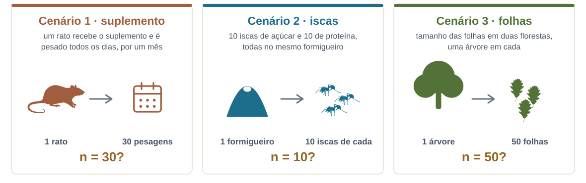

```{r}
#| label: setup
source(here::here("R/ppdac.R"))
source(here::here("R/aula02_pergunta.R"))
source(here::here("R/aula02_amostragem.R"))
source(here::here("R/aula02_delineamento.R"))
```

## Hoje

1. Tudo começa com uma boa pergunta
2. Réplica, unidade amostral e independência
3. Escala e controles
4. Técnicas de amostragem
5. Estudos observacionais e experimentais
6. Os delineamentos clássicos

::: {.nota}
Todas as figuras desta aula foram geradas em R com dados simulados. O
código está em [`R/`](https://github.com/diogoprov/bioestatistica/tree/main/R)
no repositório da disciplina, e vocês podem rodá-lo e mudar os parâmetros
para ver o que acontece.
:::

---

## Onde estamos no ciclo PPDAC

```{r}
#| fig-width: 6.4
#| fig-height: 5.1
#| out-width: "43%"
#| fig-alt: "Ciclo PPDAC com cinco etapas em círculo: Problema, Plano, Dados, Análise e Conclusão. Problema e Plano estão destacados."
ppdac_plot(destaque = c("Problema", "Plano"))
```

Esta aula trata das duas primeiras etapas. A pergunta (**Problema**) e o
jeito de coletar os dados (**Plano**) decidem o que a **Análise** vai poder
dizer, e nenhum teste conserta um plano ruim depois.

::: {.ref}
Wild, C.J. & Pfannkuch, M. 1999. *International Statistical Review* 67:223–248.
:::

---

## Ciclo PPDAC

```{r}
#| fig-width: 11
#| fig-height: 5.6
#| out-width: "90%"
#| fig-alt: "Ciclo PPDAC com os tópicos de cada etapa. Problema: compreensão do sistema, definição do problema. Plano: desenho amostral, gerenciamento de dados, visualização. Dados: coleta de dados, gerenciamento de dados, limpeza. Análise: análises exploratórias, geração de hipóteses. Conclusão: interpretação, novas ideias, comunicação."
ppdac_topicos(list(
  Problema    = c("Compreensão do sistema", "Definição do problema"),
  Plano       = c("Desenho amostral", "Gerenciamento de dados", "Visualização"),
  Dados       = c("Coleta de dados", "Gerenciamento de dados", "Limpeza"),
  "Análise"   = c("Análises exploratórias", "Geração de hipóteses"),
  "Conclusão" = c("Interpretação", "Novas ideias", "Comunicação")
))
```

# 1. Tudo começa com uma boa pergunta {.secao}

[Problema]{.ppdac-etapa .problema}

---

## Da pergunta à predição

```{r}
#| fig-width: 12
#| fig-height: 3.2
#| fig-alt: "Fluxograma da esquerda para a direita: pergunta clara, hipóteses, predições, as predições seguem da hipótese?, são testáveis?, planejar a coleta. Se as predições não seguem da hipótese, volta-se às hipóteses; se não são testáveis, volta-se às predições."
fig_fluxo_pergunta()
```

O caminho tem idas e voltas. Se uma predição não sai da hipótese, ou não dá
para testá-la, a gente volta um passo antes de ir a campo.

::: {.ref}
Esquema adaptado de Ruxton, G.D. & Colegrave, N. 2016. *Experimental design
for the life sciences*, cap. 2. Oxford University Press.
:::

---

## Dicas para fazer uma boa pergunta

- Uma pergunta científica tem de ser **testável** por meio de observações,
  de experimentos ou dos dois.
- Para algo ser testável, tem de ser **mensurável**.
- Uma boa pergunta já nomeia a **variável resposta** (dependente) e a(s)
  **variável(is) preditora(s)** (independentes).
- Atente para o **verbo**: ele indica que tipo de análise vai responder à
  pergunta.

::: {.definicao}
Evite perguntas cuja resposta é "sim" ou "não". "Existe diferença?" quase
sempre tem resposta "sim, alguma", e isso não ensina nada. Pergunte
**quanto**, **em que direção** e **de que forma**.
:::

---

## O verbo guia a análise

| A pergunta | O que ela pede |
|---|---|
| Qual a **relação** entre X e Y? | como Y muda ao longo de X: correlação ou regressão |
| Qual o **efeito** do fator X em Y? | comparar Y entre níveis de X: teste t, ANOVA |
| Como X **influencia** Y? | o mecanismo e a direção do efeito |
| Como a mudança em X **afeta** Y? | a forma da resposta: linear, saturante... |

::: {.nota}
Vamos voltar a essa tabela nas aulas 8 a 11. Por enquanto, o ponto é que a
pergunta bem escrita já carrega metade da escolha do método.
:::

---

## Como melhorar uma pergunta

1. *Existe diferença entre as áreas?* Diferença em quê? Entre quais áreas?
2. *Qual a influência do tipo de solo no crescimento de* Pinus? Já tem
   resposta e preditora, mas "influência" ainda é vago.
3. *Qual o efeito da quantidade de nitrogênio no solo na taxa de
   crescimento per capita de árvores adultas de* Pinus? Variáveis
   mensuráveis e população definida.
4. *A quantidade de nitrogênio no solo **aumenta** a taxa de crescimento
   per capita de* Pinus? Agora há uma **direção** esperada, que é uma
   predição.

::: {.nota}
Cada versão é mais fácil de testar que a anterior. Da 3 para a 4 o ganho
está em dizer de antemão o que se espera ver nos dados.
:::

---

## Hipótese e predição

```{r}
#| fig-width: 8
#| fig-height: 2.4
#| out-width: "62%"
#| fig-alt: "Diagrama com duas caixas: Nitrogênio no solo aponta para Taxa de crescimento per capita, com um sinal positivo na seta."
fig_hipotese_n()
```

::: {.definicao}
**Hipótese:** o nitrogênio faz parte de muitas moléculas envolvidas no
crescimento das plantas. **Logo**, espero que, quanto maior a quantidade de
nitrogênio disponível no solo, maior seja a taxa de crescimento per capita
de uma população de *Pinus*.
:::

A hipótese é a explicação biológica (o **porquê**). A predição é o que essa
explicação implica sobre os dados (o **que** devemos ver).

---

## Hipótese científica e hipótese estatística

- A **hipótese científica** é uma explicação sobre o mundo, escrita em
  termos biológicos.
- A **hipótese estatística** é a tradução dela para uma afirmação sobre
  parâmetros que podemos estimar a partir dos dados.
- A **hipótese nula** (H~0~) diz que a variação na resposta não está
  relacionada à variação na preditora, ou seja, que não é maior do que o
  esperado ao acaso.
- As **hipóteses alternativas** (H~1~, H~2~...) dizem como seria essa
  relação.

::: {.nota}
A aula 7 trata do teste de hipóteses em detalhe. Aqui o importante é
perceber que a mesma hipótese científica pode gerar mais de uma hipótese
estatística.
:::

---

## A hipótese nula em um gráfico

```{r}
#| fig-width: 7
#| fig-height: 4.4
#| out-width: "66%"
#| fig-alt: "Gráfico conceitual com nitrogênio no eixo x e crescimento no eixo y. Os pontos se espalham em torno de uma linha horizontal: o crescimento não muda com o nitrogênio."
fig_hipotese("nula")
```

Se H~0~ for verdadeira, saber o nitrogênio de uma parcela não ajuda a
prever o crescimento: a reta é plana e os pontos oscilam em volta dela.

---

## Três hipóteses alternativas

```{r}
#| fig-width: 12
#| fig-height: 3.5
#| fig-alt: "Três gráficos conceituais. H1: o crescimento aumenta em linha reta com o nitrogênio. H2: o crescimento aumenta e depois se estabiliza. H3: o crescimento aumenta até um máximo e depois diminui."
fig_hipoteses_alternativas()
```

- **H1, linear:** cada miligrama a mais de N rende o mesmo ganho.
- **H2, saturante:** o ganho diminui até algum outro recurso limitar.
- **H3, unimodal:** N em excesso passa a ser prejudicial.

Cada uma tem uma explicação biológica diferente e pede um modelo diferente.
Por isso vale desenhar as predições **antes** de coletar os dados.

---

## Atividade (10 min)

::: {.atividade}
**Será que a poluição afeta os girinos?**

1. **Sozinho:** reescreva essa pergunta no papel, de modo que ela seja
   testável e tenha resposta e preditora explícitas.
2. **Em duplas:** comparem as duas versões e cheguem a uma versão comum.
3. **Duas duplas** compartilham a versão final com a turma.
:::

---

## Conferindo as versões

Depois que as duplas apresentarem, confiram se a pergunta de vocês
responde a estas questões:

- Que poluente? Medido como?
- Qual resposta dos girinos: sobrevivência, crescimento, tempo até a
  metamorfose, comportamento?
- Que espécie, em que fase de desenvolvimento?
- Qual é a direção esperada do efeito?

::: {.nota}
Cada questão que ficou sem resposta é uma decisão que o Plano vai ter de
tomar mesmo assim, só que mais tarde e sem critério.
:::

# 2. Réplica, unidade amostral e independência {.secao}

[Plano]{.ppdac-etapa .plano}

---

## Conceitos

::: {.definicao}
**Unidade amostral:** a menor unidade independente sobre a qual medimos a
resposta. No exemplo do *Pinus*, uma parcela de floresta, com a população
de árvores que está nela.

**Réplica:** cada unidade amostral que recebe a mesma condição. Ex.: várias
parcelas espalhadas pela floresta.
:::

- É melhor replicar **parcelas** ou **florestas**? Depende da pergunta e de
  onde está a maior variação dos dados.
- Se a pergunta é sobre florestas, as réplicas são florestas, e várias
  parcelas na mesma floresta não substituem outra floresta.

::: {.ref}
Ruxton & Colegrave 2016, cap. 11.
:::

---

## Quantas réplicas?

```{r}
#| fig-width: 11
#| fig-height: 4.2
#| fig-alt: "Três painéis com duas florestas cada, com 3, 10 e 30 folhas por grupo. A diferença verdadeira entre as florestas é a mesma nos três. Com 3 folhas os intervalos de confiança são enormes e a ordem das médias até se inverte; com 30 os intervalos são estreitos e mostram a diferença."
fig_tamanho_amostra()
```

A diferença verdadeira (linhas tracejadas) é a mesma nos três painéis. Com
**3** réplicas a amostra nem acerta qual floresta tem folhas maiores; com
**30** a diferença fica clara.

---

## Quantas réplicas? Do que depende

- **Tamanho do efeito:** a diferença que importa biologicamente. Quanto
  menor, mais réplicas são necessárias para detectá-la.
- **Variabilidade natural:** quanto mais as unidades variam entre si, mais
  réplicas. Um **estudo piloto** dá essa estimativa antes do estudo
  principal.
- **Poder do teste:** a probabilidade de detectar o efeito se ele existir.
  Veremos isso na aula 7.

::: {.definicao}
Uma regra prática para começar: pelo menos **10 réplicas** por tratamento.
É um ponto de partida para quando não há dados prévios, não um número
mágico.
:::

::: {.ref}
Gotelli, N.J. & Ellison, A.M. 2010. *Princípios de estatística em ecologia*, cap. 6. Artmed.
:::

---

## Por que as réplicas precisam ser independentes?

- A teoria da amostragem supõe que cada unidade traz **informação nova**
  sobre a população estatística.
- Se duas réplicas são parecidas por estarem perto uma da outra, a segunda
  repete parte da informação da primeira.
- Os testes estatísticos supõem independência. Quando ela não existe, o
  teste acha que tem mais informação do que tem: os erros-padrão ficam
  pequenos demais e os valores de *P* pequenos demais.

::: {.definicao}
**Pseudorréplica:** tratar como réplicas independentes unidades que não
são independentes entre si.
:::

::: {.ref}
Hurlbert, S.H. 1984. *Ecological Monographs* 54:187–211.
:::

---

## Três fontes de pseudorréplica

- **Espacial:** réplicas próximas no espaço são mais parecidas do que
  réplicas distantes.
- **Temporal:** medidas próximas no tempo são mais parecidas do que medidas
  distantes.
- **Filogenética:** espécies aparentadas são mais parecidas porque
  herdaram características de um ancestral comum.

::: {.ref}
Ruxton & Colegrave 2016, cap. 5; Ives, A.R. & Zhu, J. 2006. *Ecological
Applications* 16:20–32.
:::

---

## Pseudorréplica espacial

```{r}
#| fig-width: 11
#| fig-height: 4
#| fig-alt: "Três grades de 10 por 10 células. Na primeira, células escuras e claras formam manchas grandes. Na segunda, se distribuem ao acaso. Na terceira, alternam como num tabuleiro de xadrez."
fig_autocorrelacao_espacial()
```

Com **autocorrelação positiva**, vizinhos se parecem: dez parcelas dentro
de uma mesma mancha valem bem menos do que dez parcelas espalhadas. O
padrão também **depende da escala**: o que é uma mancha para uma formiga
pode ser ruído para um veado.

---

## Pseudorréplica temporal

```{r}
#| fig-width: 12
#| fig-height: 4.3
#| fig-alt: "À esquerda, série temporal da abundância de uma população por 120 semanas; dois pontos em semanas vizinhas têm valores quase iguais, e um ponto distante tem valor bem diferente. À direita, a correlação entre medidas cai à medida que aumenta a distância em semanas entre elas."
fig_autocorrelacao_temporal()
```

Duas contagens em semanas seguidas são quase iguais. A correlação só cai
perto de zero depois de umas dez semanas. Contar a mesma população toda
semana **não** dá 120 réplicas independentes.

---

## Pseudorréplica filogenética

```{r}
#| fig-width: 11
#| fig-height: 4.5
#| fig-alt: "À esquerda, uma filogenia com dois clados de oito espécies. À direita, gráfico de dispersão de dois caracteres: os dois clados formam nuvens separadas, e a reta com todas as espécies tem forte inclinação negativa, mas dentro de cada clado as retas são quase planas."
fig_sinal_filogenetico()
```

Os dois caracteres foram simulados **independentes** um do outro. A
correlação forte entre as 16 espécies vem só da separação entre os clados.
Dentro de cada clado, não há relação. Na prática há uma única "réplica" da
diferença: o evento que separou os dois clados.

---

## Três cenários {.smaller}

Cinco minutos, em duplas: são delineamentos válidos ou casos de
pseudorréplica?

{fig-align="center" width="97%" fig-alt="Três cartões. Cenário 1: um rato recebe um suplemento e é pesado todos os dias por um mês; 1 rato, 30 pesagens, n igual a 30? Cenário 2: 10 iscas de açúcar e 10 de proteína no mesmo formigueiro; 1 formigueiro, 10 iscas de cada, n igual a 10? Cenário 3: tamanho das folhas em duas florestas, uma árvore em cada; 1 árvore, 50 folhas, n igual a 50?"}

::: {.definicao}
A pergunta que resolve os três: qual é a unidade que foi de fato
**replicada no fator que me interessa**?
:::

::: {.nota}
Silhuetas do [PhyloPic](https://www.phylopic.org), todas sob CC0 1.0:
*Rattus norvegicus* por Arcadia Science, *Solenopsis invicta* por
Richard J. Harris e a folha de *Quercus petraea* por Pablo Castro
Sánchez-Bermejo.
:::

---

## Os três são o mesmo erro

Em todos, o que se replicou foi a **medida**, não a unidade que recebe o
tratamento. O rato é um, o formigueiro é um, a árvore é uma.

- **Cenário 1:** trinta pesagens dizem muito sobre aquele rato e quase
  nada sobre o suplemento. Nem dá para separar o efeito do suplemento do
  crescimento normal do animal.
- **Cenário 2:** a preferência pode ser só daquela colônia.
- **Cenário 3:** a diferença pode ser entre as duas árvores, e não entre
  as florestas.

::: {.nota}
Nenhum deles é erro de conta: as medidas existem e estão corretas. O que
não existe é a informação que o *n* promete. E isso não se conserta na
análise: ou o delineamento replicou a unidade certa, ou não replicou.
:::

---

## Cenário 3: onde está a variação?

```{r}
#| fig-width: 10
#| fig-height: 4.6
#| out-width: "74%"
#| fig-alt: "Duas linhas de esquema. Na de cima, cada floresta tem uma única árvore, de onde saem 50 folhas. Na de baixo, cada floresta tem dez árvores, e de cada uma saem cinco folhas."
fig_hierarquia_folhas()
```

Folhas da mesma árvore são **subamostras**: melhoram a estimativa daquela
árvore, mas não informam sobre as outras árvores da floresta. Para comparar
florestas, é preciso replicar árvores, e para generalizar sobre "florestas
deste tipo", é preciso replicar florestas.

# 3. Escala e controles {.secao}

[Plano]{.ppdac-etapa .plano}

---

## Perguntas para planejar a amostragem {.smaller}

- As parcelas são **grandes o bastante** para produzir resultados
  realistas?
- Qual é o **grão** e qual é a **extensão** do estudo?
- A amplitude dos tratamentos ou das classes observadas cobre **toda a
  amplitude** de condições ambientais de interesse?
- Há **controles** apropriados, que isolem a variação devida apenas ao
  fator de interesse?
- As réplicas são **semelhantes entre si**, exceto pelo fator estudado?
- Foram medidos os fatores que podem impor **variação indesejada**? Os
  blocos (seção 6) servem exatamente para isso.

::: {.ref}
Gotelli & Ellison 2010, cap. 6; Ruxton & Colegrave 2016, caps. 2 e 4.
:::

---

## Grão e extensão

:::: {.columns}
::: {.column width="52%"}
```{r}
#| fig-width: 6.2
#| fig-height: 5.8
#| fig-alt: "Quatro painéis combinando grão pequeno ou grande com extensão pequena ou grande. O grão é o tamanho dos quadrados verdes de amostragem; a extensão é o tamanho do quadrado tracejado que contém todos eles."
fig_grao_extensao()
```
:::
::: {.column width="48%"}
::: {.definicao}
**Grão:** o tamanho de cada unidade amostral.

**Extensão:** a área total coberta pelo estudo.
:::

O grão define o menor padrão que conseguimos enxergar, e a extensão define
até onde podemos generalizar. Nenhum dos dois está certo ou errado em si:
depende da escala em que o processo biológico acontece.

::: {.ref}
Wiens, J.A. 1989. *Functional Ecology* 3:385.
:::
:::
::::

---

## Controles e confundimento espacial

```{r}
#| fig-width: 11
#| fig-height: 4
#| fig-alt: "Dois retângulos coloridos de um lado quente, à esquerda, para um lado frio, à direita, cada um com 18 parcelas. No desenho confundido, todas as parcelas com néctar removido estão no lado quente e todos os controles no lado frio. No desenho intercalado, os dois tipos estão misturados ao longo do gradiente."
fig_gradiente_confundido()
```

No desenho da esquerda, qualquer diferença entre tratamento e controle
pode ser efeito da **temperatura**, e não da remoção de néctar. No da
direita, o sorteio espalha os dois tipos de parcela pelo gradiente, e a
temperatura deixa de andar junto com o tratamento.

# 4. Técnicas de amostragem {.secao}

[Plano]{.ppdac-etapa .plano} → [Dados]{.ppdac-etapa .dados}

---

## Uma classificação das técnicas

```{r}
#| fig-width: 12
#| fig-height: 3.6
#| fig-alt: "Árvore de classificação. Técnicas de amostragem se dividem em probabilística (aleatória simples, estratificada), semiprobabilística (sistemática, por conglomerados, por cotas) e não probabilística (por conveniência)."
fig_arvore_tecnicas()
```

A amostragem **por conveniência** (amostrar onde é mais fácil chegar, como
a beira da estrada) não tem padronização nenhuma e não serve para análises
estatísticas. Vamos comparar as outras três mais usadas em ecologia.

::: {.ref}
Classificação segundo Vieira, S. *Estatística básica*, cap. 7.
:::

---

## A área de estudo

:::: {.columns}
::: {.column width="46%"}
```{r}
#| fig-width: 5.4
#| fig-height: 5.8
#| fig-alt: "Mapa de uma área quadrada dividida em 256 células, com três tipos de solo: argiloso à esquerda e embaixo, rochoso no centro e à direita, arenoso em cima."
fig_paisagem_amostra(paisagem(), legenda = TRUE)
```
:::
::: {.column width="54%"}
Uma floresta simulada, dividida em **256 parcelas** possíveis, com três
tipos de solo. A biomassa de árvores é bem diferente entre os solos:
maior no argiloso, menor no rochoso.

**Pergunta:** qual a biomassa média de árvores nesta floresta?

Temos recursos para medir **16 parcelas**. Como escolhê-las?

::: {.nota}
Como a floresta é simulada, conhecemos a resposta certa, e podemos ver
qual técnica chega mais perto dela.
:::
:::
::::

---

## Três maneiras de escolher 16 parcelas

```{r}
#| fig-width: 12
#| fig-height: 4.9
#| fig-alt: "A mesma área desenhada três vezes, com 16 parcelas marcadas em azul. Na aleatória simples, as parcelas caem ao acaso e se concentram em algumas regiões. Na estratificada, cada tipo de solo recebe um número de parcelas proporcional à sua área. Na sistemática, as parcelas formam uma grade regular."
fig_tecnicas()
```

---

## Aleatória simples

- Todos os elementos da população têm a **mesma chance** de serem
  sorteados.
- O sorteio pode usar um dado, uma tabela de números aleatórios ou, hoje,
  `sample()` no R.
- É a base da teoria, mas costuma ser **pouco eficiente** quando a
  população é heterogênea: por acaso, o sorteio pode deixar um tipo de
  solo inteiro de fora.

```{r}
#| echo: true
#| eval: false
# sorteia 16 das 256 parcelas
sample(1:256, size = 16)
```

---

## Estratificada

- Usada quando sabemos que a população tem **grupos** (estratos) diferentes
  entre si, como os tipos de solo.
- Dividimos a área nos estratos e sorteamos parcelas **dentro de cada
  um**, em número proporcional à área do estrato.
- Garante que todos os estratos estejam representados.
- Nem sempre é possível: exige conhecer os estratos de antemão, e o acesso
  ou o custo podem limitar.

---

## Sistemática

- Amostramos sempre o *k*-ésimo elemento. Aqui, uma parcela a cada 4
  células, nas duas direções, a partir de um ponto inicial sorteado.
- É fácil de aplicar no campo e cobre a área de modo uniforme.
- O risco: se o ambiente tem um **padrão periódico** com o mesmo intervalo
  da grade, todas as parcelas caem no mesmo ponto do ciclo.

---

## Qual técnica estima melhor a média?

```{r}
#| fig-width: 12
#| fig-height: 3.9
#| fig-alt: "Três histogramas das médias estimadas em 2000 repetições de cada técnica, com a média verdadeira marcada em vermelho. As três ficam centradas na média verdadeira. A estratificada é a mais estreita, a aleatória simples a mais larga, e a sistemática fica no meio."
fig_distribuicao_estimativas()
```

Repetimos cada técnica **2000 vezes** na floresta simulada. As três
acertam **em média** (não têm viés), mas a estratificada erra muito menos
em cada amostra: com o mesmo esforço, a estimativa é mais **precisa**.

::: {.nota}
A sistemática tem poucos resultados possíveis (só 16 pontos de partida na
grade), por isso o histograma tem esse formato irregular.
:::

---

## A armadilha da amostragem sistemática

```{r}
#| fig-width: 11
#| fig-height: 5
#| out-width: "85%"
#| fig-alt: "Dois painéis com a umidade do solo oscilando regularmente ao longo de um transecto de 100 metros, com período de 10 metros. Amostrando a cada 10 metros, todos os pontos caem nos picos e a média estimada é 14, contra 10 verdadeira. Amostrando a cada 7 metros, os pontos caem em fases diferentes e a média estimada fica em 10."
fig_sistematica_periodica()
```

Sulcos de plantio, dunas e ondulações do terreno criam padrões periódicos
que nem sempre são visíveis. Se o intervalo da amostragem coincide com o
período, a estimativa fica **enviesada**, e repetir a amostragem não
resolve o problema.

# 5. Estudos observacionais e experimentais {.secao}

[Plano]{.ppdac-etapa .plano}

---

## Efeito de confundimento

```{r}
#| fig-width: 8
#| fig-height: 3.6
#| out-width: "70%"
#| fig-alt: "Diagrama causal com três caixas. A água no solo aponta, com sinal positivo, para o nitrogênio no solo e para a taxa de crescimento. Do nitrogênio para a taxa de crescimento há uma seta com ponto de interrogação."
fig_confundimento_dag()
```

::: {.definicao}
**Variável confundidora** (ou terceira variável): afeta ao mesmo tempo a
preditora e a resposta. Aqui, solos mais úmidos retêm mais nitrogênio
**e** fazem as árvores crescerem mais.
:::

---

## Um estudo observacional, com dados simulados

```{r}
#| fig-width: 12
#| fig-height: 4.4
#| fig-alt: "À esquerda, 60 parcelas mostram o crescimento aumentando com o nitrogênio. À direita, as mesmas parcelas coloridas por classe de umidade: dentro de cada classe a relação com o nitrogênio é bem mais fraca, e as parcelas úmidas estão todas no alto."
fig_confundimento_dados()
```

Nesta simulação o nitrogênio **não tem efeito nenhum**: só a água afeta o
crescimento. Mesmo assim, olhando todas as parcelas juntas, a relação com o
nitrogênio parece forte. Separando por umidade, ela quase some.

---

## Observacional ou experimental?

- **Estudos observacionais** medem as variáveis como elas estão na
  natureza. Não permitem inferir causalidade com segurança, porque não
  isolam as variáveis confundidoras, e as réplicas podem não ser
  independentes.
  - Há como reduzir o problema: medir a confundidora e incluí-la no modelo
    como covariável, ou usar modelos de equações estruturais.
- **Estudos experimentais** permitem inferir causalidade, porque a
  **atribuição** das unidades amostrais aos tratamentos é **aleatória**.

::: {.ref}
Para quem quiser ir além: Shipley, B. 2016. *Cause and correlation in
biology*. Cambridge University Press; Pearl, J. 2009. *Causality*.
Cambridge University Press.
:::

---

## A mesma pergunta, como experimento

- Dividir a floresta em parcelas e aplicar **diferentes doses de
  nitrogênio**, mais um **controle** sem adição.
- **Sortear** que parcela recebe que tratamento.
- Se existir uma confundidora, como a água, o sorteio faz com que ela
  varie ao acaso entre os tratamentos, em vez de andar junto com o
  nitrogênio.
- A unidade amostral passa a ser a **parcela que recebeu o tratamento**.

---

## O sorteio distribui a confundidora

```{r}
#| fig-width: 12
#| fig-height: 4.2
#| fig-alt: "À esquerda, 30 parcelas sobre um gradiente de umidade, cada uma marcada com C, P ou M conforme o tratamento sorteado; os três tratamentos aparecem misturados ao longo de todo o gradiente. À direita, a água no solo de cada tratamento, com distribuições que se sobrepõem bastante."
fig_experimento_mapa()
```

Os três tratamentos aparecem em todo o gradiente. As diferenças de água
entre eles são as que o acaso produz, e não um padrão sistemático que
favoreça um tratamento.

---

## O resultado do experimento

:::: {.columns}
::: {.column width="58%"}
```{r}
#| fig-width: 7
#| fig-height: 4.6
#| fig-alt: "Crescimento per capita das 30 parcelas, separado em controle, pouco nitrogênio e muito nitrogênio. Cada grupo tem dez pontos e, ao lado, a média com intervalo de confiança de 95%. As médias aumentam do controle para muito nitrogênio."
fig_experimento_resultado()
```
:::
::: {.column width="42%"}
A preditora agora é **categórica**: um fator com três níveis.

Mostramos todos os pontos e, ao lado, a **média com o intervalo de
confiança de 95%**. Um gráfico de barras esconderia quantas parcelas há e
como elas variam.
:::
::::

---

## Experimentos: vantagens e limites

- Requerem interferência/intervenção do(a) pesquisador(a).
- **A aleatorização é a chave.** As confundidoras continuam existindo, mas
  se distribuem por todos os tratamentos sem viés.
- **Desvantagens:**
  - escala espacial restrita (colaborações em rede ajudam);
  - impossíveis com organismos grandes ou processos lentos;
  - custo para montar e manter;
  - número limitado de tratamentos.

::: {.definicao}
Não existe resposta única para "experimento ou estudo observacional?", e
nem sempre é possível fazer um experimento. Muitas perguntas em ecologia
combinam os dois.
:::

::: {.ref}
Ruxton & Colegrave 2016, cap. 3.
:::

---

## Relembrando: tipos de variáveis

- **Categóricas:** macho e fêmea; alto, médio e baixo.
- **Contínuas:** peso, altura, comprimento, diâmetro. Contagens, como o
  número de ovos, são **discretas**, mas muitas vezes tratadas junto com as
  numéricas.
- **Resposta (dependente):** aquela cujas causas queremos entender.
- **Preditora (independente):** aquela cujo efeito sobre a resposta
  queremos medir.

---

## Atividade (15 min) {.smaller}

::: {.atividade}
**Pergunta:** qual o efeito da quantidade de nitrogênio do solo na taxa de
crescimento de *Pinus*?

- **Metade da sala** desenha um **estudo observacional** para responder.
- **A outra metade** desenha um **experimento**.
:::

:::: {.columns}
::: {.column width="50%"}
**Estudo observacional**

- Como vocês escolheriam as áreas?
- Que dados coletariam?
- Qual a principal confundidora, e como lidariam com ela?
:::
::: {.column width="50%"}
**Experimento**

- Como criariam os tratamentos?
- Como usariam o sorteio para distribuir as parcelas?
- Qual seria o controle?
:::
::::

Em seguida, **uma pessoa de cada grupo** apresenta o delineamento (5 min).

# 6. Os delineamentos clássicos {.secao}

[Plano]{.ppdac-etapa .plano} → [Análise]{.ppdac-etapa .analise}

---

## Quatro classes de delineamento {.tabela-grande}

| Variável resposta | Preditora contínua | Preditora categórica |
|---|---|---|
| **Contínua** | Regressão | ANOVA |
| **Categórica** | Regressão logística | Análise de tabelas (qui-quadrado) |

O tipo da resposta e o tipo da preditora já apontam a família de análise.
Por isso decidir **o que medir, e como**, é decidir também como os dados
vão ser analisados.

::: {.ref}
Gotelli & Ellison 2010, cap. 7.
:::

---

## Desenho de regressão: a amplitude de X

```{r}
#| fig-width: 11
#| fig-height: 4.3
#| fig-alt: "Dois painéis com a mesma população de fundo, em que Y cresce com X. À esquerda, 20 pontos amostrados de X entre 0 e 10 mostram claramente a relação. À direita, 20 pontos amostrados só com X entre 4 e 5,5 formam uma nuvem sem inclinação clara."
fig_regressao_amplitude()
```

A relação existe nos dois casos. Amostrando só um trecho estreito de X, a
variação que X provoca em Y fica menor que o ruído, e a regressão não a
detecta. **Amostre a maior amplitude possível da preditora.**

---

## Desenho de regressão: a distribuição de X

```{r}
#| fig-width: 11
#| fig-height: 4.5
#| fig-alt: "Dois painéis. À esquerda, X distribuído uniformemente: a reta ajustada fica próxima da relação verdadeira. À direita, 19 pontos agrupados com X baixo e um único ponto com X igual a 9,5, abaixo da relação verdadeira: a reta ajustada fica quase plana, puxada por esse ponto."
fig_regressao_uniformidade()
```

Com X agrupado, um único ponto distante decide a inclinação da reta. Dentro
da amplitude amostrada, os valores de X devem se distribuir de modo
**aproximadamente uniforme**.

---

## Evitando confusão entre duas preditoras

```{r}
#| fig-width: 12
#| fig-height: 3.7
#| fig-alt: "Três painéis com Y em função de X1 e cores para três níveis de X. Confundidos: o nível baixo só ocorre com X1 baixo e o alto só com X1 alto, então os dois efeitos se misturam. Cruzados: os três níveis aparecem ao longo de todo X1, em faixas paralelas. Em blocos: X1 dividido em três blocos e todos os níveis de X presentes em cada bloco."
fig_confusao_x_x1()
```

- **Confundidos:** X e X~1~ aumentam juntos, e não dá para saber qual dos
  dois afeta Y.
- **Cruzados:** todas as combinações aparecem, e os efeitos se separam.
- **Em blocos:** X~1~ agrupado em blocos, com todos os níveis de X dentro
  de cada bloco. É a solução quando não dá para controlar X~1~.

---

## Intercalação dos tratamentos

```{r}
#| fig-width: 12
#| fig-height: 4.2
#| fig-alt: "Três fileiras de 12 parcelas sobre um gradiente de seco para úmido. Completamente aleatorizado: os três tratamentos misturados ao acaso. Blocos aleatorizados: a fileira dividida em quatro blocos de três parcelas, cada bloco com um tratamento de cada. Segregado: os quatro controles juntos no lado seco e os quatro de muito nitrogênio juntos no lado úmido."
fig_intercalacao()
```

No desenho **segregado**, tratamento e umidade estão confundidos, mesmo com
quatro réplicas por tratamento. Os outros dois **intercalam** os
tratamentos ao longo do gradiente.

::: {.ref}
Hurlbert 1984.
:::

---

## Blocos aleatorizados

```{r}
#| fig-width: 12
#| fig-height: 3.3
#| fig-alt: "Três blocos, um em cada tipo de solo: argiloso, rochoso e arenoso. Cada bloco tem seis parcelas, duas de cada tratamento (controle, pouco N, muito N), em posições sorteadas dentro do bloco."
fig_blocos()
```

::: {.definicao}
**Bloco:** uma área (ou um período de tempo) dentro da qual as condições
ambientais são relativamente homogêneas. Os tratamentos são sorteados
**dentro de cada bloco**.
:::

Pelo menos um bloco por tipo de solo, com todos os níveis de N em cada um.
A diferença entre solos deixa de atrapalhar a comparação entre tratamentos.

::: {.ref}
Gotelli & Ellison 2010, cap. 7; Krzywinski, M. & Altman, N. 2014. *Nature Methods* 11:699–700.
:::

---

## Desvantagens dos blocos

1. Se uma réplica dentro do bloco for perdida, a análise fica
   desbalanceada, e no caso mais simples o bloco inteiro sai.
2. O modelo mais simples supõe que **não há interação** entre bloco e
   tratamento, ou seja, que o efeito do N é o mesmo em todos os solos.
3. Cada bloco consome **graus de liberdade**, então o desenho precisa de
   réplicas suficientes para compensar.

---

## Delineamento aninhado

```{r}
#| fig-width: 12
#| fig-height: 3.8
#| fig-alt: "Esquema em três níveis. No topo, dois tratamentos, pouco N e muito N. Cada um se liga a três parcelas, P1 a P6. Cada parcela se liga a três árvores."
fig_aninhado()
```

A amostragem é feita **dentro de cada réplica**: três árvores por parcela.
Essas árvores **não** são réplicas independentes do tratamento. Elas
aumentam a precisão da estimativa de cada parcela, e o desenho permite
testar se há variação em cada nível da hierarquia.

::: {.ref}
Krzywinski, M., Altman, N. & Blainey, P. 2014. *Nature Methods* 11:977–978.
:::

---

## Parcelas subdivididas (*split-plot*)

```{r}
#| fig-width: 12
#| fig-height: 3.9
#| fig-alt: "Seis parcelas grandes, três com cerca de exclusão de herbívoros e três sem, sorteadas. Cada parcela grande é dividida em três subparcelas, que recebem controle, pouco N ou muito N em ordem sorteada."
fig_split_plot()
```

Parecido com os blocos aleatorizados, mas com **dois tratamentos aplicados
em escalas diferentes**: a cerca vale para a parcela inteira, e o
nitrogênio é sorteado entre as subparcelas. Cada tratamento tem a sua
própria unidade amostral, e a análise precisa respeitar isso.

---

## Medidas repetidas

:::: {.columns}
::: {.column width="52%"}
```{r}
#| results: asis
knitr::kable(tabela_medidas_repetidas())
```

::: {.nota}
Altura (cm) de 6 das 12 mudas; S1 a S5 são as semanas.
:::

A mesma muda é medida toda semana, então as cinco medidas de uma linha
**não** são independentes. A unidade amostral é a muda.
:::
::: {.column width="48%"}
```{r}
#| fig-width: 6
#| fig-height: 5.6
#| fig-alt: "Altura de doze mudas ao longo de cinco semanas, seis com controle e seis com muito nitrogênio. Linhas finas mostram cada muda e linhas grossas a média de cada tratamento; as mudas com nitrogênio crescem mais rápido."
fig_medidas_repetidas()
```
:::
::::

---

## BACI: antes, depois, controle, impacto

- Serve para testar o efeito de um **impacto ambiental** ao longo do
  tempo.
- Quando se sabe de antemão que haverá uma intervenção numa área:
  - define-se a área **impactada** e uma ou mais áreas **controle**;
  - mede-se nos dois grupos **antes** do impacto;
  - e mede-se de novo nos dois grupos **depois**.

::: {.definicao}
O efeito do impacto não é "depois menos antes" na área impactada, porque o
ambiente inteiro pode mudar no período. O efeito é a **diferença entre as
mudanças**: quanto a área impactada mudou a mais do que o controle.
:::

::: {.ref}
Stewart-Oaten, A., Murdoch, W.W. & Parker, K.R. 1986. *Ecology* 67:929–940;
Underwood, A.J. 1991. *Marine and Freshwater Research* 42:569–587.
:::

---

## BACI com dados simulados

```{r}
#| fig-width: 12
#| fig-height: 4.6
#| fig-alt: "À esquerda, abundância de macroinvertebrados em dois riachos controle e dois impactados ao longo de 12 coletas, com uma linha marcando a construção de uma barragem após a sexta coleta. Todos os riachos oscilam juntos, mas os impactados caem depois da barragem. À direita, as médias antes e depois: os controles ficam estáveis e os impactados caem."
fig_baci()
```

Todos os riachos sobem e descem juntos com o clima. Só comparando com os
controles dá para separar essa flutuação comum da queda causada pela
barragem. No gráfico das médias, o efeito aparece como **linhas que
deixam de ser paralelas**: uma interação.

---

## Atividade final (20 min) {.smaller}

::: {.atividade}
**Consultoria em delineamento.** Formem 4 grupos. Cada grupo é uma empresa
de consultoria que vai atender 4 clientes.

- Cada cliente tem uma demanda diferente, escrita numa folha grande.
- Cada grupo visita cada cliente por **3–4 minutos**, discute e anota na
  folha a solução de delineamento que propõe, **e o porquê**.
- Cada grupo termina na sua última estação e revisa as propostas que
  ficaram ali.
:::

Usem o vocabulário da aula: unidade amostral, réplica, pseudorréplica,
controle, aleatorização, bloco, aninhamento, BACI.

---

## Mas, afinal de contas, quantas unidades amostrais preciso coletar?

::: {.fragment}
**Análise de poder e cálculo do tamanho de efeito.**
:::

::: {.fragment}
... Mas isso já é uma história para a próxima aula.
:::

# Fechamento {.secao}

---

## O que fica de hoje

1. A pergunta define as variáveis, e as variáveis definem a análise.
2. A **unidade amostral** é a unidade independente que recebe o
   tratamento. Subamostras não são réplicas.
3. Proximidade no espaço, no tempo ou na filogenia gera
   **pseudorréplica**.
4. Estratificar melhora a precisão; sortear protege contra o viés.
5. Só a **atribuição aleatória** dos tratamentos permite inferir causa.
6. Blocos, aninhamento, parcelas subdivididas, medidas repetidas e BACI
   são respostas a problemas específicos de dependência e confundimento.

---

## O que fica de hoje, em uma linha

::: {.definicao}
Na etapa **Plano** do PPDAC se decide o que a etapa **Análise** vai poder
afirmar. Nenhum teste estatístico recupera a independência ou o controle
que o delineamento não garantiu.
:::

---

## Leituras

- Vieira, S. *Estatística básica*, cap. 7 (amostragem).
- Gotelli, N.J. & Ellison, A.M. 2010. *Princípios de estatística em
  ecologia*, caps. 6 e 7. Artmed.
- Ruxton, G.D. & Colegrave, N. 2016. *Experimental design for the life
  sciences*, caps. 2 a 5. Oxford University Press.
- Hurlbert, S.H. 1984. Leitura obrigatória para quem vai fazer pesquisa de
  campo.

---

## Referências {.smaller}

::: {.nota}
- Hurlbert, S.H. 1984. [Pseudoreplication and the design of ecological field experiments](https://doi.org/10.2307/1942661). *Ecological Monographs* 54:187–211.
- Ives, A.R. & Zhu, J. 2006. [Statistics for correlated data: phylogenies, space, and time](https://doi.org/10.1890/04-0702). *Ecological Applications* 16:20–32.
- Krzywinski, M. & Altman, N. 2014. [Analysis of variance and blocking](https://doi.org/10.1038/nmeth.3005). *Nature Methods* 11:699–700.
- Krzywinski, M., Altman, N. & Blainey, P. 2014. [Nested designs](https://doi.org/10.1038/nmeth.3137). *Nature Methods* 11:977–978.
- Stewart-Oaten, A., Murdoch, W.W. & Parker, K.R. 1986. [Environmental impact assessment: "pseudoreplication" in time?](https://doi.org/10.2307/1939815) *Ecology* 67:929–940.
- Underwood, A.J. 1991. [Beyond BACI: experimental designs for detecting human environmental impacts on temporal variations in natural populations](https://doi.org/10.1071/MF9910569). *Marine and Freshwater Research* 42:569–587.
- Wiens, J.A. 1989. [Spatial scaling in ecology](https://doi.org/10.2307/2389612). *Functional Ecology* 3:385.
- Wild, C.J. & Pfannkuch, M. 1999. [Statistical thinking in empirical enquiry](https://doi.org/10.1111/j.1751-5823.1999.tb00442.x). *International Statistical Review* 67:223–248.
- Gotelli, N.J. & Ellison, A.M. 2010. *Princípios de estatística em ecologia*. Artmed.
- Pearl, J. 2009. *Causality: models, reasoning, and inference*. Cambridge University Press.
- Ruxton, G.D. & Colegrave, N. 2016. *Experimental design for the life sciences*. Oxford University Press.
- Shipley, B. 2016. [*Cause and correlation in biology*](https://doi.org/10.1017/CBO9781139979573). Cambridge University Press.
- Vieira, S. 2018. *Estatística básica*. Cengage Learning.
:::
