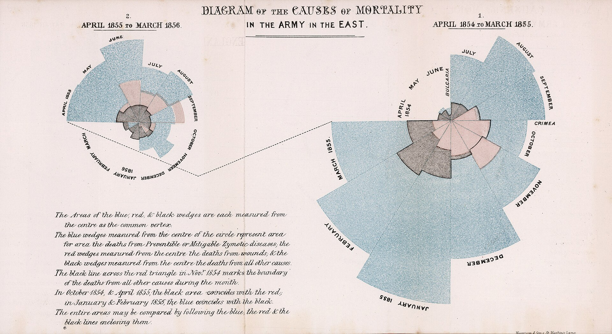

```{r}
#| label: setup
source(here::here("R/ppdac.R"))
source(here::here("R/aula03.R"))
```

## Hoje

1. Análise exploratória e planilhas
2. Tabelas
3. Tipos de gráficos, com a atividade do histograma com post-its
4. Como escolher: gráficos ou tabelas?

::: {.nota}
As tabelas e gráficos desta aula foram refeitos em R com dados simulados
(ou fictícios, quando indicado); as imagens históricas são de domínio
público. O código está em
[`R/`](https://github.com/diogoprov/bioestatistica/tree/main/R) no
repositório da disciplina.
:::

---

## Onde estamos no ciclo PPDAC

```{r}
#| fig-width: 6.4
#| fig-height: 5.1
#| out-width: "45%"
#| fig-alt: "Ciclo PPDAC com as etapas Dados e Análise destacadas nas suas cores; as demais em cinza."
ppdac_plot(destaque = c("Dados", "Análise"))
```

Organizar os dados (**Dados**) e explorá-los com tabelas e gráficos, antes
de qualquer teste (**Análise**).

---

## Ao final desta aula você deverá entender

:::: {.columns}
::: {.column width="60%"}
- Como apresentar dados em tabelas e gráficos
- Importância da Análise Exploratória de Dados
- Tipos de tabela
- Principais tipos de gráficos para cada tipo de dado
- Quando utilizar tabelas e/ou gráficos
  - Vantagens e desvantagens
:::
::: {.column width="40%"}
::: {.nota}
**Leituras**

- Triola, M.F. *Introdução à estatística*, cap. 2.
- Vieira, S. *Introdução à bioestatística*, caps. 1 e 2.
- Bussab, W.O. & Morettin, P.A. *Estatística básica*, cap. 2.
- Quinn, G.P. & Keough, M.J. *Experimental design and data analysis for
  biologists*, cap. 17.
:::
:::
::::

---

# 1. Análise exploratória e planilhas {.secao}

[Dados]{.ppdac-etapa .dados}

---

## Análise Exploratória de Dados

- Primeiro passo para qualquer análise de dados
- Deixar os dados mostrarem os padrões
- Ferramentas gráficas e tabelas
  - Visualização dos dados
  - Resumo das informações
- Permitem "contar histórias" com dados

---

## Regras básicas para planilhar dados

- **Observações nas linhas**
  - Uma unidade amostral em cada linha
- **Variáveis nas colunas**
  - Tratamentos experimentais, variáveis preditoras

---

# 2. Tabelas {.secao}

[Dados]{.ppdac-etapa .dados}

---

## Anatomia de uma tabela

```{r}
#| fig-width: 11
#| fig-height: 5
#| fig-alt: "Tabela 1.1: população residente no Brasil, segundo o sexo, de acordo com o Censo Demográfico 2010. Homens 93.406.990, mulheres 97.348.809, total 190.755.799. Fonte: Censo Demográfico 2010, IBGE (2011)."
fig_anatomia_tabela()
```

::: {.ref}
Exemplo de Vieira, S. *Introdução à bioestatística*.
:::

---

## Anatomia de uma tabela: número

```{r}
#| fig-width: 11
#| fig-height: 5
#| fig-alt: "A mesma tabela com o número, Tabela 1.1, destacado."
fig_anatomia_tabela("numero")
```

---

## Anatomia de uma tabela: título

```{r}
#| fig-width: 11
#| fig-height: 5
#| fig-alt: "A mesma tabela com o título destacado."
fig_anatomia_tabela("titulo")
```

---

## Anatomia de uma tabela: cabeçalho

```{r}
#| fig-width: 11
#| fig-height: 5
#| fig-alt: "A mesma tabela com o cabeçalho, Sexo e População residente, destacado."
fig_anatomia_tabela("cabecalho")
```

---

## Anatomia de uma tabela: linha

```{r}
#| fig-width: 11
#| fig-height: 5
#| fig-alt: "A mesma tabela com a linha Homens destacada: cada linha é uma observação."
fig_anatomia_tabela("linha")
```

---

## Anatomia de uma tabela: colunas

```{r}
#| fig-width: 11
#| fig-height: 5
#| fig-alt: "A mesma tabela com a coluna Sexo destacada: cada coluna é uma variável."
fig_anatomia_tabela("colunas")
```

---

## Anatomia de uma tabela: célula

```{r}
#| fig-width: 11
#| fig-height: 5
#| fig-alt: "A mesma tabela com a célula 93.406.990 destacada: cada célula é um único dado."
fig_anatomia_tabela("celula")
```

---

## Anatomia de uma tabela: fonte

```{r}
#| fig-width: 11
#| fig-height: 5
#| fig-alt: "A mesma tabela com a fonte destacada, que só aparece quando a tabela não foi produzida pelo autor."
fig_anatomia_tabela("fonte")
```

---

## Tabela para dados qualitativos (frequência) {.tabela-grande}

Tabela 2: Frequências e porcentagens dos 36 empregados da seção de
orçamentos da Companhia MB segundo o grau de instrução.

| Grau de instrução | Frequência ($n_i$) | Proporção ($f_i$) | Porcentagem ($100 f_i$) |
|---|---|---|---|
| Fundamental | 12 | 0,3333 | 33,33 |
| Médio | 18 | 0,5000 | 50,00 |
| Superior | 6 | 0,1667 | 16,67 |
| **Total** | **36** | **1,0000** | **100,00** |

::: {.nota}
**Uma única variável** (grau de instrução), resumida de três formas:
frequência absoluta, proporção e porcentagem.
:::

::: {.ref}
Fonte: Bussab, W.O. & Morettin, P.A. *Estatística básica*, Tabela 2.2.
:::

---

## Tabela de contingência {.tabela-grande}

Tabela 3: Girinos com e sem infecção por quitrídio (*Batrachochytrium
dendrobatidis*) em dois tipos de hábitat (dados fictícios).

| Hábitat | Infectados | Não infectados | Total |
|---|---|---|---|
| Poça temporária | 18 | 62 | 80 |
| Lagoa permanente | 41 | 59 | 100 |
| **Total** | **59** | **121** | **180** |

::: {.definicao}
**Duas variáveis** cruzadas: hábitat nas linhas, infecção nas colunas.
Dica: é o tipo de tabela usado nos testes de qui-quadrado e G (Aula 10).
:::

---

## Tabela de frequência para dados ordinais {.tabela-grande}

Tabela 4: Categoria de ameaça das espécies de anfíbios de uma região
(dados fictícios).

| Categoria | Frequência | Porcentagem |
|---|---|---|
| Menos preocupante (LC) | 58 | 63,0 |
| Quase ameaçada (NT) | 14 | 15,2 |
| Vulnerável (VU) | 11 | 12,0 |
| Em perigo (EN) | 6 | 6,5 |
| Criticamente em perigo (CR) | 3 | 3,3 |
| **Total** | **92** | **100,0** |

::: {.nota}
Em dados ordinais, as linhas seguem a ordem das categorias, e não a ordem
das frequências.
:::

---

## Tabela para dados quantitativos {.smaller}

Tabela 5: Informações sobre espécie, hábitat, estágio de desenvolvimento,
comprimento total e massa de 36 girinos (dados simulados).

```{r}
#| results: asis
d <- dados_girinos()
knitr::kable(rbind(head(d, 6) |> dplyr::mutate(dplyr::across(everything(), as.character)),
                   rep("⋮", ncol(d)),
                   tail(d, 1) |> dplyr::mutate(dplyr::across(everything(), as.character))),
             format.args = list(decimal.mark = ","))
```

::: {.nota}
Cada linha é um girino (a unidade amostral); cada coluna é uma variável,
qualitativa ou quantitativa. O modelo vem da Tabela 1 de Bussab &
Morettin.
:::

---

## Como não planilhar dados

:::: {.columns}
::: {.column width="45%"}
|   | Tratamento 1 | Tratamento 2 |
|---|---|---|
| 1 | 35 | 15 |
| 2 | 40 | 18 |
| 3 | 32 | 20 |
| 4 | 30 | 12 |
| 5 | 38 | 15 |
:::
::: {.column width="55%"}
O terror de toda pessoa que precisa analisar dados alheios: o que é cada
número? Qual é a variável medida? O que são os tratamentos?

Cada **linha** mistura duas observações diferentes, e a **variável
resposta** está espalhada em duas colunas.
:::
::::

::: {.ref}
Exemplo de Mello, M.A.R. <https://marcoarmello.wordpress.com/2018/02/01/dados/>
:::

---

## Uma tabela corretamente formatada {.smaller}

:::: {.columns}
::: {.column width="50%"}
| grupo_experimental | comprimento_corpo |
|---|---|
| com_predadores | 35 |
| com_predadores | 40 |
| com_predadores | 32 |
| com_predadores | 30 |
| com_predadores | 38 |
| sem_predadores | 15 |
| sem_predadores | 18 |
| sem_predadores | 20 |
| sem_predadores | 12 |
| sem_predadores | 15 |
:::
::: {.column width="50%"}
- Uma observação por linha
- Uma variável por coluna
- Todas as colunas nomeadas/identificadas

::: {.definicao}
`grupo_experimental`: variável **qualitativa** (fator com 2 níveis).

`comprimento_corpo`: variável **quantitativa** (contínua).
:::

Dica: é a tabela usada para o teste *t* (Aula 8).
:::
::::

---

## Pergunta para a turma {.smaller}

::: {.atividade}
**Uma pesquisadora mediu a massa de 20 sapos, 10 machos e 10 fêmeas.
Quantas linhas e quantas colunas tem a planilha bem formatada (sem contar
o cabeçalho)?**

A. 10 linhas e 2 colunas (uma para machos, outra para fêmeas)

B. 20 linhas e 2 colunas (sexo e massa)

C. 2 linhas e 10 colunas

D. 20 linhas e 20 colunas
:::

Votem sozinhos, discutam com quem está ao lado e votem de novo.

::: {.fragment}
::: {.definicao}
**B.** Cada sapo é uma observação, então uma linha por sapo (20). As
variáveis são duas: **sexo** (qualitativa) e **massa** (quantitativa). A
opção A é exatamente o formato "como não planilhar".
:::
:::

---

# 3. Tipos de gráficos {.secao}

[Análise]{.ppdac-etapa .analise}

---

## Vasta literatura sobre visualização de dados

- Knaflic, C.N. *Storytelling com dados*.
- Wilkinson, L. *The grammar of graphics*. Springer.
- Healy, K. 2018. *Data visualization: a practical introduction*.
  Princeton University Press.
- Tukey, J.W. *Exploratory data analysis*.

---

## Tipos de gráficos {.smaller}

:::: {.columns}
::: {.column width="34%"}
- **Variáveis qualitativas**
  - Pizza (setores)
  - Pirulito
  - Treemap
- **Variáveis quantitativas**
  - Diagrama de rosa
  - Dispersão (pontos)
  - Histogramas
  - Boxplot
  - Barra
  - Linha
:::
::: {.column width="66%"}
```{r}
#| fig-width: 8.4
#| fig-height: 4.9
#| fig-alt: "Galeria de nove gráficos com dados simulados. Para variáveis qualitativas: pizza, pirulito e treemap. Para quantitativas: diagrama de rosa, dispersão, histograma, boxplot, barras e linha."
fig_galeria()
```
:::
::::

::: {.ref}
Quinn & Keough, cap. 17.
:::

---

## Precisão com que a informação quantitativa é decodificada pelo leitor

```{r}
#| fig-width: 11
#| fig-height: 5.4
#| out-width: "78%"
#| fig-alt: "Sete maneiras de codificar os mesmos três valores, da mais fácil à mais difícil de ler: posição numa escala comum, posição em escalas não alinhadas, comprimento, ângulo e inclinação, área, volume e cor."
fig_precisao()
```

::: {.ref}
Cleveland, W.S. & McGill, R. 1984. *Journal of the American Statistical
Association* 79:531–554; Quinn & Keough, cap. 17.
:::

---

## Gráfico de "pizza"

```{r}
#| fig-width: 12
#| fig-height: 4.6
#| fig-alt: "À esquerda, gráfico de setores das causas de morte de girinos numa lagoa: predação 55%, dessecação da poça 25%, doença 12% e outras 8%. À direita, a piada: um setor enorme para pessoas que desejam que isso seja uma pizza de verdade e uma fatia fina para pessoas que gostam de fazer gráficos de setores."
fig_pizza()
```

::: {.definicao}
Úteis para mostrar a frequência (proporção) de uma variável discreta.
:::

::: {.ref}
Inspirado nas Figuras 2.9(a) e 2.9(b) de Triola, *Introdução à estatística*.
:::

---

## A mesma informação pode ser visualizada de mais de uma forma

```{r}
#| fig-width: 9
#| fig-height: 5.6
#| out-width: "60%"
#| fig-alt: "Proporções de cinco categorias, A a E, em dois momentos. Em cima, duas pizzas quase iguais, difíceis de comparar. Embaixo, as mesmas proporções em barras agrupadas, onde as diferenças entre antes e agora ficam claras."
fig_pizza_vs_barras()
```

::: {.ref}
Quinn & Keough, cap. 17.
:::

---

## Pirulito (*lollipop plot*)

```{r}
#| fig-width: 10
#| fig-height: 5.2
#| out-width: "76%"
#| fig-alt: "Gráfico de pirulito com 14 espécies no eixo vertical e o número de registros no horizontal; cada espécie tem um ponto para poça temporária e outro para lagoa permanente, ligados por uma barra."
fig_pirulito()
```

::: {.definicao}
Úteis para mostrar a frequência de 2 grupos.
:::

---

## Treemap

```{r}
#| fig-width: 11
#| fig-height: 5.2
#| out-width: "76%"
#| fig-alt: "Treemap com retângulos proporcionais ao número de espécies de cada família de anuros numa taxocenose fictícia: Hylidae 35%, Leptodactylidae 24%, Bufonidae 10%, Microhylidae 8%, Phyllomedusidae 7%, Outras 7%, Odontophrynidae 5%, Craugastoridae 4%."
fig_treemap()
```

::: {.definicao}
Úteis para mostrar a proporção de várias variáveis discretas.
:::

::: {.nota}
Um exemplo real e interativo: o Atlas of Economic Complexity,
<https://atlas.hks.harvard.edu>.
:::

---

## Florence Nightingale: pioneira na visualização de dados

:::: {.columns}
::: {.column width="78%"}
{width="88%" fig-alt="Os dois diagramas de rosa de Florence Nightingale, de 1858, com as causas de morte do exército britânico na Guerra da Crimeia, mês a mês; as mortes por doenças evitáveis, em azul, dominam."}
:::
::: {.column width="22%"}
{fig-alt="Fotografia de Florence Nightingale."}
:::
::::

::: {.nota}
O diagrama de rosa mostra, mês a mês, que a maioria dos soldados morria de
doenças evitáveis, e não de ferimentos. Imagens: domínio público, via
Wikimedia Commons
([fontes](https://github.com/diogoprov/bioestatistica/blob/main/assets/historia/FONTES.md)).
:::

---

## Gráfico de dispersão (*scatterplot*)

```{r}
#| fig-width: 11.5
#| fig-height: 4.6
#| fig-alt: "Dois gráficos de dispersão de altura contra comprimento do pé de 40 pessoas; no segundo, a reta de regressão mostra que pessoas com pé maior tendem a ser mais altas."
fig_dispersao()
```

::: {.definicao}
Úteis para mostrar a distribuição de duas variáveis quantitativas
contínuas.
:::

::: {.ref}
Inspirado nas Figuras 2.18 e 2.19 de Triola, *Introdução à estatística*.
:::

---

## Diagrama de pontos

```{r}
#| fig-width: 11
#| fig-height: 4.4
#| fig-alt: "Diagrama de pontos da frequência cardíaca de repouso de 150 pessoas: cada pessoa é um ponto empilhado sobre o seu valor, formando um monte centrado em torno de 70 batimentos por minuto."
fig_pontos()
```

::: {.definicao}
Úteis para mostrar a distribuição de uma variável quantitativa contínua.
:::

::: {.ref}
Inspirado na Figura 2.6 de Triola, *Introdução à estatística*.
:::

---

## Quão altos somos? {.secao}

**1,47 m · 1,70 m · 1,98 m**

---

## Histograma {.smaller}

:::: {.columns}
::: {.column width="52%"}
```{r}
#| results: asis
knitr::kable(tabela_frequencia())
```
:::
::: {.column width="48%"}
```{r}
#| fig-width: 6.2
#| fig-height: 5
#| fig-alt: "Histograma da quantidade de fósforo nas folhas de 130 plantas, com classes de 0,1 mg/g entre 8,15 e 9,25; a distribuição tem forma de sino, centrada perto de 8,7."
fig_histograma_zar()
```
:::
::::

::: {.definicao}
Úteis para mostrar a distribuição de uma variável quantitativa contínua.
:::

---

## Histograma: da tabela para as barras {.smaller}

:::: {.columns}
::: {.column width="52%"}
```{r}
#| results: asis
knitr::kable(tabela_frequencia(destaque = 1))
```
:::
::: {.column width="48%"}
```{r}
#| fig-width: 6.2
#| fig-height: 5
#| fig-alt: "O mesmo histograma com a primeira barra em vermelho: a primeira classe da tabela vira a primeira barra, e a sua frequência é a altura da barra."
fig_histograma_zar(destaque = 1)
```
:::
::::

Cada **classe** da tabela é uma barra no eixo x, e a **frequência** da
classe é a altura da barra.

::: {.ref}
Inspirado no Exemplo 5 (fósforo em folhas) de Zar, J.H. *Biostatistical
analysis*; dados simulados.
:::

---

## Atividade prática: construção de histograma {.smaller}

::: {.atividade}
**Atividade com post-it: a altura dos estudantes**

1. **Coletem os dados.** Em grupos, meçam a altura uns dos outros. Cada
   pessoa escreve a sua altura (em cm) num post-it.
2. **Ordenem os dados** e calculem o número de classes pela regra de
   Sturges:
   $$k = 1 + 3{,}322 \times \log_{10}(n)$$
3. **Montem a tabela de frequência** e **desenhem os eixos** no quadro, com
   classes da largura de um post-it.
4. Cada pessoa **cola o seu post-it** na classe certa, empilhando. O
   histograma aparece na frente de todo mundo.
5. **Mudem as classes**: refaçam com classes mais estreitas e mais largas,
   e vejam a forma mudar.
6. **Desenhem e discutam**: qual largura de classe mostra melhor os dados?
   Por quê?
:::

::: {.ref}
Atividade adaptada de 3M, *Create a histogram with your students*,
<https://www.post-it.com/3M/en_US/post-it/ideas/articles/How-to-make-a-histogram-to-visualize-data-and-solve-problems/>.
:::

---

## Mudem as classes

```{r}
#| fig-width: 12
#| fig-height: 4.6
#| fig-alt: "Três histogramas das mesmas 40 alturas simuladas, com classes de 2, 5 e 10 centímetros. Com classes de 2 cm o gráfico fica serrilhado; com 10 cm, quase sem forma; com 5 cm aparecem dois picos."
fig_histograma_larguras()
```

Com $n = 40$, a regra de Sturges dá
$k = 1 + 3{,}322 \times \log_{10}(40) \approx 6{,}3$, ou seja, **6 classes**.
Os mesmos dados contam histórias diferentes conforme a largura das classes.

---

## Gráficos de caixa (*boxplots*)

```{r}
#| fig-width: 10
#| fig-height: 5.4
#| out-width: "72%"
#| fig-alt: "Boxplot anotado do comprimento de espinhos: a caixa vai do primeiro quartil (Q1, percentil 25%) ao terceiro (Q3, percentil 75%), com a mediana dentro; as hastes vão até os limites de 1,5 vez o intervalo interquartil, e dois valores acima disso aparecem como pontos vermelhos, os outliers."
fig_boxplot_anatomia()
```

::: {.definicao}
Úteis para mostrar a distribuição de uma variável quantitativa contínua.
:::

---

## Aprendendo a desenhar um boxplot {.smaller}

1. Ordene os dados do maior para o menor
2. Calcule a mediana
3. Separe os dados cujos valores estão **abaixo** da mediana
4. Calcule a mediana destes dados, este é o Q1
5. Separe os dados cujos valores estão **acima** da mediana
6. Calcule a mediana destes dados, este é o Q3
7. Calcule a variação interquartil = Q3 − Q1
8. Desenhe uma caixa ligando o Q1 e o Q3
9. Coloque uma linha dentro da caixa indicando a mediana
10. Desenhe uma reta da extremidade da caixa até 1,5 × IQR. Repita o mesmo
    procedimento para o Q3

::: {.nota}
Alguns livros (por exemplo, Vieira) desenham as hastes até os percentis
10% e 90%. Sempre diga na legenda qual convenção você usou.
:::

---

## Histograma e boxplot: a forma da distribuição

```{r}
#| fig-width: 12
#| fig-height: 5
#| fig-alt: "Três distribuições simuladas, cada uma com um histograma em cima e um boxplot embaixo. Assimétrica: caixa deslocada para a esquerda e vários outliers à direita. Normal: caixa no centro e hastes simétricas. Uniforme: caixa larga, sem outliers."
fig_distribuicoes_boxplot()
```

::: {.ref}
Inspirado em Triola, *Introdução à estatística*, cap. 3.
:::

---

## Pergunta para a turma {.smaller}

::: {.atividade}
**Num boxplot, a caixa contém:**

A. todos os dados

B. os 50% dos dados do meio, entre Q1 e Q3

C. a média mais ou menos um desvio-padrão

D. 95% dos dados
:::

Votem sozinhos, discutam com quem está ao lado e votem de novo.

::: {.fragment}
::: {.definicao}
**B.** A caixa vai do percentil 25% (Q1) ao percentil 75% (Q3), então
contém a metade central dos dados. O boxplot não mostra média nem
desvio-padrão.
:::
:::

---

## Gráfico de barras

```{r}
#| fig-width: 10
#| fig-height: 4.8
#| out-width: "85%"
#| fig-alt: "Gráfico de barras com a porcentagem de 80 machos por sítio de vocalização: vegetação emergente 51%, margem 32%, água aberta 11% e fora da poça 5%."
fig_barras_freq()
```

::: {.ref}
Inspirado na Figura 2.1 de Vieira, *Introdução à bioestatística*.
:::

---

## Gráfico de barras

:::: {.columns}
::: {.column width="55%"}
```{r}
#| fig-width: 6.8
#| fig-height: 5
#| fig-alt: "Duas barras com a mesma média do comprimento de espinhos; a primeira com a barra de erro do desvio-padrão, longa, e a segunda com a do erro-padrão, bem mais curta."
fig_barras_dp_ep()
```
:::
::: {.column width="45%"}
::: {.definicao}
Úteis para mostrar a média (e a dispersão) de uma variável quantitativa
contínua.
:::

O **desvio-padrão** mede a variabilidade dos dados; o **erro-padrão** mede
a precisão da estimativa da média. A legenda precisa dizer qual dos dois a
barra mostra, e o tamanho da amostra.
:::
::::

::: {.ref}
Inspirado na Figura 3.3 de Vieira, *Introdução à bioestatística*.
:::

---

## Desconfie das barras com erro

```{r}
#| fig-width: 12
#| fig-height: 4.6
#| fig-alt: "À esquerda, três barras idênticas, com a mesma média e o mesmo erro-padrão. À direita, os mesmos três conjuntos de dados ponto a ponto: um simétrico, um com um valor extremo e um bimodal, com dois grupos separados."
fig_dinamite()
```

As três barras são iguais, mas os dados por trás delas não. Sempre que
puder, **mostre os pontos**.

::: {.ref}
Weissgerber, T.L. et al. 2015. *PLOS Biology* 13:e1002128.
:::

---

## Gráfico de linha

```{r}
#| fig-width: 9
#| fig-height: 4.8
#| out-width: "70%"
#| fig-alt: "Gráfico de linha com a densidade média de girinos em quatro meses, com barras de erro-padrão, para primavera e verão; as duas estações caem ao longo do tempo, e a primavera fica sempre acima."
fig_linha()
```

::: {.definicao}
Úteis para mostrar tendências temporais.
:::

::: {.ref}
Inspirado em Quinn & Keough, cap. 17.
:::

---

# 4. Como escolher? {.secao}

[Análise]{.ppdac-etapa .analise} → [Conclusão]{.ppdac-etapa .conclusao}

---

## Como escolher qual gráfico usar?

```{r}
#| fig-width: 13
#| fig-height: 5.6
#| out-width: "100%"
#| fig-alt: "Árvore de decisão com uma miniatura de gráfico em cada folha a partir da pergunta o que você deseja mostrar, com quatro ramos. Comparação: por item (colunas, barras, tabela com gráficos, colunas de largura variável) ou ao longo do tempo (linha, radar, colunas). Relação: dispersão para duas variáveis, bolhas para três. Distribuição: histograma para uma variável, dispersão para duas, superfície para três. Composição: colunas ou áreas empilhadas ao longo do tempo; pizza, cascata ou empilhado 100% para composição estática."
fig_escolha_grafico()
```

::: {.ref}
Esquema de Randal S. Olson, inspirado no trabalho de A. Abela; tradução do
IBPAD (2016), <https://ibpad.com.br/ciencia-dados/qual-e-o-grafico-mais-adequado/>.
:::

---

## Quando usar gráficos vs. tabelas? {.secao}

---

## Vantagens

- **Dos gráficos:**
  - **Sintetizam os dados e facilitam o entendimento de padrões**
  - **Informam rápida e concisamente sobre a variabilidade** dos dados
  - Permitem visualizar a distribuição das variáveis
  - Podem ser **impactantes** e levar a insights que as palavras por si só
    não conseguem transmitir, comunicando padrões, redes e sistemas
    complexos
- **Das tabelas:**
  - São ideais para quando a precisão de cada valor é importante para o
    leitor
  - Apresentam **grandes volumes de dados precisos** de forma organizada

---

## Limitações

- **Dos gráficos:**
  - Apresentar muitos pontos de dados em gráficos como scatter plots, box
    plots ou histogramas pode **sacrificar a legibilidade**
  - A interpretação baseada apenas em gráficos pode ser não confiável, pois
    é possível construir gráficos muito diferentes com base nos mesmos
    dados
- **Das tabelas:**
  - Não são ideais para **exibir tendências ou relacionamentos** entre
    variáveis
  - Podem **sobrecarregar o leitor** se forem muito grandes ou contiverem
    excesso de informações

---

## Gráficos e tabelas: finalidade e vantagens {.smaller}

| | Gráficos | Tabelas |
|---|---|---|
| **Finalidade principal** | Apresentar tendências e relacionamentos entre variáveis. Sintetizar dados e facilitar o entendimento de padrões. Visualizar a distribuição das variáveis. | Apresentar dados precisos para referência. Exibir grandes quantidades de dados que poderiam sobrecarregar um gráfico. Fornecer visões gerais sistemáticas e informações de fundo. |
| **Vantagens** | Síntese e clareza de padrões: rápida compreensão de variabilidade e distribuição. Impacto visual: enriquecem a argumentação e são cruciais para comunicar sistemas complexos. Revelam padrões: permitem ver a forma da distribuição dos dados e a variabilidade dos pontos. Preservam dados individuais (ex.: ramo-e-folhas). | Precisão e detalhe: exibem valores exatos e grandes volumes de dados. Visão sistemática: úteis para dados que exigem atenção individual e para informações de fundo. |

---

## Gráficos e tabelas: quando preferir e limitações {.smaller}

| | Gráficos | Tabelas |
|---|---|---|
| **Quando preferir** | Ao focar em tendências, comparações de distribuições (contínuas entre categorias), relações entre variáveis contínuas e valores médios com medidas de variação. Para poucas categorias em gráficos de setores. Para contar uma história mais abrangente com múltiplos formatos. Para dados contínuos em grande número (histograma) ou discretos (diagrama de linhas). Para dados contínuos em pequeno número (gráfico de pontos). | Ao focar em dados para referência, grandes volumes de dados precisos e visões gerais sistemáticas ou informações de fundo. Quando todos os dados precisam de atenção igual e não há uma tendência clara a destacar. |
| **Limitações** | Podem ofuscar dados precisos se a finalidade for referência. Muitos tipos mostram apenas valores médios, ocultando dados individuais. Legibilidade comprometida com excesso de pontos. Gráficos 3D podem dificultar a compreensão de proporções. A interpretação pode ser influenciada pela forma de construção. | Não são eficazes para exibir tendências ou relacionamentos entre variáveis. Podem sobrecarregar o leitor se muito grandes. Geralmente não devem ser o elemento principal de uma figura. Não destacam características específicas dos dados tão bem quanto um gráfico. |

---

## Boas práticas para reportar resultados

Boas práticas para reportar resultados na forma de **texto**, **tabela** e
**gráficos**, de modo que outras pessoas consigam extrair e compilar as
informações, por exemplo numa meta-análise:

- descreva os métodos com detalhe (local, data, número de réplicas);
- reporte a média, a medida de variação (e qual é) e o tamanho da amostra
  de cada grupo;
- informe a estatística do teste, os graus de liberdade e o valor de *P*
  exato;
- nas figuras, diga o que as barras de erro representam e evite pontos
  sobrepostos que escondam dados.

::: {.ref}
Gerstner, K. et al. 2017. Will your paper be used in a meta-analysis? Make
the reach of your research broader and longer lasting. *Methods in
Ecology and Evolution* 8:777–784.
:::

---

## Recapitulação

- Dados são usualmente resumidos em forma de tabela e/ou gráficos
- A escolha depende do tipo de variável
- O tipo de gráfico determina a maneira com que se deseja contar a
  história sobre os dados
- Histogramas e boxplots são muito úteis para a análise exploratória de
  dados

---

## Referências {.smaller}

::: {.nota}
- Cleveland, W.S. & McGill, R. 1984. [Graphical perception: theory, experimentation, and application to the development of graphical methods](https://doi.org/10.1080/01621459.1984.10478080). *Journal of the American Statistical Association* 79:531–554.
- Gerstner, K. et al. 2017. [Will your paper be used in a meta-analysis? Make the reach of your research broader and longer lasting](https://doi.org/10.1111/2041-210X.12758). *Methods in Ecology and Evolution* 8:777–784.
- Weissgerber, T.L.; Milic, N.M.; Winham, S.J. & Garovic, V.D. 2015. [Beyond bar and line graphs: time for a new data presentation paradigm](https://doi.org/10.1371/journal.pbio.1002128). *PLOS Biology* 13:e1002128.
- Bussab, W.O. & Morettin, P.A. *Estatística básica*. Saraiva.
- Healy, K. 2018. *Data visualization: a practical introduction*. Princeton University Press.
- Knaflic, C.N. *Storytelling com dados*.
- Quinn, G.P. & Keough, M.J. *Experimental design and data analysis for biologists*. Cambridge University Press.
- Triola, M.F. *Introdução à estatística*.
- Tukey, J.W. *Exploratory data analysis*.
- Vieira, S. *Introdução à bioestatística*.
- Wilkinson, L. *The grammar of graphics*. Springer.
- Zar, J.H. *Biostatistical analysis*. Pearson.
:::
