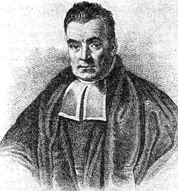
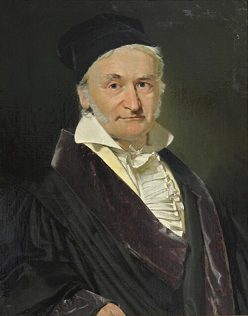
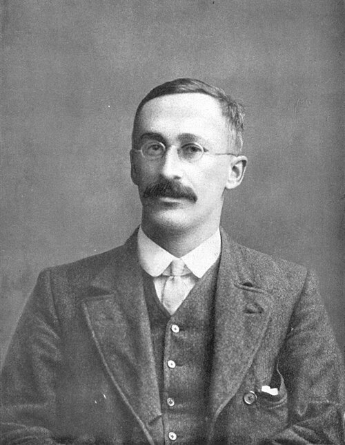

```{r}
#| label: setup
source(here::here("R/ppdac.R"))
source(here::here("R/aula05.R"))
```

## Hoje

1. Fundamentos da probabilidade, e a atividade de genética
2. Variáveis aleatórias e distribuições de probabilidade
3. Distribuições discretas: Bernoulli, binomial e Poisson, e o Kahoot
4. A distribuição normal e o escore-Z, e a dinâmica "O normal e o raro"
5. Como escolher qual distribuição usar

::: {.nota}
As figuras desta aula foram geradas em R (as distribuições são calculadas,
não desenhadas à mão); os retratos históricos são de domínio público. O
código está em
[`R/`](https://github.com/diogoprov/bioestatistica/tree/main/R) no
repositório da disciplina.
:::

---

## Onde estamos no ciclo PPDAC

```{r}
#| fig-width: 6.4
#| fig-height: 5.1
#| out-width: "45%"
#| fig-alt: "Ciclo PPDAC com as etapas Análise e Conclusão destacadas nas suas cores; as demais em cinza."
ppdac_plot(destaque = c("Análise", "Conclusão"))
```

A probabilidade é a linguagem com que a **Análise** passa da amostra para
a população, e com que a **Conclusão** diz quanta incerteza resta.

---

## Ao final desta aula você deverá entender

:::: {.columns}
::: {.column width="60%"}
- Fundamentos da probabilidade
- Variáveis aleatórias e distribuições de probabilidade
- Distribuições de probabilidade discretas:
  - Binomial
  - Poisson
- Distribuições de probabilidade contínuas:
  - A distribuição normal
- Qual distribuição usar
:::
::: {.column width="40%"}
::: {.nota}
**Leituras**

- Triola, M.F. *Introdução à estatística*, caps. 5 e 6.
- Vieira, S. *Introdução à bioestatística*, caps. 8, 14 e 15.
- Bussab, W.O. & Morettin, P.A. *Estatística básica*, caps. 5, 6 e 7.
- Gotelli, N.J. & Ellison, A.M. *Princípios de estatística em ecologia*,
  caps. 1 e 2.
:::
:::
::::

---

# 1. Fundamentos da probabilidade {.secao}

[Análise]{.ppdac-etapa .analise}

---

## O que é probabilidade?

- Medida da incerteza de um evento
- Em biologia, muitos fenômenos são influenciados pelo acaso
- **Exemplos:**
  - A herança de um alelo específico de um gene.
  - O sexo de um filhote.
  - A captura de um animal em uma armadilha.

---

## Por que precisamos de probabilidade em biologia?

- **Exemplos reais**
  - Genética: probabilidade de herdar uma característica (ex.: cor dos
    olhos)
  - Ecologia: distribuição de espécies em um hábitat
  - Epidemiologia: risco de contrair uma doença
- **Ferramenta essencial**
  - Base para testes estatísticos, modelagem e tomada de decisões

---

## Conceitos fundamentais {.smaller}

:::: {.columns}
::: {.column width="65%"}
- **Experimento aleatório:** um processo que pode ter diferentes
  resultados, mesmo quando repetido da mesma maneira.
  - *Exemplo:* cruzamento de duas plantas de ervilha heterozigotas
    (Aa × Aa).
- **Espaço amostral (S):** o conjunto de todos os resultados possíveis de
  um experimento aleatório.
  - *Exemplo:* os possíveis genótipos dos descendentes: {AA, Aa, aA, aa}.
- **Evento (E):** um subconjunto do espaço amostral; um ou mais
  resultados de interesse.
  - *Exemplo:* o descendente ter o genótipo "aa".
:::
::: {.column width="35%"}
::: {.definicao}
**Exemplo genético clássico**

Ao cruzar duas plantas de ervilha heterozigotas (Aa × Aa), o genótipo do
descendente é um evento aleatório. O espaço amostral é {AA, Aa, aA, aa}.

**P(aa) = 25%**: a probabilidade de um descendente ser homozigoto
recessivo.
:::
:::
::::

---

## Definições de probabilidade: clássica

- **Clássica:** todos os resultados são igualmente prováveis.

$$P(E) = \frac{\text{número de resultados favoráveis}}{\text{número total de resultados}}$$

- *Exemplo:* a probabilidade de um descendente de um cruzamento Aa × Aa
  ser "aa" é 1/4.

---

## Definições de probabilidade: axiomática {.smaller}

- **Axiomática:** define 3 axiomas que qualquer medida de probabilidade
  deve obedecer para ser matematicamente consistente.
  - **Axioma 1: não negatividade.** A probabilidade de qualquer evento A
    é um número não negativo: $P(A) \geq 0$
  - **Axioma 2: normalização.** A probabilidade do espaço amostral
    completo é 1: $P(S) = 1$
  - **Axioma 3: aditividade contável.** Para qualquer sequência enumerável
    de eventos disjuntos dois a dois ($A_i \cap A_j = \emptyset$ para
    $i \neq j$), a probabilidade da união é a soma das probabilidades
    individuais:

$$P\left(\bigcup_{i=1}^{\infty} A_i\right) = \sum_{i=1}^{\infty} P(A_i)$$

---

## Definições de probabilidade: frequentista e bayesiana {.smaller}

- **Frequentista:** baseada na frequência relativa de um evento em um
  **grande número de repetições**

$$P(E) = \lim_{n \to \infty} \frac{n(E)}{n}$$

  - *Exemplo:* se em 1.000 nascimentos em um hospital 510 são meninos, a
    probabilidade de nascer um menino é estimada em 0,51.
- **Bayesiana:** probabilidade é uma medida do **grau de crença** ou
  confiança na veracidade de uma proposição, **com base nas informações**
  e evidências **disponíveis**
  - Não é uma propriedade física e objetiva do mundo (como a frequência de
    caras em uma moeda), mas sim uma representação do nosso estado de
    conhecimento (ou incerteza) sobre algo
  - A principal força da abordagem bayesiana é sua capacidade de
    atualizar crenças. À medida que novas evidências surgem, podemos usar
    um mecanismo formal para revisar nossa probabilidade inicial.

---

## Teorema de Bayes {.smaller}

:::: {.columns}
::: {.column width="76%"}
$$P(H \mid E) = \frac{P(E \mid H)\, P(H)}{P(E)}$$

Onde:

- **P(H|E): probabilidade a posteriori.** É o que queremos descobrir: a
  nossa **crença atualizada** na hipótese H, *depois* de observar a
  evidência E.
- **P(H): probabilidade a priori.** É a nossa **crença inicial** na
  hipótese H, *antes* de considerarmos a nova evidência.
- **P(E|H): verossimilhança.** A probabilidade de observar a evidência E,
  *assumindo que a hipótese H é verdadeira*.
- **P(E): evidência marginal.** A probabilidade total de observar a
  evidência E. Atua como uma constante de normalização.

O fluxo de pensamento é: **crença inicial (prior) + nova evidência
(verossimilhança) → crença atualizada (posterior)**.
:::
::: {.column width="24%"}
{fig-alt="Gravura de um homem de peruca e roupas escuras, tradicionalmente identificado como Thomas Bayes."}

::: {.nota}
Domínio público, via Wikimedia Commons. A autenticidade do retrato é
incerta.
:::
:::
::::

---

## Comparação entre frequentista e bayesiana {.smaller}

| Característica | Abordagem frequentista | Abordagem bayesiana |
|---|---|---|
| **Definição principal** | Frequência relativa de um evento em um grande número de ensaios repetidos. | Grau de crença ou confiança na veracidade de uma proposição. |
| **Natureza** | Objetiva (a probabilidade é uma propriedade do mundo físico). | Subjetiva (a probabilidade é um estado de conhecimento de um observador). |
| **O que descreve?** | A taxa com que eventos ocorrem em experimentos. | A incerteza sobre qualquer proposição, seja ela repetível ou não. |
| **Parâmetros do modelo** | Parâmetros (como a média μ) são constantes fixas, mas desconhecidas. | Parâmetros são variáveis aleatórias sobre as quais temos crenças (distribuições). |
| **Resultado principal** | Intervalos de confiança e valores-p. | Distribuições de probabilidade a posteriori para os parâmetros. |

---

## Regras da probabilidade {.smaller}

- **Regra da adição**
  - **Eventos mutuamente exclusivos:** $P(A \text{ ou } B) = P(A) + P(B)$
    - *Exemplo:* a probabilidade de um descendente ser AA **ou** aa.
  - **Eventos não exclusivos:** $P(A \text{ ou } B) = P(A) + P(B) - P(A \cap B)$
    - *Exemplo:* animal mamífero **ou** carnívoro.
- **Regra da multiplicação**
  - **Eventos independentes:** $P(A \text{ e } B) = P(A) \cdot P(B)$
    - *Exemplo:* a probabilidade de o primeiro filho de um casal ser
      menino **e** o segundo também.
  - **Eventos dependentes:** $P(A \text{ e } B) = P(A) \cdot P(B \mid A)$
    - *Exemplo:* probabilidade de sortear duas bolas vermelhas sem
      reposição.
- **Probabilidade condicional:** a probabilidade de um evento A ocorrer,
  **dado que** o evento B já ocorreu: $P(A \mid B) = P(A \text{ e } B) / P(B)$
  - *Exemplo:* a probabilidade de um indivíduo ter uma doença, dado que o
    teste deu positivo.

---

## União, interseção, complemento

```{r}
#| fig-width: 10
#| fig-height: 6
#| out-width: "72%"
#| fig-alt: "Quatro diagramas de Venn com o espaço amostral S: a união de A e B sombreada; a interseção de A e B sombreada; o complemento de A, tudo fora de A, sombreado; e dois círculos separados, eventos mutuamente excludentes."
fig_venn()
```

---

## Probabilidade condicional

```{r}
#| fig-width: 11
#| fig-height: 4
#| fig-alt: "À esquerda, o espaço amostral Ω com os eventos A, em azul, e B, em vermelho, e a interseção A∩B sombreada. À direita, só o círculo B com a parte A∩B sombreada: quando sabemos que B ocorreu, B passa a ser o novo espaço amostral."
fig_condicional()
```

Saber que B ocorreu **encolhe o espaço amostral** para B. A pergunta passa
a ser: dentro de B, que fração é A?

---

## Atividade: "Probabilidade na genética" (5 min) {.smaller}

::: {.atividade}
Num cruzamento **Aa × Aa**, em que **a** é recessivo, calculem em duplas:

1. A probabilidade de um descendente ser **aa**.
2. A probabilidade de um descendente ter o **fenótipo dominante**.
3. A probabilidade de **dois** descendentes seguidos serem **aa**.
4. **Dado que** um descendente tem o fenótipo dominante, a probabilidade
   de ele ser **Aa**.
:::

::: {.fragment}
::: {.definicao}
1. 1/4. 2. P(AA) + P(Aa) = 1/4 + 1/2 = **3/4** (adição, eventos
mutuamente exclusivos). 3. 1/4 × 1/4 = **1/16** (multiplicação, eventos
independentes). 4. P(Aa | dominante) = (1/2) / (3/4) = **2/3**
(probabilidade condicional).
:::
:::

---

# 2. Variáveis aleatórias e distribuições de probabilidade {.secao}

[Análise]{.ppdac-etapa .analise}

---

## Variáveis aleatórias {.smaller}

- Uma **variável aleatória (v.a.)** é uma variável cujo valor é uma
  realização (resultado) de um experimento aleatório (ex.: sorteio)
- **Tipos de variáveis aleatórias:**
  - **Discreta:** assume um número *finito* ou contável de valores.
    - Exemplos: número de filhotes em uma ninhada; número de colônias de
      bactérias em uma placa de Petri.
  - **Contínua:** pode assumir qualquer valor *em um intervalo*.
    - Exemplos: altura de uma planta; peso de um animal; concentração de
      uma substância no sangue.

---

## Variáveis aleatórias

- **Funções:**
  - Discretas: função de probabilidade $P(X = x)$
  - Contínuas: função densidade de probabilidade $f(x)$
- **Medidas:**
  - **Esperança (média):**
    - $E(X) = \sum x \, P(X = x)$ (discreta)
    - $E(X) = \int x \, f(x) \, dx$ (contínua)
  - **Variância:** $\mathrm{Var}(X) = E[X^2] - (E[X])^2$

---

## Distribuição de probabilidade

- Uma **distribuição de probabilidade** descreve como as probabilidades
  se distribuem sobre os valores de uma variável aleatória.
- Para v.a. discretas, é uma lista de todos os valores possíveis e suas
  probabilidades.
- Para v.a. contínuas, é descrita por uma curva de densidade de
  probabilidade.

---

## Uma família de distribuições

```{r}
#| fig-width: 13
#| fig-height: 6.2
#| out-width: "100%"
#| fig-alt: "Rede de quinze distribuições de probabilidade ligadas por linhas, cada uma com uma miniatura: uniforme, Bernoulli, hipergeométrica, binomial, geométrica, binomial negativa e Poisson, com barras; exponencial, log-normal, normal, qui-quadrado, Weibull, t de Student, gama e beta, com curvas."
fig_relacoes()
```

---

## Variáveis aleatórias contínuas

```{r}
#| fig-width: 13
#| fig-height: 6.2
#| out-width: "100%"
#| fig-alt: "A mesma rede com as distribuições contínuas destacadas em vermelho: exponencial, log-normal, normal, qui-quadrado, Weibull, t de Student, gama e beta."
fig_relacoes("continuas")
```

---

## Variáveis aleatórias discretas

```{r}
#| fig-width: 13
#| fig-height: 6.2
#| out-width: "100%"
#| fig-alt: "A mesma rede com as distribuições discretas destacadas em vermelho: uniforme, Bernoulli, hipergeométrica, binomial, geométrica, binomial negativa e Poisson."
fig_relacoes("discretas")
```

---

## Binomial

```{r}
#| fig-width: 13
#| fig-height: 6.2
#| out-width: "100%"
#| fig-alt: "A mesma rede com a binomial destacada."
fig_relacoes("Binomial")
```

---

## Poisson

```{r}
#| fig-width: 13
#| fig-height: 6.2
#| out-width: "100%"
#| fig-alt: "A mesma rede com a Poisson destacada."
fig_relacoes("Poisson")
```

---

## Normal: a distribuição mais importante

```{r}
#| fig-width: 13
#| fig-height: 6.2
#| out-width: "100%"
#| fig-alt: "A mesma rede com a normal destacada e a nota: a distribuição mais importante para descrever variáveis aleatórias contínuas."
fig_relacoes("Normal")
```

---

# 3. Distribuições discretas {.secao}

[Análise]{.ppdac-etapa .analise}

---

## Distribuição de Bernoulli

- **Definição:** experimento com dois resultados (sucesso/fracasso)
- **Parâmetro:** *p* (probabilidade de sucesso)
- **Exemplo biológico:** sobrevivência de um organismo após tratamento

```{r}
#| fig-width: 11
#| fig-height: 3.8
#| fig-alt: "Distribuição de Bernoulli com p = 0,7. À esquerda, a função de probabilidade: uma haste de altura 0,3 em 0 (fracasso) e outra de 0,7 em 1 (sucesso). À direita, a função de distribuição acumulada, em degraus: 0 antes de 0, 0,3 entre 0 e 1, e 1 a partir de 1."
fig_bernoulli()
```

---

## Distribuição binomial {.smaller}

- Modelo para v.a. discretas.
- **Condições para usar a binomial:**
  - Número fixo de tentativas ($n$).
  - Cada tentativa tem apenas dois resultados possíveis (sucesso ou
    fracasso).
  - A probabilidade de sucesso ($p$) é a mesma em todas as tentativas.
  - As tentativas são independentes.
- **Fórmula:**

$$P(X = x) = \binom{n}{x} p^x (1 - p)^{n - x}$$

- **Exemplos em biologia:**
  - Herança mendeliana (proporção de fenótipos)
  - Um casal tem 5 filhos. Qual a probabilidade de que exatamente 3 sejam
    meninos (considerando $p = 0{,}5$)?
    [$\binom{5}{3} 0{,}5^5 = 10/32 \approx 0{,}31$]{.fragment}
  - Sucesso/fracasso em experimentos de germinação

---

## Distribuição binomial

```{r}
#| fig-width: 10
#| fig-height: 4.6
#| out-width: "78%"
#| fig-alt: "Gráfico de barras da distribuição binomial com n = 8 e p = 0,25: a probabilidade de 0 a 8 filhotes doentes numa ninhada, com o pico em 2 filhotes (0,311)."
fig_binomial(8, .25, "Número de filhotes doentes na ninhada")
```

Um gene recessivo causa uma doença com 25% de chance em descendentes de
pais portadores. O gráfico mostra a probabilidade do número de filhotes
doentes numa ninhada de 8.

---

## Distribuição binomial: exemplo 1 {.smaller}

::: {.atividade}
Seja X uma variável aleatória com o número de caras em 12 lançamentos de
uma moeda honesta. Qual a probabilidade de sair 5 caras em 12
lançamentos?

[$P(X = 5) = \binom{12}{5} 0{,}5^{12} = 792 / 4.096 \approx 0{,}193$]{.fragment}
:::

::: {.atividade}
Há uma probabilidade de 0,3 de um girino, ao forragear em um corpo
d'água, ser predado por uma larva de odonata. Determine as probabilidades
de que, dentre seis girinos que estão forrageando no corpo d'água, 0, 1,
2, 3, 4, 5 ou 6 sejam predados.

**k?** **n?** **p?**
:::

---

## Distribuição binomial: exemplo 1

**k** = 0, 1, 2, 3, 4, 5 e 6; **n** = 6; **p** = 0,3

$$f(k; n, p) = \binom{n}{k} p^k (1 - p)^{n - k}$$

```{r}
#| fig-width: 10
#| fig-height: 4.2
#| out-width: "80%"
#| fig-alt: "Gráfico de barras da binomial com n = 6 e p = 0,3: as probabilidades de 0 a 6 girinos predados são 0,118; 0,303; 0,324; 0,185; 0,060; 0,010 e 0,001."
fig_binomial(6, .3, "Número de girinos predados (k)")
```

---

## Distribuição de Poisson {.smaller}

- Modelo para v.a. discretas.
- Usada para modelar o número de ocorrências de um evento em um intervalo
  fixo de tempo ou espaço.
- **Condições:**
  - Os eventos ocorrem a uma taxa média constante ($\lambda$).
  - Os eventos são independentes.
- **Fórmula:**

$$P(X = x) = \frac{\lambda^x e^{-\lambda}}{x!}$$

- **Exemplos em biologia:**
  - Número de mutações em um gene por geração.
  - Número de ninhos de uma espécie de ave por hectare de floresta.
  - Contagem de células em quadrantes microscópicos.
  - Ocorrência de espécies em áreas delimitadas.

---

## Distribuição de Poisson

```{r}
#| fig-width: 10
#| fig-height: 4.6
#| out-width: "76%"
#| fig-alt: "Gráfico de barras da Poisson com λ = 3: a probabilidade de encontrar de 0 a 8 ninhos num quilômetro quadrado, com os picos em 2 e 3 ninhos (0,224 cada)."
fig_poisson(3, 8, "Número de ninhos por km²")
```

Em média, um biólogo encontra 3 ninhos de uma ave rara por km² numa
reserva. O gráfico mostra a probabilidade de encontrar um certo número de
ninhos num km² qualquer.

---

## Distribuição de Poisson: exemplo 1

- Suponha que observamos o número de visitas de borboletas em uma flor
  durante um período de 15 minutos.
- A probabilidade de uma borboleta chegar é a mesma para quaisquer dois
  períodos de tempo de igual comprimento.
- A visita ou não de uma borboleta em qualquer período de tempo é
  independente da visita ou não de uma outra borboleta em qualquer outro
  período de tempo.

---

## Distribuição de Poisson: exemplo 1 {.smaller}

Suponha que o número médio de borboletas que visitam a flor no período de
15 minutos é 10. Então:

$$P(x) = \frac{\lambda^x e^{-\lambda}}{x!} = \frac{10^x e^{-10}}{x!}$$

X: número de borboletas que chegam em qualquer período de 15 minutos. A
probabilidade de 5 chegadas em 15 minutos é:

$$P(X = 5) = \frac{10^5 e^{-10}}{5!} = 0{,}0378$$

```{r}
#| fig-width: 10
#| fig-height: 3.4
#| out-width: "78%"
#| fig-alt: "Gráfico de barras da Poisson com λ = 10, de 0 a 20 borboletas, com a barra de 5 borboletas em vermelho."
fig_poisson(10, 20, "Borboletas em 15 minutos", destaque = 5, rotulos = FALSE)
```

---

## Distribuição binomial e Poisson

$$X \sim B(n, p)$$

Se **n** for grande e **p** for pequeno, o evento é raro. Na prática:
$n \geq 50$ ou 100 e $np < 5$ ou 10.

Neste caso, a distribuição binomial é muito parecida com a de Poisson,
com $\lambda = np$.

```{r}
#| fig-width: 10
#| fig-height: 3.3
#| out-width: "74%"
#| fig-alt: "Barras lado a lado da binomial com n = 100 e p = 0,03 e da Poisson com λ = 3, de 0 a 10 eventos: as duas são quase idênticas."
fig_binom_poisson()
```

---

## Atividade 2: "Qual distribuição usar?" (5 minutos) {.secao}

[Kahoot: Probabilidade e distribuições de probabilidade](https://create.kahoot.it/details/c2996a96-77cb-49bc-a526-b2393a950a38)

---

## Qual distribuição usar? {.smaller}

::: {.atividade}
Sem Kahoot: em duplas, digam se cada contagem segue melhor uma
**binomial** ou uma **Poisson**.

1. Insetos vivos em plantas tratadas com inseticida
2. Baleias avistadas por hora
3. Erros de transcrição por par de bases
4. Presença ou ausência de um parasita em peixes
5. Pacientes no pronto-socorro por dia
6. Sementes que germinaram
7. Colônias numa placa de Petri
8. Amostras classificadas como contaminadas
:::

::: {.fragment}
::: {.definicao}
**Binomial** (n tentativas, sucesso ou fracasso): 1, 4, 6 e 8.
**Poisson** (eventos num intervalo de tempo ou espaço): 2, 3, 5 e 7.
:::
:::

---

# 4. A distribuição normal {.secao}

[Análise]{.ppdac-etapa .analise}

---

## A distribuição normal {.smaller}

:::: {.columns}
::: {.column width="74%"}
- A mais importante das distribuições contínuas.
- A curva normal (ou gaussiana) tem forma de sino, simétrica em torno da
  média.
- A importância da distribuição normal como um modelo de fenômenos
  quantitativos se deve em parte ao Teorema do Limite Central.
- **Parâmetros:**
  - Média ($\mu$): centro da distribuição.
  - Desvio-padrão ($\sigma$): dispersão dos dados.
- **Exemplos em biologia:**
  - Altura e peso de indivíduos em uma população.
  - Pressão sanguínea.
  - Comprimento das asas de uma espécie de borboleta.
:::
::: {.column width="26%"}
{fig-alt="Retrato a óleo de Carl Friedrich Gauss idoso, de boina preta."}

::: {.nota}
C.A. Jensen; domínio público, via Wikimedia Commons.
:::
:::
::::

---

## A curva da vida: a distribuição normal

Muitas variáveis contínuas na biologia, como altura, peso e pressão
sanguínea, seguem a famosa "curva em sino". Ela é simétrica em torno da
média ($\mu$), e sua dispersão é medida pelo desvio-padrão ($\sigma$).

```{r}
#| fig-width: 10
#| fig-height: 4.4
#| out-width: "85%"
#| fig-alt: "Curva normal da altura de plantas com média 30 cm e desvio-padrão 5 cm, com três faixas: de 25 a 35 cm (68% das plantas), de 20 a 40 cm (95%) e de 15 a 45 cm (99,7%)."
fig_normal_empirica()
```

---

## Variando a média (tendência central)

```{r}
#| fig-width: 10
#| fig-height: 4.6
#| out-width: "85%"
#| fig-alt: "Três curvas normais iguais, com desvio-padrão 1, centradas em 0, 1 e 2: mudar a média só desloca a curva."
fig_normal_media()
```

::: {.ref}
Redesenhado a partir de Zar, J.H. *Biostatistical analysis*.
:::

---

## Variando a variância (medida de dispersão)

```{r}
#| fig-width: 10
#| fig-height: 4.6
#| out-width: "85%"
#| fig-alt: "Três curvas normais centradas em zero com desvios-padrão 1, 1,5 e 2: quanto maior o desvio-padrão, mais baixa e mais larga a curva."
fig_normal_variancia()
```

::: {.ref}
Redesenhado a partir de Zar, J.H. *Biostatistical analysis*.
:::

---

## Distribuição *t* de Student

:::: {.columns}
::: {.column width="70%"}
- Usada quando $\sigma$ **é desconhecido** e **as amostras são pequenas**
- Importante em testes de hipóteses

$$E(t) = 0, \qquad \mathrm{Var}(t) = \frac{\nu}{\nu - 2}, \quad \nu > 2$$

```{r}
#| fig-width: 8
#| fig-height: 3.1
#| fig-alt: "A normal padrão, tracejada, e duas distribuições t com 2 e 5 graus de liberdade: as t são mais baixas no centro e têm caudas mais pesadas."
fig_t_normal()
```
:::
::: {.column width="30%"}
{fig-alt="Fotografia de William Sealy Gosset."}

::: {.nota}
Domínio público, via Wikimedia Commons.
:::
:::
::::

---

## Modelos para variáveis contínuas {.smaller}

| Modelo | $f(x)$ | Parâmetros | $E(X)$ | $\mathrm{Var}(X)$ |
|---|---|---|---|---|
| Uniforme | $\frac{1}{\beta - \alpha}$, $\alpha < x < \beta$ | $\alpha, \beta$ | $\frac{\alpha + \beta}{2}$ | $\frac{(\beta - \alpha)^2}{12}$ |
| Exponencial | $\frac{1}{\beta} e^{-x/\beta}$, $x > 0$ | $\beta$ | $\beta$ | $\beta^2$ |
| Normal | $\frac{1}{\sigma\sqrt{2\pi}} e^{-\frac{1}{2}\left(\frac{x - \mu}{\sigma}\right)^2}$ | $\mu, \sigma$ | $\mu$ | $\sigma^2$ |
| Gama | | $\alpha, \beta > 0$ | $\alpha\beta$ | $\alpha\beta^2$ |
| Qui-quadrado | | $\nu$ | $\nu$ | $2\nu$ |
| *t* de Student | | $\nu$ | $0$ | $\frac{\nu}{\nu - 2}$ |
| *F* de Snedecor | | $\nu_1, \nu_2$ | $\frac{\nu_2}{\nu_2 - 2}$ | $\frac{2\nu_2^2(\nu_1 + \nu_2 - 2)}{\nu_1(\nu_2 - 2)^2(\nu_2 - 4)}$ |

::: {.ref}
Adaptado da Tabela 7.2 de Bussab, W.O. & Morettin, P.A. *Estatística
básica*.
:::

---

## Usos e aplicações da distribuição normal {.secao}

---

## A importância da distribuição normal padrão {.smaller}

- A **distribuição normal padrão** tem média 0 e desvio-padrão 1.
- Podemos converter qualquer variável normal para a normal padrão usando o
  **escore-Z**:

$$Z = \frac{X - \mu}{\sigma}$$

- O escore-Z nos diz quantos desvios-padrão um valor está da média.
- **Aplicação:** podemos calcular a probabilidade de um valor ocorrer em
  qualquer distribuição normal.
  - *Exemplo:* se a altura média dos homens em uma população é 175 cm, com
    desvio-padrão de 7 cm, qual a probabilidade de um homem ter mais de
    182 cm?

---

## Cálculo passo a passo do escore-Z

- Fórmula: $Z = \dfrac{X - \mu}{\sigma}$
- **X** = o valor que queremos investigar (182 cm)
- **μ** = a média da população (175 cm)
- **σ** = o desvio-padrão da população (7 cm)
- **Passo 1: calcular o escore-Z**
  1. Z = (182 − 175) / 7
  2. Z = 7 / 7
  3. **Z = 1**
- Isso significa que a altura de 182 cm está exatamente **1 desvio-padrão
  acima da média**.

---

## Cálculo passo a passo do escore-Z

- Agora, usamos as propriedades da curva normal padrão:
- A curva é simétrica, e 50% dos valores estão acima da média e 50%
  abaixo.

```{r}
#| fig-width: 8
#| fig-height: 4
#| out-width: "68%"
#| fig-alt: "Curva normal com as duas metades sombreadas em tons diferentes, cada uma com 0,5 da área; no topo, média = mediana = moda."
fig_normal_simetria()
```

::: {.ref}
Inspirado na Figura 8.4 de Vieira, *Introdução à bioestatística*.
:::

---

## Cálculo passo a passo do escore-Z

- Pela "regra empírica" (68–95–99,7), sabemos que aproximadamente **68%**
  dos valores estão dentro de 1 desvio-padrão da média (entre Z = −1 e
  Z = 1).
- Como a curva é simétrica, metade dessa área (34%) está entre a média
  (Z = 0) e Z = 1.

```{r}
#| fig-width: 10
#| fig-height: 4
#| out-width: "78%"
#| fig-alt: "Curva normal padrão dividida em faixas de um desvio-padrão, com as porcentagens: 34,1% de cada lado entre a média e 1σ, 13,6% entre 1σ e 2σ, 2,1% entre 2σ e 3σ e 0,1% além de 3σ."
fig_regra_empirica()
```

---

## Cálculo passo a passo do escore-Z

- Se 50% de todos os homens têm altura acima da média e 34% estão entre a
  média e 182 cm (Z = 1), a probabilidade de um homem ter mais de 182 cm é
  a área restante na cauda superior da curva.
- Probabilidade = 50% − 34% = **16%**

```{r}
#| fig-width: 10
#| fig-height: 3.4
#| out-width: "66%"
#| fig-alt: "Curva normal da altura dos homens, média 175 cm e desvio-padrão 7 cm, com a área acima de 182 cm em vermelho: cerca de 15,9%."
fig_altura_z()
```

**Resposta:** a probabilidade de um homem selecionado ao acaso nessa
população ter mais de 182 cm de altura é de aproximadamente **16%**.

---

## Escore-Z

**Conceito:** distância a que um valor observado está da média, em
unidades de desvio-padrão.

$$Z = \frac{\overbrace{x}^{\text{valor observado}} - \overbrace{\mu}^{\text{valor médio}}}{\underbrace{\sigma}_{\text{desvio-padrão}}}$$

---

## Escore-Z: da escala original para a escala padrão

```{r}
#| fig-width: 11
#| fig-height: 4.8
#| fig-alt: "Quinze pessoas como pontos na escala da pressão arterial, em mmHg, e logo abaixo os mesmos pontos na escala do escore-Z, centrada em zero. Uma pessoa com 100 mmHg, em vermelho, fica cerca de 1,7 desvio-padrão abaixo da média."
fig_escore_z()
```

Um desvio de 10 mmHg é pouco ou é muito? Depende do desvio-padrão. O
escore-Z responde em unidades comparáveis.

::: {.ref}
Inspirado no tutorial de escore-Z do DATAtab,
<https://datatab.net/tutorial/z-score>.
:::

---

## Por que isso é importante?

```{r}
#| fig-width: 11
#| fig-height: 3.4
#| fig-alt: "Três curvas normais padrão com as áreas centrais sombreadas: 68% entre −1σ e 1σ, 95% entre −2σ e 2σ e 99,7% entre −3σ e 3σ."
fig_tres_intervalos()
```

Porque, para distribuições simétricas, sabemos que **95% dos dados
estarão a uma distância de 2 desvios-padrão da média**. Valores além disso
são "significativamente" baixos ou altos.

::: {.ref}
Inspirado em Triola, M.F. *Introdução à estatística*, Figura 3-3.
:::

---

## Por que isso é importante?

Permite **comparar amostras vindas de populações diferentes**.

```{r}
#| fig-width: 11
#| fig-height: 4.2
#| fig-alt: "Duas curvas normais do comprimento de girinos: na lagoa A, média 70 mm e desvio-padrão 10 mm, com um girino de 80 mm; na lagoa B, média 140 mm e desvio-padrão 20 mm, com um girino de 160 mm. Os dois girinos têm Z = 1."
fig_comparar_z()
```

Os dois girinos têm tamanhos muito diferentes, mas cada um está
**exatamente 1 desvio-padrão acima** da média da sua lagoa.

---

## Dinâmica: "O normal e o raro" (5 minutos)

::: {.atividade}
- Formem 4 grupos de 4–5 alunos cada.
- Utilizem o escore-Z para responder se as seguintes situações
  representam eventos raros ou comuns:
  - **Comuns:** dentro do intervalo de 2 desvios-padrão
  - **Raros:** acima (positivo) ou abaixo (negativo) de 2 desvios-padrão
- Cada grupo discute e apresenta sua resposta.
:::

---

## Dinâmica: "O normal e o raro" {.smaller}

::: {.atividade}
**Grupo 1:** a concentração de glicose no sangue de uma população de
peixes segue uma distribuição normal com média 60 mg/dL e desvio-padrão
5 mg/dL. Um peixe com 75 mg/dL seria considerado "normal" ou "raro"?
Justifiquem usando o escore-Z.

**Grupo 2:** o comprimento dos ovos de uma espécie de beija-flor segue uma
distribuição normal com média de 15 mm e desvio-padrão de 0,5 mm. Um
biólogo encontra um ovo com 16,5 mm de comprimento. Este ovo tem um
tamanho comum ou incomum para a espécie?
:::

::: {.fragment}
::: {.definicao}
**Grupo 1:** Z = (75 − 60) / 5 = **3**: raro (atípico).
**Grupo 2:** Z = (16,5 − 15) / 0,5 = **3**: incomum; mais de 99,7% dos
ovos teriam tamanho mais próximo da média.
:::
:::

---

## Dinâmica: "O normal e o raro" {.smaller}

::: {.atividade}
**Grupo 3:** a pressão arterial sistólica em um grupo de capivaras adultas
em repouso é normalmente distribuída, com média de 130 mmHg e
desvio-padrão de 10 mmHg. Uma capivara examinada apresentou pressão de
145 mmHg. Este valor é considerado normal ou raro?

**Grupo 4:** o peso dos frutos de uma variedade de tomate segue uma
distribuição normal com média de 150 g e desvio-padrão de 12 g. Em uma
colheita, um tomate pesou apenas 120 g. Este peso é normal ou atípico
para esta variedade?
:::

::: {.fragment}
::: {.definicao}
**Grupo 3:** Z = (145 − 130) / 10 = **1,5**: comum; está dentro de ±2
desvios-padrão, onde estão cerca de 95% dos indivíduos.
**Grupo 4:** Z = (120 − 150) / 12 = **−2,5**: atípico; um fruto
atipicamente leve.
:::
:::

---

# 5. Como escolher qual distribuição usar? {.secao}

[Análise]{.ppdac-etapa .analise}

---

## Comparação entre distribuições {.smaller}

| Distribuição | Tipo de variável | Parâmetros-chave | Média ($\mu$) | Variância ($\sigma^2$) | Caso de uso biológico clássico |
|---|---|---|---|---|---|
| Binomial | Discreta | $n$ (ensaios), $p$ (prob. de sucesso) | $np$ | $np(1 - p)$ | Número de indivíduos infectados em uma amostra de $n$. |
| Poisson | Discreta | $\lambda$ (taxa média) | $\lambda$ | $\lambda$ | Número de mutações raras em uma fita de DNA. |
| Normal | Contínua | $\mu$ (média), $\sigma$ (desvio-padrão) | $\mu$ | $\sigma^2$ | Distribuição de uma característica quantitativa como altura ou peso. |

---

## Qual modelo usar? Um guia de decisão

```{r}
#| fig-width: 10
#| fig-height: 6.4
#| out-width: "72%"
#| fig-alt: "Árvore de decisão. Qual o tipo da sua variável aleatória? Se discreta (contagem): o experimento tem um número fixo de tentativas, cada uma com dois resultados? Sim leva à binomial; não leva à Poisson, para eventos num intervalo de tempo ou espaço. Se contínua (medição): a distribuição é simétrica, com a maioria dos valores perto da média? Sim leva à normal. Cada folha tem uma miniatura da distribuição."
fig_guia_distribuicao()
```

---

## Recapitulando

- **Probabilidade:** a linguagem da incerteza.
- **Variáveis aleatórias:** discretas e contínuas.
- **Distribuições de probabilidade:** modelos para o comportamento de
  variáveis aleatórias.
  - **Binomial:** contagem de sucessos em *n* tentativas.
  - **Poisson:** contagem de eventos em um intervalo.
  - **Normal:** modelo para dados contínuos e simétricos.

---

## Referências {.smaller}

::: {.nota}
- Bussab, W.O. & Morettin, P.A. *Estatística básica*. Saraiva.
- Gotelli, N.J. & Ellison, A.M. 2010. *Princípios de estatística em ecologia*. Artmed.
- Triola, M.F. *Introdução à estatística*.
- Vieira, S. *Introdução à bioestatística*.
- Zar, J.H. *Biostatistical analysis*. Pearson.
- DATAtab. *Z-score*. <https://datatab.net/tutorial/z-score>
:::
