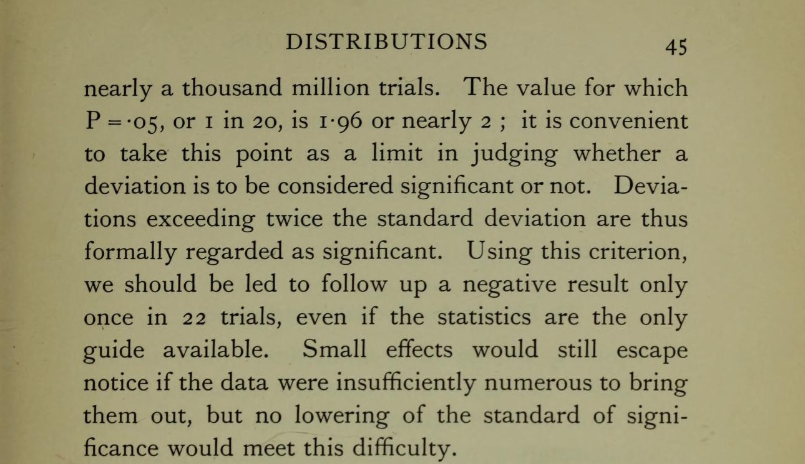

```{r}
#| label: setup
source(here::here("R/ppdac.R"))
source(here::here("R/aula07.R"))
pinus <- dados_pinus()
```

## Hoje

1. **Teste de hipótese**
   - Lista de passos
   - Exemplo de teste: comparação de médias
   - Hipótese nula e alternativa
   - Erro tipo I e tipo II
2. **Tomada de decisão**: o valor de *P*
3. **Poder do teste**
4. **Escolha do teste**

::: {.nota}
As figuras desta aula foram geradas em R com dados simulados; os retratos
de Karl Pearson e Ronald Fisher são de domínio público. O código está em
[`R/`](https://github.com/diogoprov/bioestatistica/tree/main/R) no
repositório da disciplina.
:::

---

## Onde estamos no ciclo PPDAC

```{r}
#| fig-width: 6.4
#| fig-height: 5.1
#| out-width: "45%"
#| fig-alt: "Ciclo PPDAC com as etapas Problema, Plano, Análise e Conclusão destacadas nas suas cores; Dados em cinza."
ppdac_plot(destaque = c("Problema", "Plano", "Análise", "Conclusão"))
```

O teste de hipótese atravessa o ciclo: começa na pergunta (**Problema**),
fixa as regras antes da coleta (**Plano**) e termina numa decisão
(**Análise** e **Conclusão**).

---

## Leituras

- Triola, M.F. *Introdução à estatística*, cap. 8.
- Bussab, W.O. & Morettin, P.A. *Estatística básica*, cap. 12.
- Gotelli, N.J. & Ellison, A.M. *Princípios de estatística em ecologia*,
  cap. 4.

---

## Arcabouço Neyman-Pearson para testar uma hipótese estatística

:::: {.columns}
::: {.column width="30%"}
{width="85%" fig-alt="Fotografia em preto e branco do jovem Ronald Fisher, de óculos e terno."}
:::
::: {.column width="70%"}
- **Ronald A. Fisher** propôs o valor de *P* como medida de evidência
  contra a hipótese nula.
- **Jerzy Neyman** e **Egon Pearson** propuseram o arcabouço de decisão:
  hipótese nula *e* alternativa, nível de significância fixado antes e os
  dois tipos de erro.
- O teste que usamos hoje é uma mistura das duas ideias.

::: {.nota}
Retrato de Fisher: domínio público, via Wikimedia Commons. Não há retratos
de Neyman e de Egon Pearson com licença aberta.
:::
:::
::::

---

## O roteiro: oito passos de um teste de hipótese

```{r}
#| fig-width: 11
#| fig-height: 4.6
#| fig-alt: "Fluxograma em oito passos: 1, identificar a afirmativa e escrevê-la na forma simbólica; 2, dar a forma simbólica que vale quando a afirmativa é falsa; 3, hipóteses nula e alternativa; 4, nível de significância; 5, estatística do teste. Daí o caminho se divide: pelo método do valor P, calcular o valor P e rejeitar H0 se P for menor ou igual a alfa; pelo método do valor crítico, achar os valores críticos e rejeitar H0 se a estatística cair na região crítica. Os dois caminhos chegam ao passo 8, a conclusão em termos não técnicos."
fig_roteiro()
```

::: {.ref}
Inspirado na Figura 8.1 de Triola 2024, *Introdução à estatística*.
:::

# 1. Identificar a afirmativa {.secao}

[Problema]{.ppdac-etapa .problema} → [Plano]{.ppdac-etapa .plano}

---

## Passos 1 e 2

```{r}
#| fig-width: 11
#| fig-height: 4.6
#| out-width: "80%"
#| fig-alt: "O fluxograma dos oito passos com os passos 1 e 2 em destaque."
fig_roteiro(1:2)
```

1. Identifique a afirmativa a ser testada e expresse-a na forma simbólica.
2. Dê a forma simbólica que deve ser verdadeira quando a afirmativa
   original é falsa.

---

## Da pergunta à predição

:::: {.columns}
::: {.column width="45%"}
```{r}
#| fig-width: 5
#| fig-height: 5
#| fig-alt: "Diagrama vertical: Pergunta leva, pela teoria, à Hipótese; a Hipótese leva, por dedução, à Predição."
fig_pergunta_hipotese()
```
:::
::: {.column width="55%"}
- **Pergunta:** as alturas médias de plantas adultas de *Pinus* diferem
  entre áreas com solo argiloso e rochoso?
- **Hipótese científica:** a disponibilidade de recursos/nutrientes no
  solo influencia a altura de plantas.
- **Predição:** a altura média das plantas **será maior** no solo
  argiloso, devido à maior disponibilidade de nutrientes.
:::
::::

---

## Hipótese científica vs. hipótese estatística

- **Hipótese científica:** uma ideia geral e testável sobre como o mundo
  funciona.
  - *Exemplo:* "A presença do predador X afeta o comportamento de
    forrageamento da presa Y".
- **Hipótese estatística:** uma reformulação da hipótese científica em
  termos matemáticos e precisos, envolvendo parâmetros populacionais
  (médias, proporções etc.).
  - *Exemplo:* "A média do tempo de forrageamento da presa Y na presença do
    predador X é diferente da média na ausência do predador X".

---

## Unidade amostral

Qual destes desenhos testa a pergunta?

```{r}
#| fig-width: 11
#| fig-height: 5
#| out-width: "92%"
#| fig-alt: "À esquerda, 20 áreas separadas, 10 de solo argiloso e 10 de solo rochoso, cada uma com uma parcela. À direita, só duas áreas grandes, uma de cada solo, com 10 parcelas em cada."
fig_unidade_amostral()
```

---

## Unidade amostral

```{r}
#| fig-width: 11
#| fig-height: 5
#| out-width: "82%"
#| fig-alt: "A mesma figura com um sinal de certo nas 20 áreas independentes e um X nas duas áreas com 10 parcelas cada."
fig_unidade_amostral(marca = TRUE)
```

Com só duas áreas, as 10 parcelas de cada solo são **pseudorréplicas**:
qualquer diferença entre as duas áreas, e não só o solo, explicaria o
resultado (Aula 2).

---

## Variáveis *preditora* e *resposta*

:::: {.columns}
::: {.column width="50%"}
::: {.definicao}
**Preditora**

Tipos de solo

(categórica com 2 níveis)
:::
:::
::: {.column width="50%"}
::: {.definicao}
**Resposta**

Altura das plantas

(contínua)
:::
:::
::::

# 3. Hipótese nula e alternativa {.secao}

[Problema]{.ppdac-etapa .problema}

---

## Passo 3

```{r}
#| fig-width: 11
#| fig-height: 4.6
#| out-width: "80%"
#| fig-alt: "O fluxograma dos oito passos com o passo 3 em destaque."
fig_roteiro(3)
```

Considere as duas expressões simbólicas: a **hipótese alternativa H₁** é a
que **não** contém a igualdade (usa <, > ou ≠); a **hipótese nula H₀** é a
que diz que o parâmetro é igual ao valor fixo considerado.

---

## Hipótese nula e alternativa no exemplo

:::: {.columns}
::: {.column width="50%"}
::: {.definicao}
**Hipótese nula**

Não há diferença nas médias das alturas das árvores entre as áreas.
:::
:::
::: {.column width="50%"}
::: {.definicao}
**Hipótese alternativa**

A média de altura das árvores em áreas com solo argiloso **será maior**
do que a das em solo rochoso.
:::
:::
::::

---

## A hipótese nula (H₀): o *status quo*

- A **hipótese nula (H₀)** é sempre uma afirmação de "nenhum efeito",
  "nenhuma diferença" ou "nenhuma associação".
  - É a hipótese que *assumimos como verdadeira para iniciar o teste*.
    Ela representa o ceticismo, a ideia de que qualquer padrão observado
    nos dados é meramente fruto do acaso.
  - Sempre contém um sinal de igualdade (=, ≤ ou ≥).
- **Exemplos biológicos:**
  - H₀: a proporção de sementes que germinam com e sem um novo tratamento
    é a mesma ($p_1 = p_2$).
  - H₀: a altura média de plantas de duas populações diferentes é igual
    ($\mu_1 = \mu_2$).
  - H₀: não há correlação entre o tamanho do corpo de um animal e o tamanho
    de seu território ($\rho = 0$).

---

## A hipótese alternativa (H₁)

- A **hipótese alternativa (H₁ ou Hₐ)** é a afirmação que contradiz a
  hipótese nula. É o que o pesquisador geralmente acredita ser verdade ou
  espera demonstrar.
  - Representa a existência de um efeito, uma diferença ou uma associação.
  - Nunca contém um sinal de igualdade (geralmente usa ≠, < ou >).
- **Exemplos (em contraste com H₀):**
  - H₁: a proporção de sementes que germinam é diferente entre os
    tratamentos ($p_1 \neq p_2$).
  - H₁: a altura média das plantas é diferente entre as populações
    ($\mu_1 \neq \mu_2$).
  - H₁: existe uma correlação entre o tamanho do corpo e o tamanho do
    território ($\rho \neq 0$).

---

## Atividade 1: Slido

::: {.atividade}
Para cada cenário biológico, escrevam a **hipótese nula (H₀)** e a
**hipótese alternativa (H₁)** em termos de parâmetros populacionais.

1. Um biólogo quer saber se um novo tipo de ração (Ração A) altera o peso
   médio de camundongos em comparação com a ração padrão (Ração B).
2. Uma farmacêutica testa se a proporção de cura de um novo medicamento é
   maior que a proporção de 20% do medicamento antigo.

Respondam no [Slido da turma](https://app.sli.do/event/c8RFbj984d5b8J7d15PigR)
(pergunta aberta). Sem Slido: cada dupla escreve num papel e duas duplas
leem as suas respostas.
:::

::: {.fragment}
::: {.definicao}
1. H₀: $\mu_A = \mu_B$; H₁: $\mu_A \neq \mu_B$ ("altera" não diz a direção).
2. H₀: $p \leq 0{,}20$ (ou $p = 0{,}20$); H₁: $p > 0{,}20$.
:::
:::

# 4. Escolher o nível de significância {.secao}

[Plano]{.ppdac-etapa .plano}

---

## Passo 4

```{r}
#| fig-width: 11
#| fig-height: 4.6
#| out-width: "80%"
#| fig-alt: "O fluxograma dos oito passos com o passo 4 em destaque."
fig_roteiro(4)
```

Selecione o **nível de significância α** com base na gravidade de um erro
tipo I. Faça α pequeno se as consequências da rejeição de uma H₀
verdadeira forem severas. Os valores de 0,05 e 0,01 são muito comuns.

---

## Um pouco de história...

:::: {.columns}
::: {.column width="22%"}
{width="95%" fig-alt="Retrato de Karl Pearson, de bigode, em fotogravura."}
:::
::: {.column width="78%"}
- **1900, Karl Pearson:** calcula o valor de *P* num caso específico, o
  teste de χ².
- **1925, Ronald Fisher**, em *Statistical methods for research workers*:
  generaliza o valor de *P* para todos os casos e propõe *P* = 0,05 como
  limite para significância.
- **1933, Jerzy Neyman e Egon Pearson:** o teste como regra de decisão,
  com α fixado antes e os erros tipo I e II.
- A mistura das duas escolas gerou uma confusão que dura até hoje entre o
  *P* (evidência) e o α (taxa de erro).
:::
::::

::: {.ref}
Pearson 1900, *Philosophical Magazine* 50:157–175; Fisher 1925; Neyman &
Pearson 1933, *Philosophical Transactions of the Royal Society A*
231:289–337; Hubbard & Bayarri 2003, *The American Statistician*
57:171–178. Retrato: domínio público, via Wikimedia Commons.
:::

---

## De onde vem o *P* = 0,05?

{width="54%" fig-align="center" fig-alt="Trecho da página 45 de Statistical methods for research workers, de Fisher, em inglês: o valor para o qual P = 0,05, ou 1 em 20, é 1,96, ou quase 2; é conveniente tomar este ponto como limite para julgar se um desvio deve ser considerado significativo ou não."}

"O valor para o qual *P* = 0,05, ou 1 em 20, é 1,96, ou quase 2; é
**conveniente** tomar este ponto como limite para julgar se um desvio deve
ser considerado significativo ou não."

::: {.ref}
Fisher, R.A. 1928. *Statistical methods for research workers*, 2ª ed., p. 45. Oliver & Boyd. Digitalização do Internet Archive; domínio público. Tradução nossa.
:::

---

## Nível de significância

- Famoso e incauto "valor de *P*" (*P-value*)
- Os valores de alfa mais utilizados são 1%, 5% e 10%
- Então, por que não diminuir o α para próximo de zero?
  - Porque, se fizermos isso, quase nunca seríamos capazes de coletar
    dados com um padrão forte o suficiente para rejeitá-la, mesmo que ela
    seja falsa. Ou seja, aumentamos a chance de cometer o erro tipo II

::: {.nota}
α e *P* não são a mesma coisa: o **α** é escolhido **antes** de coletar os
dados (é a regra do jogo); o **valor de *P*** é calculado **depois**, a
partir dos dados, e é comparado com o α.
:::

---

## A declaração da ASA sobre o valor de *P*

Em 2016, a American Statistical Association publicou seis princípios sobre
o valor de *P*. Em resumo:

1. O valor de *P* indica o quanto os dados são incompatíveis com um modelo
   estatístico (por exemplo, com H₀).
2. Ele **não** mede a probabilidade de a hipótese ser verdadeira, nem a de
   os dados terem sido produzidos só pelo acaso.
3. Conclusões científicas não devem se basear só em o *P* passar ou não de
   um limiar.
4. Uma inferência correta exige relato completo e transparência.
5. O valor de *P*, ou a significância estatística, **não** mede o tamanho
   de um efeito nem a importância de um resultado.
6. Sozinho, o valor de *P* não é uma boa medida de evidência sobre um
   modelo ou hipótese.

::: {.ref}
Wasserstein, R.L. & Lazar, N.A. 2016. [The ASA statement on *p*-values:
context, process, and purpose](https://doi.org/10.1080/00031305.2016.1154108).
*The American Statistician* 70:129–133.
:::

# 5. Escolher a estatística do teste {.secao}

[Plano]{.ppdac-etapa .plano} → [Análise]{.ppdac-etapa .analise}

---

## Passo 5

```{r}
#| fig-width: 11
#| fig-height: 4.6
#| out-width: "80%"
#| fig-alt: "O fluxograma dos oito passos com o passo 5 em destaque."
fig_roteiro(5)
```

Identifique a estatística de teste relevante para o teste e determine sua
distribuição amostral (tal como normal, *t*, qui-quadrado).

---

## Qual teste usar? {.medio}

Sugestão de alguns testes estatísticos a empregar de acordo com o tipo de
variável observada. Entre parênteses, alguns testes não paramétricos.

| Variável dependente | Variável independente | Teste |
|---|---|---|
| Quantitativa | 1 categórica com 2 níveis | **Teste *t* (teste U)** |
| Quantitativa | 1 categórica com + 2 níveis | ANOVA 1 fator (Kruskal-Wallis) |
| Quantitativa | 2 categóricas | ANOVA 2 fatores (Friedman¹) |
| Quantitativa | 1 quantitativa | Regressão simples (correlação de Spearman) |
| Quantitativa | 2 ou mais quantitativas | Regressão múltipla |
| Quantitativa | 1 categórica e 1 ou mais quantitativas | ANCOVA |
| Categórica | 1 categórica | Qui-quadrado²; teste G² |
| Categórica | 2 ou mais categóricas | Log-linear² |

(1) No caso de amostras dependentes. (2) Esses testes eventualmente
verificam não a relação de dependência entre variáveis, mas sim a
associação entre elas, descaracterizando, portanto, a classificação de
variáveis dependentes e independentes.

::: {.ref}
Tabela 1 da apostila de Paglia & De Marco. No nosso exemplo (altura ×
tipo de solo), o teste é o *t*.
:::

# 6. Valor crítico do teste {.secao}

[Análise]{.ppdac-etapa .analise}

---

## Como escolher valores críticos

- São valores da estatística do teste a partir dos quais se pode rejeitar
  a hipótese de que a estatística veio de uma distribuição nula, com um
  certo nível de confiança (probabilidade), dado o tamanho amostral.
- A **região crítica** é a região onde H₀ é rejeitada. A área da região
  crítica é igual ao nível de significância (α), que estabelece a
  probabilidade de rejeitar H₀ quando ela é verdadeira.
- Por exemplo, se utilizarmos o nível de significância de 5%, a
  probabilidade de rejeitar H₀ quando ela é verdadeira é igual a 5%.

---

## A região crítica

```{r}
#| fig-alt: "Normal padrão com as duas caudas sombreadas além de −1,96 e 1,96, cada uma com área 0,025: são as regiões críticas, onde se rejeita H0. O meio é a região de não rejeição."
fig_regiao_critica()
```

---

## Região crítica, valor crítico e estatística do teste {.medio}

::: {.atividade}
**Exemplo (dados fictícios).** Numa praia de desova, 482 de 926 filhotes
de tartaruga são fêmeas ($\hat{p} = 0{,}52$). A proporção de fêmeas é
maior que 0,5? H₀: $p = 0{,}5$; H₁: $p > 0{,}5$.
:::

```{r}
#| fig-alt: "Normal padrão com a cauda direita sombreada além do valor crítico 1,645 (alfa = 0,05). A seta vermelha da estatística do teste, z = 1,25, cai fora da região crítica."
fig_regiao_critica("dir", obs = z_tartarugas()) +
  annotate("text", x = 2.9, y = .12, label = "α = 0,05", size = 4.5)
```

::: {.ref}
Inspirado na Figura 8.4 de Triola 2024, com um contexto biológico.
:::

---

## Decisão é baseada na hipótese nula

- Se o valor da estatística do teste cair na região crítica, rejeita-se
  H₀.
- Ou **rejeitamos** H₀
  - No exemplo, há diferença entre a média de altura dos grupos
- Ou **não rejeitamos** H₀
  - No exemplo, não há evidência de diferença entre as médias dos grupos

::: {.nota}
Não rejeitar não é o mesmo que provar que
H₀ é verdadeira: os dados apenas não trouxeram evidência suficiente contra
ela. É o que diz o próximo slide.
:::

---

## Princípio da falseabilidade

::: {.definicao}
Só conseguimos **falsear** uma hipótese.
:::

- Nenhum número de observações confirma uma hipótese de vez; uma
  observação contrária pode refutá-la.
- Por isso o teste é montado contra H₀: buscamos evidência para
  rejeitá-la.

::: {.ref}
Popper, K. *A lógica da pesquisa científica*.
:::

---

## Erro tipo I e tipo II {.secao}

---

## Falso positivo e falso negativo

:::: {.columns}
::: {.column width="50%"}
[**Erro tipo I: falso positivo**]{.erro-titulo .tipo1}

{height="340px" fig-align="center" fig-alt="Ilustração de uma consulta: um médico sorridente, de jaleco e estetoscópio, fala com um senhor idoso de cabelo branco e suéter azul, que o olha espantado."}

::: {.fala}
"O senhor está grávido!"
:::
:::
::: {.column width="50%"}
[**Erro tipo II: falso negativo**]{.erro-titulo .tipo2}

{height="340px" fig-align="center" fig-alt="Ilustração de uma consulta: uma médica sorridente, de jaleco, fala com uma mulher grávida de nove meses, com as mãos na barriga, que a olha surpresa."}

::: {.fala}
"Você não está grávida!"
:::
:::
::::

::: {.nota}
Ilustrações geradas por IA (Gamma), a partir de uma piada clássica sobre os dois tipos de erro.
:::

---

## As quatro situações possíveis

::: {.tabela-grande}
| Decisão | H₀ é verdadeira | H₀ é falsa |
|---|---|---|
| Não rejeitar H₀ | Decisão correta | Erro do tipo II (β) |
| Rejeitar H₀ | Erro do tipo I (α) | Decisão correta (poder) |
:::

---

## A balança entre os dois erros

```{r}
#| fig-alt: "Duas curvas: a distribuição da estatística se H0 for verdadeira (contínua) e se H1 for verdadeira (tracejada). Uma linha vertical marca o valor crítico. À direita dela, sob a curva de H0, a área vermelha é alfa, o erro tipo I; à esquerda, sob a curva de H1, a área azul é beta, o erro tipo II. Beta = 0,28 e poder = 0,72."
fig_alfa_beta()
```

Mover o valor crítico para a direita diminui α, mas aumenta β; para a
esquerda, o contrário.

---

## Erro tipo I

::: {.tabela-grande}
| Decisão | H₀ é verdadeira | H₀ é falsa |
|---|---|---|
| Não rejeitar H₀ | Decisão correta | Erro do tipo II (β) |
| Rejeitar H₀ | [**Erro do tipo I (α)**]{style="color:#c0392b"} | Decisão correta (poder) |
:::

- **Erro tipo I** (*nível de significância, ou α*): define a probabilidade
  máxima que estamos dispostos a aceitar de cometer um erro do tipo I.
- *O que significa?* Sempre que a probabilidade calculada por um teste for
  menor ou igual a α, deve-se rejeitar a hipótese nula, por ela ser
  *menos plausível* que o nível crítico adotado.

---

## Por que a decisão se baseia no erro tipo I?

::: {.definicao}
A decisão é baseada no erro tipo I (alfa), porque é considerado o mais
grave e porque os testes pressupõem que a hipótese nula seja verdadeira.
:::

---

## A consequência do erro define o α

:::: {.columns}
::: {.column width="62%"}
```{=html}
<div class="juri" role="img" aria-label="Matriz dois por dois do tribunal do júri. Colunas: réu inocente (H0 verdadeira) ou culpado (H0 falsa). Linhas: condenado (rejeita H0) ou absolvido (não rejeita H0). Inocente condenado: erro tipo I, falso positivo, probabilidade alfa. Culpado condenado: decisão correta, poder 1 menos beta. Inocente absolvido: decisão correta, 1 menos alfa. Culpado solto: erro tipo II, falso negativo, probabilidade beta.">
<div class="juri-canto">Veredito ↓ · Realidade →</div>
<div class="juri-col">Réu é inocente<br><span>H₀ verdadeira</span></div>
<div class="juri-col">Réu é culpado<br><span>H₀ falsa</span></div>
<div class="juri-lin">Condenado<br><span>rejeita H₀</span></div>
<div class="juri-cel erro"><div class="juri-tit">Erro tipo I</div><div class="juri-sub">falso positivo: inocente preso</div><div class="juri-prob">P = α</div></div>
<div class="juri-cel certo"><div class="juri-tit">Decisão correta</div><div class="juri-sub">culpado condenado</div><div class="juri-prob">poder = 1 − β</div></div>
<div class="juri-lin">Absolvido<br><span>não rejeita H₀</span></div>
<div class="juri-cel certo"><div class="juri-tit">Decisão correta</div><div class="juri-sub">inocente absolvido</div><div class="juri-prob">1 − α</div></div>
<div class="juri-cel erro"><div class="juri-tit">Erro tipo II</div><div class="juri-sub">falso negativo: culpado solto</div><div class="juri-prob">P = β</div></div>
</div>
```
:::
::: {.column width="38%"}
A escolha do nível de significância e o balanço entre os dois tipos de
erro dependem da consequência do erro.

Pense num tribunal do júri, em que H₀ é "o réu é inocente".

Num julgamento, condenar um inocente é considerado o erro mais grave; por
isso se exige prova "além de qualquer dúvida razoável", um α pequeno.
:::
::::

::: {.nota}
Ícones: ilustração feita com IA (Gemini).
:::

---

## Erro tipo II (β)

::: {.tabela-grande}
| Decisão | H₀ é verdadeira | H₀ é falsa |
|---|---|---|
| Não rejeitar H₀ | Decisão correta | [**Erro do tipo II (β)**]{style="color:#2f5f88"} |
| Rejeitar H₀ | Erro do tipo I (α) | Decisão correta (poder) |
:::

A chance de cometer o erro tipo II (β) depende:

- do nível de significância (quanto maior o α, menor o β);
- do tamanho amostral (quanto maior, menor o β);
- do tamanho do efeito: o quão afastada a realidade está da hipótese nula
  (quanto mais, menor o β);
- da variabilidade natural dos dados não explicada pelo efeito testado
  (quanto maior, maior o β).

---

## O que muda o β

```{r}
#| fig-width: 11
#| fig-height: 5.6
#| out-width: "92%"
#| fig-alt: "Cinco painéis com as curvas de H0 e H1 e as áreas alfa e beta. Em relação à referência (beta 0,28, poder 0,72): alfa maior dá beta 0,17; n = 50 dá beta 0,03; efeito maior dá beta 0,03; variabilidade maior dá beta 0,60."
fig_poder()
```

---

## Poder do teste = 1 − β

- Ao reduzir o beta, aumentamos o poder do teste
- **Poder:** a probabilidade de *rejeitar* a hipótese nula quando ela é
  realmente FALSA. Um teste poderoso é aquele capaz de detectar pequenos
  efeitos, ou seja, pequenos desvios da hipótese nula.
- Mas como podemos fazer isso?
  - Reduzir o erro de estimativa
  - Aumentar o tamanho amostral
  - Aumentar a diferença nos tratamentos/grupos
  - Utilizar o desenho amostral/experimental correto
  - Aumentar o erro tipo I

# 7. Calcular a estatística do teste {.secao}

[Análise]{.ppdac-etapa .analise}

---

## Passos 6 e 7

```{r}
#| fig-width: 11
#| fig-height: 4.6
#| out-width: "80%"
#| fig-alt: "O fluxograma dos oito passos com os passos 6 e 7 dos dois métodos em destaque."
fig_roteiro(6:7)
```

- **Método do valor P:** ache o valor da estatística de teste e o valor
  *P*; rejeite H₀ se $P \leq \alpha$.
- **Método do valor crítico:** ache a estatística de teste e os valores
  críticos; rejeite H₀ se a estatística estiver na região crítica.

---

## A estatística do teste

- É um valor calculado a partir dos dados da amostra, usado para decidir
  se rejeitamos ou não H₀.
- Ela mede a diferença entre o que foi observado na amostra e o que seria
  esperado sob a hipótese nula, em unidades de erro padrão.
- **A ideia central:** se a estatística de teste for muito "extrema"
  (longe do que H₀ prevê), ela fornece evidências contra H₀.
- Cada teste de hipótese (teste *t*, qui-quadrado etc.) tem sua própria
  estatística de teste (*t*, χ² etc.).

---

## Região crítica e valor de *P*: dois caminhos para a mesma decisão

Temos duas abordagens principais para tomar a decisão final.

**Abordagem do valor crítico:**

- A **região crítica** (ou região de rejeição) é o conjunto de todos os
  valores da estatística de teste que nos levariam a rejeitar H₀.
- O **valor crítico** é o ponto que separa a região de rejeição da região
  de não rejeição. Ele é determinado pelo nível de significância α.
- **Decisão:** se a estatística de teste calculada a partir dos seus dados
  cai na região crítica, você rejeita H₀.

---

## Região crítica e valor de *P*: dois caminhos para a mesma decisão

**Abordagem do valor de *P*:**

- O **valor de *P*** é a probabilidade de obter um resultado (uma
  estatística de teste) ***tão ou mais extremo do que o que foi observado
  na amostra, assumindo que a hipótese nula (H₀) é verdadeira***.
- **Decisão:** se o valor de *P* for menor ou igual ao nível de
  significância α, você rejeita H₀.
  - **Se $P \leq \alpha$ → rejeita-se H₀** (resultado estatisticamente
    significante)
  - **Se $P > \alpha$ → não se rejeita H₀** (resultado não
    estatisticamente significante)

---

## Os dois métodos no exemplo das tartarugas

```{r}
#| fig-width: 11
#| fig-height: 4.2
#| fig-alt: "Dois painéis. À esquerda, método do valor P: a área sob a normal à direita de z = 1,25 é o valor P, 0,1056. À direita, método do valor crítico: a região crítica começa em 1,645 e o z observado de 1,25 cai fora dela. Os dois levam a não rejeitar H0."
fig_dois_metodos()
```

$P = 0{,}1056 > 0{,}05$ e $z = 1{,}25 < 1{,}645$: pelos dois caminhos,
**não rejeitamos H₀**.

::: {.ref}
Inspirado nas Figuras 8.6 e 8.7 de Triola 2024; dados fictícios.
:::

---

## Atividade 2: "Decifrando o valor de *P*" (10 minutos)

::: {.atividade}
**Instruções:** formem pequenos grupos (4–5 alunos). Discutam o cenário e
preparem uma resposta.

**Cenário:** um pesquisador realizou um experimento para testar se um novo
tratamento melhora a sobrevivência de corais. Ele definiu α = 0,05. Ao
final da análise, ele obteve um valor de ***P* = 0,03**.

**Perguntas para o grupo:**

1. Qual é a decisão estatística que o pesquisador deve tomar em relação à
   sua hipótese nula?
2. O que um valor de *P* de 0,03 significa em termos de probabilidade,
   considerando a hipótese nula?
3. Se o valor de *P* fosse 0,25, qual seria a decisão e a interpretação?
:::

::: {.fragment}
::: {.definicao}
1. Rejeitar H₀, pois $0{,}03 \leq 0{,}05$.
2. **Se o tratamento não tivesse efeito**, a chance de obter uma diferença
   tão grande ou maior que a observada seria de 3%. Não é a chance de H₀
   ser verdadeira.
3. Não rejeitar H₀: os dados não trazem evidência suficiente de efeito, o
   que **não** prova que o tratamento é inútil.
:::
:::

---

## Testes unicaudais vs. bicaudais {.smaller}

A escolha depende de como a hipótese alternativa (H₁) é formulada.

:::: {.columns}
::: {.column width="50%"}
**Teste bicaudal:**

- Usado quando H₁ afirma que existe uma diferença, mas não especifica a
  direção (≠).
- A região de rejeição é dividida nas duas caudas da distribuição.
- *Exemplo:* H₁: $\mu_1 \neq \mu_2$.
:::
::: {.column width="50%"}
**Teste unicaudal:**

- Usado quando H₁ especifica a direção da diferença (< ou >).
- A região de rejeição fica em apenas uma cauda da distribuição.
- *Exemplo à esquerda:* H₁: $\mu < 100$.
- *Exemplo à direita:* H₁: $p > 0{,}5$.
:::
::::

```{r}
#| fig-width: 11
#| fig-height: 3
#| out-width: "72%"
#| fig-alt: "Três curvas normais: bicaudal, com as duas caudas sombreadas; unicaudal à esquerda, com a cauda esquerda sombreada; unicaudal à direita, com a cauda direita sombreada."
fig_caudas()
```

::: {.ref}
Inspirado na Figura 8.2 de Triola 2024.
:::

---

## Como a escolha errada do tipo de teste pode afetar nossas conclusões {.medio}

- **Contexto:** um biólogo quer testar se um novo fertilizante afeta a
  altura média de uma espécie de planta. A altura média histórica
  (placebo) é de 30 cm.
- **Experimento:** ele cultiva um grupo de *n* = 30 plantas com o novo
  fertilizante.
- **Nível de significância:** α = 0,05.
- **Resultado do experimento:** após coletar os dados, ele calcula sua
  estatística de teste (vamos usar o *t* de Student, pois o desvio-padrão
  da população é desconhecido, mas o *Z* funciona igual).
  - **Estatística de teste calculada: $t_{obs} = 1{,}80$**
  - Isso significa que a média da amostra dele foi 1,80 **erros padrão**
    acima da média de 30 cm.

Agora, vamos analisar a conclusão de dois pesquisadores diferentes usando
exatamente o mesmo dado ($t = 1{,}80$), com graus de liberdade
$gl = n - 1 = 29$.

::: {.nota}
Com *n* = 30, *gl* = 29; o *t* mede a distância em erros padrão, não em
desvios-padrão.
:::

---

## O pesquisador cético (teste bicaudal)

Este pesquisador não sabe o que esperar.

- **Pergunta:** "O fertilizante *altera* a altura (para mais ou para
  menos)?"
- **Hipótese alternativa (Hₐ):** $\mu \neq 30$ cm
- **Análise:** ele divide o α = 0,05. Ele precisa de 2,5% em cada cauda.
- **Valor crítico:** para *gl* = 29 e α/2 = 0,025, o valor crítico de *t*
  (que ele procura na tabela) é $t_{crítico} = \pm 2{,}045$.
- **Regra de decisão:** ele só rejeita H₀ se $t_{obs} > +2{,}045$ ou
  $t_{obs} < -2{,}045$.
- **Comparação:** o $t_{obs}$ foi 1,80; 1,80 é **menor** que 2,045. O
  valor **não caiu** na região de rejeição.
- **Conclusão (bicaudal):** "Não há evidência (*P* > 0,05) de que o
  fertilizante altere a altura média das plantas."

---

## O pesquisador otimista (teste unicaudal)

Este pesquisador sabe, baseado em teoria, que o fertilizante aumenta o
crescimento.

- **Pergunta:** "O fertilizante *aumenta* a altura?"
- **Hipótese alternativa (Hₐ):** $\mu > 30$ cm
- **Análise:** ele "aposta tudo" na cauda superior. Ele coloca α = 0,05
  inteiro de um só lado.
- **Valor crítico:** para *gl* = 29 e α = 0,05 (unicaudal), o valor
  crítico de *t* é $t_{crítico} = +1{,}699$.
- **Regra de decisão:** ele rejeita H₀ se $t_{obs} > +1{,}699$.
- **Comparação:** o $t_{obs}$ foi 1,80; 1,80 é **maior** que 1,699. O
  valor **caiu** na região de rejeição.
- **Conclusão (unicaudal):** "Há evidência (*P* < 0,05) de que o
  fertilizante aumenta a altura média das plantas."

---

## Mesmo resultado (*t* = 1,80), conclusões diferentes!

```{r}
#| fig-width: 11
#| fig-height: 4.2
#| fig-alt: "Dois painéis com a distribuição t de 29 graus de liberdade. À esquerda, teste bicaudal: as regiões críticas começam em −2,045 e 2,045, e a seta vermelha em t = 1,80 cai fora delas. À direita, teste unicaudal: a região crítica começa em 1,699 e a seta verde em t = 1,80 cai dentro dela."
fig_cetico_otimista()
```

---

## A escolha vem antes dos dados

- O mesmo resultado do experimento (*t* = 1,80) foi "não significativo"
  para um pesquisador e "significativo" para outro.
- O mais importante é: **a escolha entre bicaudal e unicaudal não pode ser
  feita depois que você olha os dados.** Isso seria "trapacear" (prática
  chamada de *p-hacking*). Se o pesquisador cético visse que seu
  *t* = 1,80 "quase" deu significativo, ele não poderia simplesmente dizer
  "Ah, vou fingir que eu queria um teste unicaudal desde o início".
- A escolha deve ser feita **antes do experimento**, baseada na teoria
  biológica que justifica uma hipótese direcional. Se não há uma forte
  razão teórica para prever a direção, o teste bicaudal (mais
  conservador) é o padrão.

---

## Resumo

::: {.tabela-grande}
| Característica | Cenário 1 (bicaudal) | Cenário 2 (unicaudal) |
|---|---|---|
| Pergunta de pesquisa | O fertilizante *altera* a altura? | O fertilizante *aumenta* a altura? |
| Hipótese alternativa (Hₐ) | $\mu \neq 30$ | $\mu > 30$ |
| Risco α (0,05) | Dividido: 2,5% em cada cauda | Concentrado: 5% na cauda superior |
| Valor crítico ($t_{crítico}$) | ±2,045 | +1,699 |
| Estatística calculada | *t* = 1,80 | *t* = 1,80 |
| Comparação | 1,80 < 2,045 | 1,80 > 1,699 |
| Conclusão | **Não significativo** | **Significativo** |
:::

---

## De volta aos *Pinus*: os dados

```{r}
#| fig-alt: "Curvas de densidade da altura das plantas de Pinus nos dois solos: a do solo argiloso fica um pouco à direita da do solo rochoso, com muita sobreposição; cada solo tem um valor baixo isolado perto de 18–19 m."
fig_pinus_densidade(pinus)
```

25 plantas em cada solo (dados simulados).

---

## Teste *t* para amostras independentes e variâncias separadas

$$t = \frac{\bar{X}_1 - \bar{X}_2}{\sqrt{\dfrac{s_1^2}{N_1} + \dfrac{s_2^2}{N_2}}}$$

::: {.columns}
::: {.column width="50%"}
::: {.definicao}
**Em linguagem humana...**

$$\frac{\text{Sinal}}{\text{Ruído}} = \frac{\text{Diferença na média dos grupos}}{\text{Variabilidade dos grupos}}$$
:::
:::
::::

---

## Calculando a estatística do teste no R {.smaller}

```{r}
#| echo: true
#| class-output: codigo-compacto
head(pinus, 4)
t.test(altura ~ solo, data = pinus, alternative = "greater")
```

::: {.nota}
`alternative = "greater"` pede o teste unicaudal da predição (argiloso >
rochoso). O `t.test()` usa por padrão a fórmula com variâncias separadas
(Welch), a mesma do slide anterior.
:::

---

## Lendo a saída do R

```{r}
tt_pinus <- t.test(altura ~ solo, data = pinus, alternative = "greater")
```

- **`t`** = `r num_br(tt_pinus$statistic, 3)`: a estatística do teste.
- **`df`** = `r num_br(tt_pinus$parameter, 1)`: os graus de liberdade.
- **`p-value`** = `r num_br(tt_pinus$p.value, 4)`: o valor de *P*.
- **`alternative hypothesis`**: a H₁ testada (diferença maior que 0).
- **`mean in group`**: as médias de cada solo,
  `r num_br(tt_pinus$estimate[1], 2)` m e
  `r num_br(tt_pinus$estimate[2], 2)` m.

---

## E se não houvesse a distribuição *t*?

```{r}
obs_pinus <- dif_medias(pinus$altura, pinus$solo)
p_perm <- mean(permuta_pinus(pinus) >= obs_pinus - 1e-9)
```

Se o solo **não** afeta a altura (H₀), o rótulo "argiloso" ou "rochoso"
de cada planta é arbitrário: qualquer arranjo dos rótulos seria tão
provável quanto o observado.

1. Calcule a diferença entre as médias observada:
   `r num_br(obs_pinus, 2)` m.
2. **Embaralhe os rótulos** de solo entre as 50 plantas e recalcule a
   diferença.
3. Repita milhares de vezes. As diferenças formam a **distribuição
   nula**, construída com os próprios dados.
4. O valor de *P* é a proporção de embaralhamentos com diferença igual ou
   maior que a observada.

::: {.ref}
Dormann, C.F. & Ellison, A.M. 2025. *Statistics by simulation*. Princeton University Press. Manly, B.F.J. & Navarro Alberto, J.A. 2020. *Randomization, bootstrap and Monte Carlo methods in biology*. 4ª ed. Chapman & Hall/CRC.
:::

---

## Atividade: embaralhe os rótulos (10 min)

::: {.atividade}
1. Cada grupo recebe 12 cartões com alturas de *Pinus*: 6 de solo
   argiloso e 6 de solo rochoso. Calculem a diferença entre as médias.
2. **Embaralhem os cartões** e dividam em duas pilhas de 6, uma
   "argilosa" e uma "rochosa". Calculem a nova diferença.
3. Repitam o passo 2 cinco vezes e marquem as diferenças num diagrama de
   pontos no quadro, junto com as dos outros grupos.

Quantas diferenças embaralhadas são tão grandes quanto a observada? O que
isso diz sobre H₀?
:::

---

## O teste de permutação dos *Pinus*

```{r}
#| fig-width: 10
#| fig-height: 4
#| fig-alt: "Histograma de 5.000 diferenças entre as médias de altura com os rótulos de solo embaralhados, centrado em zero e indo de cerca de menos 0,8 a mais 0,85 metro. Uma linha vertical marca a diferença observada, de 0,34 metro; as barras à direita dela estão destacadas e somam cerca de 14% dos embaralhamentos."
fig_permutacao(pinus)
```

O *P* da permutação (`r num_br(p_perm, 3)`) é quase igual ao do teste *t*
(`r num_br(tt_pinus$p.value, 3)`), sem nenhuma suposição sobre a forma da
distribuição. A decisão é a mesma: não rejeitamos H₀.

---

## Passo a passo de um teste de hipóteses

1. **Formule as hipóteses:** defina a hipótese nula (H₀) e a hipótese
   alternativa (H₁) a partir da pergunta de pesquisa.
2. **Defina o nível de significância:** escolha o valor de α (geralmente
   0,05).
3. **Calcule a estatística de teste:** use a fórmula apropriada para seus
   dados (ex.: teste *z*, teste *t*).
4. **Encontre o valor de *P* (ou o valor crítico):** determine a
   probabilidade associada à sua estatística de teste.
5. **Tome a decisão:** compare o valor de *P* com α (ou a estatística de
   teste com o valor crítico).
   - Rejeite H₀ ou não rejeite H₀.
6. **Interprete o resultado:** conclua em linguagem clara, respondendo à
   pergunta de pesquisa original.

# 8. Tomada de decisão: rejeitar ou não a hipótese nula? {.secao}

[Conclusão]{.ppdac-etapa .conclusao}

---

## Passos 7 e 8

```{r}
#| fig-width: 11
#| fig-height: 4.6
#| out-width: "80%"
#| fig-alt: "O fluxograma dos oito passos com os passos 7 e 8 em destaque."
fig_roteiro(7:8)
```

---

## A decisão no exemplo dos *Pinus*

```{r}
#| fig-alt: "Distribuição t com a região crítica unicaudal à direita sombreada. A seta vermelha da estatística observada fica à esquerda do valor crítico, na região de não rejeição de H0."
fig_pinus_decisao(pinus)
```

*t*~obs~ = `r num_br(tt_pinus$statistic, 2)`, menor que o *t*~crítico~, e
*P* = `r num_br(tt_pinus$p.value, 3)`, maior que 0,05: **não rejeitamos H₀**.

---

## Redação da conclusão final {.medio}

::: {.tabela-grande}
| | A afirmativa original **não** contém igualdade (vira H₁) | A afirmativa original contém igualdade (vira H₀) |
|---|---|---|
| **Rejeita H₀** | "Há evidência suficiente para apoiar a afirmativa de que..." (o único caso em que a afirmativa original é apoiada) | "Há evidência suficiente para garantir a rejeição da afirmativa de que..." (o único caso em que a afirmativa original é rejeitada) |
| **Não rejeita H₀** | "Não há evidência suficiente para apoiar a afirmativa de que..." | "Não há evidência suficiente para garantir a rejeição da afirmativa de que..." |
:::

::: {.fragment}
::: {.definicao}
No exemplo, a afirmativa "a altura média é maior no solo argiloso" não
contém igualdade e H₀ não foi rejeitada: **"não há evidência suficiente
para apoiar a afirmativa de que as plantas de *Pinus* são mais altas no
solo argiloso".**
:::
:::

::: {.ref}
Inspirado na Figura 8.5 de Triola 2024.
:::

---

## Como exibir os resultados em forma gráfica

:::: {.columns}
::: {.column width="55%"}
```{r}
#| fig-width: 6.4
#| fig-height: 5.2
#| fig-alt: "Boxplot da altura das plantas de Pinus no solo argiloso e no rochoso, com os pontos de cada planta: as medianas são parecidas, cerca de 22,5 e 22 m, e as caixas se sobrepõem bastante."
fig_pinus_boxplot(pinus)
```
:::
::: {.column width="45%"}
- O boxplot mostra a mediana, os quartis e cada planta.
- Na legenda ou no texto, relate a estatística, os graus de liberdade e o
  *P*: "*t*~`r num_br(tt_pinus$parameter, 1)`~ = `r num_br(tt_pinus$statistic, 2)`;
  *P* = `r num_br(tt_pinus$p.value, 3)`".
:::
::::

---

## Atividade 3: "Qual é o teste?" (Kahoot) {.secao}

[Kahoot: Teste de hipótese](https://create.kahoot.it/details/f81ec20f-f843-4cdb-957d-b2ac3922d48b)

---

## Resumo dos tópicos

::: {.definicao}
- O teste de hipóteses é a ferramenta para tomar decisões baseadas em
  dados na presença de incerteza.
- Sempre partimos da hipótese nula (H₀) e buscamos evidências para
  rejeitá-la.
- A decisão é feita comparando o **valor de *P*** com o **nível de
  significância (α)**.
- Se $P \leq \alpha$, o resultado é estatisticamente significante e
  rejeitamos H₀.
:::

---

## Recursos extras online

- Canal do YouTube *Statistics Learning Centre*: vídeos "Hypothesis
  testing (difference of two means)", "Choosing the test" e
  "Understanding the p-value".
- [Apostila de estatística de De Marco & Paglia](https://files.cercomp.ufg.br/weby/up/85/o/Apostila_de_estat%C3%ADstica.pdf)
- Visualizações interativas de Kristoffer Magnusson: [o jogo do valor de
  *P*](https://rpsychologist.com/pvalue/) e [poder e significância](https://rpsychologist.com/d3/nhst/)

---

## Referências {.medio}

::: {.nota}
- Fisher, R.A. 1925. *Statistical methods for research workers*. Oliver & Boyd.
- Gotelli, N.J. & Ellison, A.M. *Princípios de estatística em ecologia*.
- Hubbard, R. & Bayarri, M.J. 2003. [Confusion over measures of evidence (*p*'s) versus errors (α's) in classical statistical testing](https://doi.org/10.1198/0003130031856). *The American Statistician* 57:171–178.
- Bussab, W.O. & Morettin, P.A. *Estatística básica*.
- Dormann, C.F. & Ellison, A.M. 2025. *Statistics by simulation*. Princeton University Press.
- Manly, B.F.J. & Navarro Alberto, J.A. 2020. *Randomization, bootstrap and Monte Carlo methods in biology*. 4ª ed. Chapman & Hall/CRC.
- Neyman, J. & Pearson, E.S. 1933. [On the problem of the most efficient tests of statistical hypotheses](https://doi.org/10.1098/rsta.1933.0009). *Philosophical Transactions of the Royal Society of London A* 231:289–337.
- Paglia & De Marco. Apostila de estatística (Tabela 1).
- Pearson, K. 1900. [On the criterion that a given system of deviations from the probable in the case of a correlated system of variables is such that it can be reasonably supposed to have arisen from random sampling](https://doi.org/10.1080/14786440009463897). *Philosophical Magazine* 50:157–175.
- Popper, K. *A lógica da pesquisa científica*.
- Triola, M.F. 2024. *Introdução à estatística*. LTC.
- Wasserstein, R.L. & Lazar, N.A. 2016. [The ASA statement on *p*-values: context, process, and purpose](https://doi.org/10.1080/00031305.2016.1154108). *The American Statistician* 70:129–133.
:::
