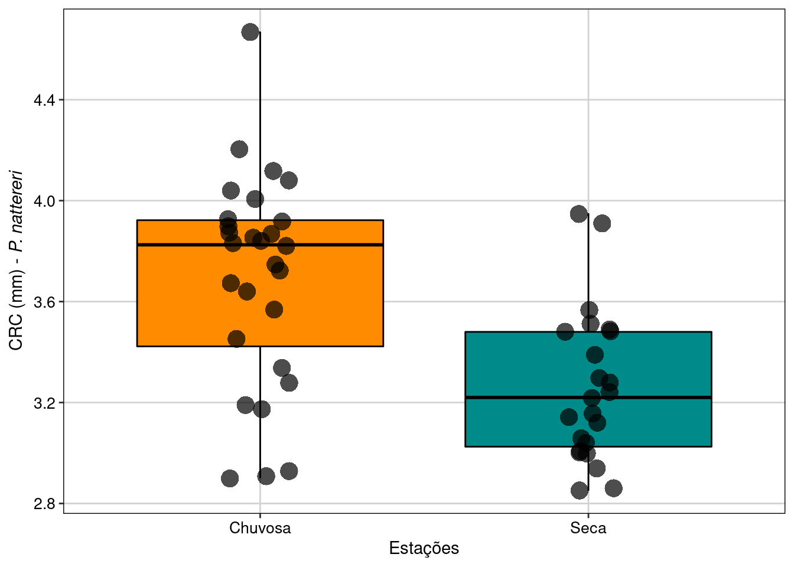
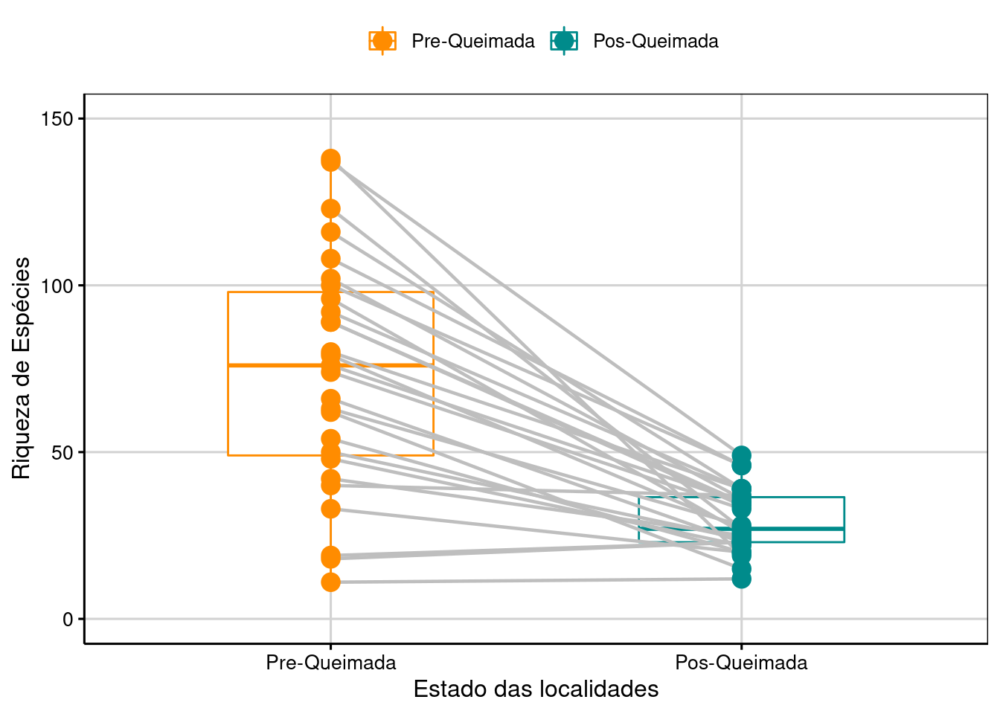

```{r}
#| label: setup
source(here::here("R/ppdac.R"))
source(here::here("R/aula08.R"))
melros <- dados_melros()
sopa <- dados_sopa()
lr <- lagartos_resumo
sp2 <- sum((lr$n - 1) * lr$dp^2) / (sum(lr$n) - 2)
t_lagartos <- diff(rev(lr$media)) / sqrt(sp2 * sum(1 / lr$n))
tt_melros <- t.test(melros$depois, melros$antes, paired = TRUE)
# número para dentro de $...$: a vírgula decimal precisa de {,} no LaTeX
num_tex <- function(v, d = 2) sub(",", "{,}", num_br(v, d), fixed = TRUE)
```

## Hoje

1. O teste *t*: hipóteses, nível de significância e erros
2. Teste *t* para uma amostra
3. Teste *t* para duas amostras: independentes e pareadas
4. Qual teste usar e como interpretar
5. O teste *t* como um tipo particular de modelo linear

::: {.nota}
As figuras desta aula foram geradas em R com dados simulados; as
silhuetas são do PhyloPic (CC0), e duas figuras vêm do livro *Análises ecológicas no R* (CC BY-NC 4.0). O código está em
[`R/`](https://github.com/diogoprov/bioestatistica/tree/main/R) no
repositório da disciplina.
:::

---

## Onde estamos no ciclo PPDAC

```{r}
#| fig-width: 6.4
#| fig-height: 5.1
#| out-width: "45%"
#| fig-alt: "Ciclo PPDAC com as etapas Análise e Conclusão destacadas nas suas cores; as demais em cinza."
ppdac_plot(destaque = c("Análise", "Conclusão"))
```

O teste *t* é a primeira ferramenta de **Análise** para comparar médias; o
modelo linear é a moldura que vai nos acompanhar até a ANOVA.

---

## Ao final desta aula, vocês serão capazes de:

- Identificar situações em que o teste *t* de Student é o teste apropriado
- Diferenciar entre o teste *t* para uma amostra, para duas amostras
  independentes e para dados pareados
- Formular hipóteses nula (H₀) e alternativa (H₁) para diferentes cenários
  biológicos
- Compreender os pressupostos do teste: normalidade e homogeneidade de
  variâncias
- Interpretar o resultado de um teste *t* (valor de *P* e estatística de
  teste) para tomar uma decisão e redigir uma conclusão contextualizada

---

## Esta aula está baseada em

- Vieira, S. *Introdução à bioestatística*, caps. 10 e 11.
- Triola, M.F. *Introdução à estatística*, cap. 9.
- Bussab, W.O. & Morettin, P.A. *Estatística básica*, caps. 12 e 13.
- Zar, J.H. *Biostatistical analysis*, caps. 7, 8 e 9.
- Quinn, G.P. & Keough, M.J. *Experimental design and data analysis for
  biologists*, 2ª ed., cap. 4.
- Gelman, A., Hill, J. & Vehtari, A. 2020. *Regression and other stories*,
  cap. 6.
- Whitlock, M.C. & Schluter, D. 2020. *The analysis of biological data*,
  3ª ed., cap. 12.

---

## Perguntas comuns

- Um novo fertilizante realmente aumenta o crescimento médio das plantas
  em comparação com o fertilizante antigo?
- A concentração de um poluente em um rio está, em média, acima do limite
  de segurança estabelecido por lei?
- Um medicamento para baixar a pressão arterial realmente funciona? Como
  podemos provar isso comparando a pressão *antes* e *depois* do
  tratamento?

::: {.nota}
**O problema central:** a média de uma amostra quase nunca será
exatamente igual à média de outra amostra ou a um valor de referência. A
questão que a estatística nos ajuda a responder é: essa diferença que
observamos é grande o suficiente para concluirmos que há uma diferença
real nas populações de onde as amostras vieram?
:::

# 1. O teste *t* {.secao}

[Análise]{.ppdac-etapa .analise}

---

## O que é um teste *t*

::: {.definicao}
*Ferramenta estatística que permite comparar médias de uma ou duas
populações. Ele avalia se as médias são significativamente diferentes,
levando em conta a média, o desvio-padrão e o tamanho da amostra.*
:::

---

## Os 4 passos do teste de hipóteses

1. **Construir as hipóteses** (H₀ e H₁).
2. **Especificar o nível de significância** (α).
3. **Calcular o valor do teste** (a estatística *t*).
4. **Interpretar o resultado** e tomar uma decisão.

---

## Hipótese nula e alternativa(s)

- **Hipótese nula (H₀):** a hipótese da "não diferença" ou da
  "nulidade".
  - Ela sempre contém o sinal de igualdade (=, ≤ ou ≥). Ex.: "A média de
    peso dos filhotes é igual a 25 kg" (H₀: μ = 25).
- **Hipótese(s) alternativa(s) (H₁, Hₐ):** contradiz a hipótese nula. É
  geralmente o que o pesquisador quer apoiar. Ex.: a média de peso é
  diferente de 25 kg (H₁: μ ≠ 25).

::: {.ref}
Vieira, *Introdução à bioestatística*, cap. 10.
:::

---

## Nível de significância e erros

::: {.tabela-grande}
| Decisão | H₀ é verdadeira | H₀ é falsa |
|---|---|---|
| Não rejeitar H₀ | Decisão correta | Erro do tipo II (β) |
| Rejeitar H₀ | Erro do tipo I (α) | Decisão correta (poder) |
:::

---

## Qual teste usar? {.smaller}

| Variável dependente | Variável independente | Teste |
|---|---|---|
| Quantitativa | 1 categórica com 2 níveis | **Teste *t* (teste U)** |
| Quantitativa | 1 categórica com + 2 níveis | ANOVA 1 fator (Kruskal-Wallis) |
| Quantitativa | 2 categóricas | ANOVA 2 fatores (Friedman¹) |
| Quantitativa | 1 quantitativa | Regressão simples (correlação de Spearman) |
| Quantitativa | 2 ou mais quantitativas | Regressão múltipla |
| Quantitativa | 1 categórica e 1 ou mais quantitativas | ANCOVA |
| Categórica | 1 categórica | Qui-quadrado²; teste G² |
| Categórica | 2 ou mais categóricas | Log-linear² |

(1) No caso de amostras dependentes. (2) Esses testes eventualmente
verificam não a relação de dependência entre variáveis, mas sim a
associação entre elas.

::: {.ref}
Tabela 1 da apostila de Paglia & De Marco.
:::

# 2. Teste *t* para uma amostra {.secao}

[Análise]{.ppdac-etapa .analise}

---

## Teste *t* para uma amostra

- **Quando usar:** para comparar a média de uma amostra com um valor de
  referência específico ($\mu_0$)
- **Exemplos biológicos:**
  - A OMS preconiza uma taxa de cesáreas de 15%. Um pesquisador coleta
    dados de uma maternidade para verificar se a taxa média é diferente
    desse valor de referência.
  - Verificar se a quantidade média de flúor em uma marca de dentifrício
    corresponde ao valor especificado na embalagem.

---

## Hipóteses uni- e bicaudais

- **Bicaudal**

$$H_0: \mu = \mu_0 \quad \text{vs.} \quad H_1: \mu \neq \mu_0$$

- **Unicaudal**

$$H_0: \mu \geq \mu_0 \quad \text{vs.} \quad H_1: \mu < \mu_0 \qquad \left(\text{ou } H_0: \mu \leq \mu_0 \quad \text{vs.} \quad H_1: \mu > \mu_0\right)$$

---

## Cálculo da estatística *t*

$$t = \frac{\bar{x} - \mu_0}{s / \sqrt{n}}$$

- Média da amostra ($\bar{x}$)
- Valor de referência ($\mu_0$)
- Desvio-padrão ($s$)
- Tamanho da amostra ($n$)

---

## Tomada de decisão

:::: {.columns}
::: {.column width="40%"}
- Compare o *t* calculado com o *t* crítico da tabela (com $n - 1$ graus
  de liberdade)
- Ou, de forma mais moderna, observe o **valor de *P*** fornecido pelo
  software
:::
::: {.column width="60%"}
```{r}
#| fig-width: 7
#| fig-height: 4.4
#| fig-alt: "Curvas da distribuição t com 1, 3 e 10 graus de liberdade e da normal: quanto menos graus de liberdade, mais baixo o pico e mais pesadas as caudas; com 10 gl a t já quase coincide com a normal."
fig_t_gl()
```
:::
::::

---

## Atividade prática 1: pense-pareie-compartilhe (10 min) {.smaller}

::: {.atividade}
**Cenário:** "Um biólogo sabe que, historicamente, uma espécie de peixe em
um lago tem um comprimento médio de 15 cm. Após a introdução de uma nova
espécie invasora, ele mede o comprimento de 30 peixes da espécie nativa e
suspeita que o tamanho médio diminuiu. Quais são as hipóteses H₀ e H₁
para este estudo?"

**Instruções:**

1. Pensem individualmente por 1 minuto
2. Discutam com um colega ao lado por 2 minutos
3. 2–3 duplas compartilham suas respostas
:::

::: {.fragment}
::: {.definicao}
H₀: $\mu \geq 15$ cm; H₁: $\mu < 15$ cm (teste unicaudal).
:::
:::

# 3. Teste *t* para duas amostras {.secao}

[Análise]{.ppdac-etapa .analise}

---

## Teste *t* para duas amostras {.smaller}

- **Amostras independentes:** os valores de uma amostra não estão
  relacionados ou pareados com os da outra. Os grupos são distintos.
  - *Exemplos:* comparar o nível de ansiedade entre um grupo de meninos e
    um grupo de meninas; comparar o tempo de alívio da dor entre um grupo
    que recebeu um anti-inflamatório e *outro* grupo que recebeu laser.
- **Amostras dependentes (dados pareados):** os valores da amostra são
  pareados. Cada dado numa amostra está ligado a outro na segunda amostra.
  - *Exemplos:* medir uma variável nos mesmos indivíduos *antes* e
    *depois* de uma intervenção (ex.: peso em setembro vs. abril);
    comparar uma característica entre mãe e filho, ou em gêmeos.

---

## Independentes ou pareadas?

```{r}
#| fig-width: 10
#| fig-height: 5.4
#| out-width: "82%"
#| fig-alt: "Dois esquemas. À esquerda, amostras independentes: 16 quadrados espalhados, metade amarelos (tratamento A) e metade vermelhos (tratamento B), cada unidade com um só tratamento. À direita, amostras pareadas: 8 unidades, cada uma com um quadrado amarelo e um vermelho lado a lado."
fig_independente_pareado()
```

::: {.ref}
Inspirado em Whitlock & Schluter 2020, cap. 12.
:::

---

## Teste *t* para amostras independentes

- **Objetivo:** comparar as médias de dois grupos completamente
  separados.
- **Pressuposto-chave:** as variâncias dos dois grupos devem ser
  aproximadamente iguais (**homogeneidade de variâncias**)
  - Como verificar? Usa-se um **teste F** para comparar as duas
    variâncias. A hipótese nula do teste F é que as variâncias são iguais
    (H₀: $\sigma_1^2 = \sigma_2^2$)

---

## Caso 1: variâncias homogêneas

- Calcula-se a **variância combinada** (*pooled variance*, $s_p^2$), que é
  uma média das duas variâncias de amostra, ponderada pelos graus de
  liberdade

$$t = \frac{\bar{x}_1 - \bar{x}_2}{\sqrt{s_p^2 \left(\dfrac{1}{n_1} + \dfrac{1}{n_2}\right)}}$$

- Graus de liberdade

$$\nu = n_1 + n_2 - 2$$

---

## Exemplo: tamanho do corpo de uma rã

{width="50%" fig-align="center" fig-alt="Boxplots do comprimento rostro-cloacal de Physalaemus nattereri na estação chuvosa e na seca, com os pontos de cada indivíduo: as rãs da estação chuvosa são maiores, mediana perto de 3,8 contra 3,2."}

Tamanho do corpo (CRC) de *Physalaemus nattereri* em duas estações.

::: {.ref}
Figura do cap. 7 de Da Silva et al. 2022, [*Análises ecológicas no R*](https://paternogbc.github.io/livro_aer/cap7.html), CC BY-NC 4.0.
:::

---

## Caso 2: variâncias heterogêneas

- Se o teste F indica que as variâncias são diferentes, uma versão
  modificada do teste *t* é usada (conhecido como **teste *t* de Welch**)
- Não se calcula a variância ponderada

$$t = \frac{\bar{x}_1 - \bar{x}_2}{\sqrt{\dfrac{s_1^2}{n_1} + \dfrac{s_2^2}{n_2}}}$$

- Graus de liberdade: cálculo feito por programa

---

## Chifres mais longos aumentam a sobrevivência? {.smaller}

:::: {.columns}
::: {.column width="55%"}
```{r}
#| fig-width: 6.6
#| fig-height: 5
#| fig-alt: "Histogramas do comprimento do chifre de lagartos-de-chifre: os 154 vivos concentram-se perto de 24 mm; os 30 mortos por picanços, perto de 22 mm."
fig_lagartos()
```
:::
::: {.column width="45%"}
{width="45%" fig-alt="Silhueta de lagarto-de-chifre."}

| Grupo | Média | Desvio | *n* |
|---|---|---|---|
| Vivos | 24,28 | 2,63 | 154 |
| Mortos | 21,99 | 2,71 | 30 |

$t = `r num_tex(t_lagartos, 2)`$; $t_{0,05(2),182} = 1{,}97$; *P* < 0,05

::: {.nota}
Silhueta de *Phrynosoma hernandesi* por Caleb M. Gordon, via PhyloPic,
CC0 1.0. Na tabela do original, os rótulos "vivos" e "mortos" estavam
trocados.
:::
:::
::::

::: {.ref}
Médias, desvios e tamanhos do exemplo de Whitlock & Schluter 2020, cap.
12; histogramas com dados simulados.
:::

---

## Teste *t* para dados pareados {.smaller}

- **Lógica:** este teste reduz um problema de duas amostras a um problema
  de uma amostra. Ele não analisa os dados originais, mas sim a
  **diferença (*d*)** dentro de cada par.
- **Procedimento:**
  1. Para cada par, calcule a diferença: $d = x_{antes} - x_{depois}$
  2. Calcule a média das diferenças ($\bar{d}$) e o desvio-padrão das
     diferenças ($s_d$)
  3. Execute um teste *t* para *uma amostra* nessas diferenças, testando
     se a média das diferenças é igual a zero.

---

## Teste *t* para dados pareados

- **Hipóteses:** $H_0: \mu_d = 0$ vs. $H_1: \mu_d \neq 0$
- **Fórmula:**

$$t = \frac{\bar{d} - 0}{s_d / \sqrt{n}}$$

- **Graus de liberdade:** $\nu = n - 1$ ($n$ = número de pares)

---

## A testosterona suprime o sistema imune? {.smaller}

```{r}
#| fig-width: 10
#| fig-height: 3.8
#| out-width: "85%"
#| fig-alt: "À esquerda, a produção de anticorpos de 13 melros antes e depois do implante de testosterona, com uma linha ligando as duas medidas de cada ave: algumas sobem, outras descem. À direita, o histograma das diferenças, espalhado em torno de zero."
fig_melros(melros)
```

{height="60px" fig-alt="Silhueta de melro-de-asa-vermelha."}
13 machos de melro-de-asa-vermelha, antes e depois do implante:
$t = `r num_tex(tt_melros$statistic, 2)`$; $t_{0,05(2),12} = 2{,}18$; *P* > 0,05.
Não há evidência de efeito da testosterona.

::: {.ref}
Desenho do exemplo de Whitlock & Schluter 2020, cap. 12; dados simulados.
Silhueta de *Agelaius phoeniceus* por Caleb M. Gordon, via PhyloPic, CC0 1.0.
:::

---

## Exemplo: riqueza de artrópodes antes e depois de queimada

{width="50%" fig-align="center" fig-alt="Riqueza de espécies de artrópodes em 27 áreas antes e depois de uma queimada; cada área é uma linha cinza ligando as duas medidas. Quase todas as linhas descem: a mediana cai de cerca de 75 para cerca de 27 espécies."}

Riqueza de artrópodes de 27 áreas comparadas antes e depois de queimada.

::: {.ref}
Figura do cap. 7 de Da Silva et al. 2022, [*Análises ecológicas no R*](https://paternogbc.github.io/livro_aer/cap7.html), CC BY-NC 4.0.
:::

# 4. Qual teste usar e como interpretar {.secao}

[Análise]{.ppdac-etapa .analise} → [Conclusão]{.ppdac-etapa .conclusao}

---

## Atividade prática 2: qual teste usar? (5 min) {.secao}

[Kahoot: Teste t](https://create.kahoot.it/details/095cb8f0-fc9f-437a-9449-105b02de0750)

---

## Qual teste *t* usar?

```{r}
#| fig-width: 11
#| fig-height: 5
#| fig-alt: "Fluxograma. Estou comparando uma média com um valor? Se sim, teste t para uma amostra. Se não, estou comparando duas médias? Se sim, são dados pareados? Se sim, teste t pareado. Se não, as variâncias são homogêneas? Se sim, teste t com variância combinada; se não, teste t de Welch."
fig_qual_teste_t()
```

---

## Como interpretar o resultado do teste

- A conclusão nunca "prova" que H₁ é verdadeira (lembrem-se do Popper).
  Usamos frases como: "Há evidência estatística suficiente para rejeitar a
  hipótese nula..." ou "Não há evidência estatística para concluir que as
  médias são diferentes...".
- A conclusão deve sempre se referir ao contexto do problema original.
  Exemplo: "Não foi encontrada evidência de que os oito ratos machos (...)
  tinham peso médio diferente do especificado (70 g)".

---

## E se os pressupostos não forem atendidos?

- **Normalidade:** o teste *t* é considerado **robusto** a desvios da
  normalidade, especialmente com amostras maiores (*n* > 30) ou de tamanhos
  iguais. No entanto, se os dados forem muito assimétricos ou contiverem
  outliers, os resultados podem não ser confiáveis.
- **Possível solução:** testes não paramétricos ou transformações nos
  dados.

# 5. Teste *t* como um tipo particular de modelo linear geral {.secao}

[Análise]{.ppdac-etapa .analise}

---

## Introduzindo LMs

- Até aqui aprendemos três versões do teste *t* de Student: para uma
  amostra, para duas amostras independentes e para dados pareados. Cada um
  parecia ter sua própria fórmula e seu próprio procedimento.
- Isso pode parecer uma "coleção de testes", uma receita de bolo para cada
  situação.
- Mas e se eu dissesse que todos eles são, na verdade, **a mesma ideia
  estatística fundamental** disfarçada de maneiras diferentes?

---

## Diferentes testes *t* são tipos particulares de um único modelo linear

::: {.r-stack}
```{r}
#| fig-height: 5.6
#| out-width: "76%"
#| fig-alt: "Meme do cérebro galáctico, nível 1 de 4: \"Médias amostrais são estimadores não enviesados de médias populacionais\", com um cérebro pequeno e pouco brilhante."
fig_galaxy_brain(1)
```

::: {.fragment}
```{r}
#| fig-height: 5.6
#| out-width: "76%"
#| fig-alt: "Meme do cérebro galáctico, níveis 1 e 2: acrescenta \"Posso comparar médias de duas populações\", com um cérebro maior sobre fundo azul."
fig_galaxy_brain(2)
```
:::

::: {.fragment}
```{r}
#| fig-height: 5.6
#| out-width: "76%"
#| fig-alt: "Meme do cérebro galáctico, níveis 1 a 3: acrescenta \"Existem vários tipos de teste t\", com o cérebro brilhando sobre fundo azul-escuro."
fig_galaxy_brain(3)
```
:::

::: {.fragment}
```{r}
#| fig-height: 5.6
#| out-width: "76%"
#| fig-alt: "Meme do cérebro galáctico completo: no nível 4, \"Diferentes testes t são tipos particulares de um modelo linear unificado\", com o cérebro irradiando luz num fundo de galáxia com estrelas."
fig_galaxy_brain(4)
```
:::
:::

---

::: {.meme}
{fig-alt="Pintura O Grito, de Edvard Munch: uma figura com as mãos no rosto e a boca aberta, sob um céu alaranjado. Legenda: eu, depois de aprender três testes t diferentes, descobrindo que é tudo o mesmo modelo linear."}

[Eu, depois de aprender três testes *t* diferentes…]{.meme-topo} […descobrindo que é tudo o mesmo modelo linear]{.meme-base}
:::

::: {.ref}
Edvard Munch, *O Grito* (1893), domínio público, via Wikimedia Commons. Legenda nossa.
:::


## Introduzindo LMs

- Agora, vamos revisitar o teste *t*, mas sob uma nova ótica: a de
  **modelagem linear**.
- Vamos ver como todos os testes *t* são, na essência, modelos lineares
  simples.
- Entender isso não só unifica o conhecimento, mas abre as portas para
  quase todas as técnicas estatísticas que vocês usarão na carreira, como
  a ANOVA.

---

## Equação de um modelo linear passo a passo

$$\text{Dados} = \text{Modelo} + \text{Erro}$$

::: {.fragment}
$$\text{Dados}_i = \text{Modelo}_i + \text{Erro}_i$$
:::

::: {.fragment}
$$y_i = \underbrace{\alpha + \beta x_i}_{\text{modelo}} + \underbrace{\varepsilon_i}_{\text{erro}}$$
:::

---

## Equação de um modelo linear passo a passo

$$\underbrace{y_i}_{\text{variável resposta}} = \underbrace{\alpha}_{\text{intercepto}} + \underbrace{\beta}_{\text{inclinação (slope)}}\; \underbrace{x_i}_{\text{variável preditora}} + \varepsilon_i$$

```{r}
#| fig-width: 8
#| fig-height: 4.4
#| out-width: "62%"
#| fig-alt: "Uma reta crescente. O intercepto alfa é a altura em que ela corta o eixo Y, em X = 0; a inclinação beta é quanto Y sobe quando X aumenta uma unidade."
fig_reta_parametros()
```

::: {.ref}
Inspirado na Figura 9.1 de Quinn & Keough, *Experimental design and data
analysis for biologists*.
:::

---

## Equação de um modelo linear passo a passo

$$\text{Erro}_i = \text{Dados}_i - \widehat{\text{Dados}}_i$$

```{r}
#| fig-width: 8
#| fig-height: 4.6
#| out-width: "65%"
#| fig-alt: "Pontos em torno de uma reta ajustada; segmentos vermelhos verticais ligam cada ponto à reta: são os erros, ou resíduos, a diferença entre o dado e o valor previsto pelo modelo."
fig_residuos()
```

---

## Exemplo

$$\text{Altura dos filhos} = \alpha + \beta \times \text{altura dos pais} + \text{resíduos}$$

$$\text{Pressão arterial} = \alpha + \beta \times \text{grupo de tratamento} + \text{resíduos}$$

---

## Parâmetros do modelo

- **Intercepto** = valor médio da variável resposta quando a variável
  preditora é zero
- **Inclinação** (*slope*, coeficiente angular) = inclinação da reta
  predita pelo modelo. Representa o efeito de X sobre Y: mede o quanto a
  variável resposta (Y) muda, em média, quando X aumenta uma unidade.
  - Pode-se calcular o IC95% para o *slope*
- **Resíduo (erro):** representa a variabilidade biológica natural e tudo
  mais que não conseguimos explicar com nosso modelo.

---

::: {.meme}
{fig-alt="Pintura de Winslow Homer: uma truta salta fora d'água, ao lado de uma isca, num rio escuro. Legenda: X numérico ficou para trás; agora o salto para X categórico."}

[Até aqui: a reta da 8ª série]{.meme-topo} [Agora, o salto: X não precisa ser número]{.meme-base}
:::

::: {.ref}
Winslow Homer, *Leaping Trout* (1889), domínio público, via Wikimedia Commons. Legenda nossa.
:::

---

## Preditores categóricos

- Até agora, parece uma equação de reta da 8ª série. Mas o grande poder do
  modelo linear é que a variável preditora, X, **não precisa ser
  numérica**.
- Podemos usar uma variável categórica, como "grupo tratado". E a maneira
  de fazer isso é com algo chamado **variáveis *dummy***.
  - Se temos dois grupos (ex.: Controle e Tratamento), criamos uma
    variável X que assume o valor **0** para um grupo (o grupo de
    referência, ex.: Controle) e **1** para o outro (ex.: Tratamento).

---

## Variáveis *dummy* como "tradutores" {.smaller}

- Mas e se o nosso preditor não for um número e sim uma categoria? Por
  exemplo:
  - Grupo: Tratamento vs. Controle
  - Sexo: Macho vs. Fêmea
  - Local: Área preservada vs. Área poluída
- Não podemos colocar a palavra "Tratamento" na equação e multiplicá-la
  por β. Precisamos de uma forma de "traduzir" essas categorias para uma
  linguagem numérica que o modelo linear entenda.

::: {.definicao}
A variável *dummy* é um "tradutor" que converte categorias em números (0 e
1), permitindo que usemos preditores categóricos em modelos matemáticos
como o modelo linear.
:::

---

## Solução para o problema {.smaller}

A variável *dummy* (também chamada de variável fictícia, indicadora ou
binária) é uma variável numérica que representa uma informação
categórica.

**Como funciona?** A forma mais comum é a codificação 0/1:

1. **Escolha um "grupo de referência":** um dos seus grupos será a base de
   comparação. A escolha é arbitrária, mas afeta a interpretação dos
   resultados. Geralmente, o grupo "Controle" ou o grupo mais comum é
   escolhido como referência.
2. **Atribua os códigos:**
   - O grupo de referência recebe o código **0**.
   - O outro grupo recebe o código **1**.

Essa simples codificação transforma nossa variável categórica em um número
que pode ser usado na equação do modelo linear. Ela atua como um
"interruptor": está "desligada" (0) para o grupo de referência e "ligada"
(1) para o outro grupo.

---

## Codificando um fator como *dummy*

Um experimento para testar o efeito de um suplemento na dieta de ratos.
Variável categórica original: **Grupo** ("Controle" e "Suplemento");
variável resposta (Y): **Peso_Final** (em gramas).

:::: {.columns}
::: {.column width="50%"}
| | Grupo | Peso_Final (g) |
|---|---|---|
| 1 | Controle | 205 |
| 2 | Controle | 215 |
| 3 | Suplemento | 230 |
| 4 | Suplemento | 240 |
| 5 | Controle | 210 |
:::
::: {.column width="50%"}
| | Peso_Final (g) | Suplemento_dummy |
|---|---|---|
| 1 | 205 | 0 |
| 2 | 215 | 0 |
| 3 | 230 | 1 |
| 4 | 240 | 1 |
| 5 | 210 | 0 |
:::
::::

---

## A mágica na interpretação do modelo {.smaller}

Vamos ver o que acontece quando colocamos essa variável *dummy* na nossa
equação:

$$\text{Peso\_Final}_i = \alpha + \beta \times \text{Suplemento\_dummy}_i$$

- Para um rato do grupo **Controle** (Suplemento_dummy = 0):
  $\text{Peso\_Final}_{Controle} = \alpha + \beta \cdot 0 = \alpha$
  - **Interpretação:** o coeficiente α (o intercepto) é a média de peso do
    grupo de referência (o grupo Controle).
- Para um rato do grupo **Suplemento** (Suplemento_dummy = 1):
  $\text{Peso\_Final}_{Suplemento} = \alpha + \beta \cdot 1 = \alpha + \beta$
  - **Interpretação:** a média de peso do grupo Suplemento é a média do
    grupo Controle (α) mais o valor de β.

---

## Ligando os pontos

- Isso significa que o coeficiente β representa exatamente a **diferença
  entre a média do grupo "1" e a média do grupo "0"**:

$$\beta = \text{Média}_{Suplemento} - \text{Média}_{Controle}$$

::: {.definicao}
Portanto, fazer um teste *t* para amostras independentes para testar se as
médias dos dois grupos são iguais (H₀: $\mu_{Suplemento} = \mu_{Controle}$)
é matematicamente idêntico a fazer um modelo linear e testar se o
coeficiente da variável *dummy* é igual a zero (H₀: β = 0).
:::

---

## A reta que liga duas médias

```{r}
#| fig-width: 9
#| fig-height: 5
#| out-width: "75%"
#| fig-alt: "Pontos de dois grupos, um em X = 0 e outro em X = 1. Linhas tracejadas marcam a média de cada grupo. Uma reta vermelha liga as duas médias: o intercepto alfa é a média do grupo 0, e a inclinação beta é a diferença entre as médias."
fig_dummy()
```

::: {.ref}
Inspirado na Figura 7.4 de Gelman, Hill & Vehtari 2020 e em
[Lindeløv, *Common statistical tests are linear models*](https://lindeloev.github.io/tests-as-linear/).
:::

---

## E se tivermos mais de 2 grupos? {.smaller}

A beleza dessa abordagem é que ela se expande facilmente. Se você tiver
*k* grupos, precisará de *k* − 1 variáveis *dummy*.

- Exemplo com 3 grupos: "Controle", "Tratamento A", "Tratamento B"
- Referência: "Controle"
- Variáveis *dummy* (precisamos de 3 − 1 = 2):
  - Trat_A_dummy: é 1 se o grupo for "Tratamento A", 0 se for o contrário.
  - Trat_B_dummy: é 1 se o grupo for "Tratamento B", 0 se for o contrário.

| | Trat_A_dummy | Trat_B_dummy |
|---|---|---|
| Controle | 0 | 0 |
| Tratamento A | 1 | 0 |
| Tratamento B | 0 | 1 |

---

## E se tivermos mais de 2 grupos?

$$y = \alpha + \beta_1 \times \text{Trat}_{A,dummy} + \beta_2 \times \text{Trat}_{B,dummy}$$

- α seria a média do grupo Controle.
- β₁ seria a diferença entre a média do Tratamento A e o Controle.
- β₂ seria a diferença entre a média do Tratamento B e o Controle.

::: {.definicao}
Isso é, fundamentalmente, como a **Análise de Variância (ANOVA)**
funciona!
:::

---

## Construindo o modelo passo a passo {.smaller}

Queremos comparar o teor de sódio em duas marcas de sopa. Nossa variável
resposta (Y) é "teor de sódio"; nossa variável preditora (X) é a "marca
da sopa", com a marca A como referência (X = 0) e a marca B como X = 1.

$$\text{Sódio}_i = \alpha + \beta \times \text{Marca}_i + \varepsilon_i$$

- Para a marca A (X = 0): $\text{Média}(\text{Sódio}_A) = \alpha + \beta \cdot 0 = \alpha$
  - α é simplesmente a média do teor de sódio do grupo de referência!
- Para a marca B (X = 1): $\text{Média}(\text{Sódio}_B) = \alpha + \beta \cdot 1 = \alpha + \beta$
  - A média da marca B é a média da marca A mais o valor de β.
- Se $\text{Média}(\text{Sódio}_B) = \text{Média}(\text{Sódio}_A) + \beta$, então
  $\beta = \text{Média}(\text{Sódio}_B) - \text{Média}(\text{Sódio}_A)$:
  **β é exatamente a diferença entre as médias dos grupos!**

::: {.nota}
No original, duas marcas comerciais; aqui, marcas fictícias e dados
simulados.
:::

---

## O mesmo resultado, por dois caminhos {.smaller}

:::: {.columns}
::: {.column width="50%"}
```{r}
#| echo: true
#| class-output: codigo-compacto
t.test(sodio ~ marca, data = sopa,
       var.equal = TRUE)
```
:::
::: {.column width="50%"}
```{r}
#| echo: true
#| class-output: codigo-compacto
modelo <- lm(sodio ~ marca, data = sopa)
summary(modelo)$coefficients
```
:::
::::

O *t* e o *P* do coeficiente `marcaB` são os mesmos do teste *t* (o sinal
só depende de qual grupo vem primeiro na subtração).

---

::: {.meme}
{fig-alt="Pintura de Caravaggio: um rapaz recua assustado, com a mão mordida por um pequeno lagarto escondido entre frutas e flores. Legenda: quando você descobre que o beta é só a diferença entre as médias dos grupos."}

[Quando você descobre que o β…]{.meme-topo} […é só a diferença entre as médias dos grupos]{.meme-base}
:::

::: {.ref}
Caravaggio, *Menino mordido por um lagarto* (c. 1593–1594), domínio público, via Wikimedia Commons. Legenda nossa.
:::

---

## Conectando com o teste de hipótese

- A hipótese nula do teste *t* para amostras independentes é
  H₀: $\mu_A = \mu_B$
- Isso é o mesmo que dizer que a diferença entre as médias é zero:
  H₀: $\mu_B - \mu_A = 0$
- Vimos que β é a diferença entre as médias. Portanto, a hipótese nula do
  teste *t* é exatamente a mesma que testar se o coeficiente β é igual a
  zero no modelo linear: **H₀: β = 0**
- A estatística *t* e o valor de *P* que você obtém ao testar se β = 0 num
  programa são idênticos aos que você obtém com um teste *t* para amostras
  independentes

---

## Atividade: desafio do coeficiente {.smaller}

::: {.atividade}
**Cenário:** pesquisadores testaram um novo fármaco para inibir o
crescimento de tumores em ratos. Um grupo recebeu o fármaco (Tratado) e
outro, um placebo (Controle). Eles rodaram um modelo linear e obtiveram a
seguinte saída (variável resposta: tamanho do tumor, mm³; grupo de
referência: Controle):

| Coeficiente | Estimativa | Erro padrão | Valor *t* | Valor *P* |
|---|---|---|---|---|
| (Intercepto) | 52,5 | 3,1 | 16,9 | < 0,001 |
| GrupoTratado | −15,3 | 4,5 | −3,4 | 0,003 |

1. Qual é o tamanho médio do tumor no grupo Controle?
2. Qual é a diferença no tamanho médio do tumor entre o grupo Tratado e o
   Controle?
3. Qual era a hipótese nula que o teste *t* estaria avaliando? E qual a
   hipótese nula correspondente no modelo linear?
4. Com um nível de significância de α = 0,05, o fármaco teve um efeito
   estatisticamente significante? Por quê?
:::

---

## Atividade: desafio do coeficiente (respostas) {.smaller}

1. Qual é o tamanho médio do tumor no grupo Controle?
   - **52,5 mm³**, o valor do intercepto α
2. Qual é a diferença no tamanho médio do tumor entre o grupo Tratado e o
   Controle?
   - **−15,3 mm³**, o valor de β. O sinal negativo indica que o grupo
     tratado teve um tumor menor
3. Qual era a hipótese nula que o teste *t* estaria avaliando?
   - H₀: $\mu_{Controle} = \mu_{Tratado}$
   - E qual a hipótese nula correspondente no modelo linear? **H₀: β = 0**
4. Com α = 0,05, o fármaco teve um efeito estatisticamente significante?
   - **Sim**, pois o valor de *P* (0,003) do coeficiente GrupoTratado é
     menor que 0,05.

---

## Teste *t* pareado: o modelo mais simples {.smaller}

- **Lógica:** como vimos, o teste *t* pareado funciona calculando a
  diferença ($d_i$) para cada par. Isso cria uma *nova e única variável*.
- **O modelo:** estamos simplesmente testando se a média dessa nova
  variável é zero: $d_i = \alpha + \varepsilon_i$.
- **A hipótese:** a hipótese nula H₀: $\mu_d = 0$ é idêntica a testar se o
  intercepto desse modelo é zero: **H₀: α = 0**.
- **Conexão:** um teste *t* pareado é apenas um modelo linear com um único
  parâmetro (o intercepto), aplicado aos dados de diferença.

---

## Teste *t* para uma amostra {.smaller}

- **Lógica:** queremos testar se a média da nossa amostra é igual a um
  valor de referência, $\mu_0$.
- **O modelo:** em vez de modelar Y, vamos modelar *a diferença para o
  valor de referência*: $Y_i' = Y_i - \mu_0$.
- Se a média original ($E[Y_i]$) for igual a $\mu_0$, então a média da
  nossa nova variável ($E[Y_i']$) = 0.
- **Equação do modelo:** $(Y_i - \mu_0) = \alpha + \varepsilon_i$
- **A hipótese:** a hipótese nula H₀: $\mu = \mu_0$ se torna um teste para
  saber se o intercepto (que é a média da variável transformada) é zero:
  **H₀: α = 0**

---

## Por que pensar em modelos?

::: {.tabela-grande}
| Tipo de teste *t* | Pergunta | Modelo linear | Hipótese nula |
|---|---|---|---|
| Uma amostra | A média da população é $\mu_0$? | $(Y - \mu_0) \sim \alpha$ | H₀: α = 0 |
| Pareado | A média das diferenças é 0? | $Y_{diferença} \sim \alpha$ | H₀: α = 0 |
| Amostras independentes | As médias dos dois grupos são iguais? | $Y \sim \alpha + \beta X_{grupo}$ | H₀: β = 0 |
:::

---

## Vantagens da abordagem de modelagem {.smaller}

- **Escalabilidade:** e se tivermos 3 grupos ou mais? Não precisamos de um
  novo teste "do zero". Apenas adicionamos mais preditores *dummy* ao
  nosso modelo linear. Isso é a **ANOVA**.
- **Flexibilidade:** e se quisermos comparar dois grupos, mas também
  controlar o efeito de uma variável contínua (como a idade do paciente)?
  Apenas adicionamos outra variável preditora ao modelo. Isso é a
  **ANCOVA**.
  - $Y \sim \alpha + \beta_1 X_{grupo} + \beta_2 X_{idade}$
- **Compreensão aprofundada:** em vez de decorar uma lista de testes, você
  aprende um único arcabouço para formular e responder perguntas
  científicas.

---

## Para levar

::: {.definicao}
O teste *t*, a ANOVA e a regressão não são ferramentas diferentes; são
variações de um mesmo tema: **os modelos lineares**. Ao entender essa
conexão, vocês estão se preparando não apenas para usar a estatística,
mas para pensar como estatístico(a)!
:::

---

::: {.meme}
{fig-alt="Pintura de Joseph Wright of Derby: um filósofo explica um planetário mecânico a adultos e crianças, com os rostos iluminados por uma lâmpada no lugar do Sol. Legenda: a turma, ao perceber que teste t, ANOVA e regressão são variações do mesmo modelo linear."}

[A turma, ao perceber que teste *t*, ANOVA e regressão…]{.meme-topo} […são variações do mesmo modelo linear]{.meme-base}
:::

::: {.ref}
Joseph Wright of Derby, *Um filósofo dando uma palestra sobre o planetário* (c. 1766), domínio público, via Wikimedia Commons. Legenda nossa.
:::

---

## Revisão! {.secao}

[Kahoot: Introdução aos Modelos Lineares](https://create.kahoot.it/details/dfd7caf5-696f-4d48-8d54-cdfb347ae74c)

---

## Referências {.smaller}

::: {.nota}
- Bussab, W.O. & Morettin, P.A. *Estatística básica*.
- Da Silva, F.R., Gonçalves-Souza, T., Paterno, G.B., Provete, D.B. & Vancine, M.H. 2022. [*Análises ecológicas no R*](https://paternogbc.github.io/livro_aer/). Nupeea; Canal 6.
- Gelman, A., Hill, J. & Vehtari, A. 2020. [*Regression and other stories*](https://doi.org/10.1017/9781139161879). Cambridge University Press.
- Lindeløv, J.K. *Common statistical tests are linear models*. <https://lindeloev.github.io/tests-as-linear/>
- Paglia & De Marco. Apostila de estatística (Tabela 1).
- Quinn, G.P. & Keough, M.J. *Experimental design and data analysis for biologists*, 2ª ed. Cambridge University Press.
- Triola, M.F. 2024. *Introdução à estatística*. LTC.
- Vieira, S. *Introdução à bioestatística*.
- Whitlock, M.C. & Schluter, D. 2020. *The analysis of biological data*, 3ª ed. W. H. Freeman.
- Zar, J.H. *Biostatistical analysis*.
:::
