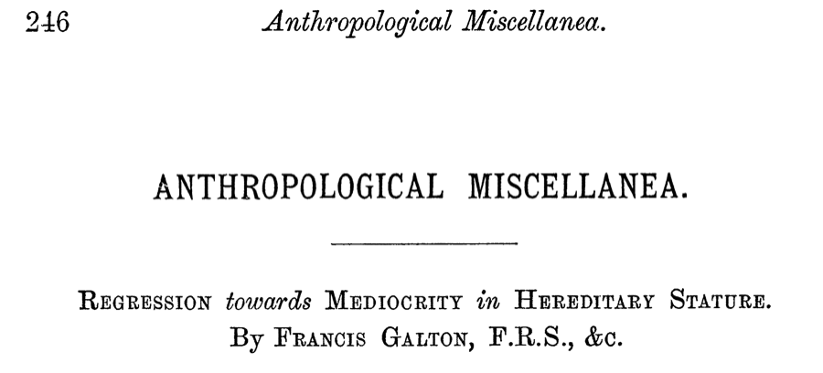
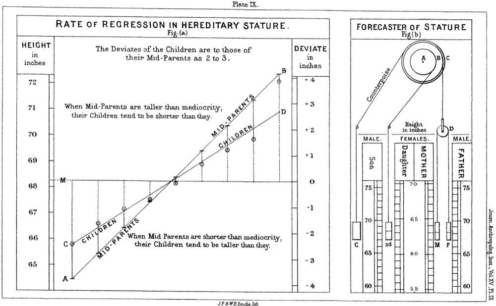
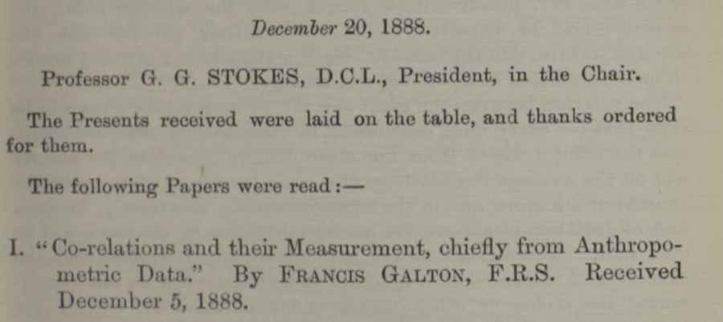
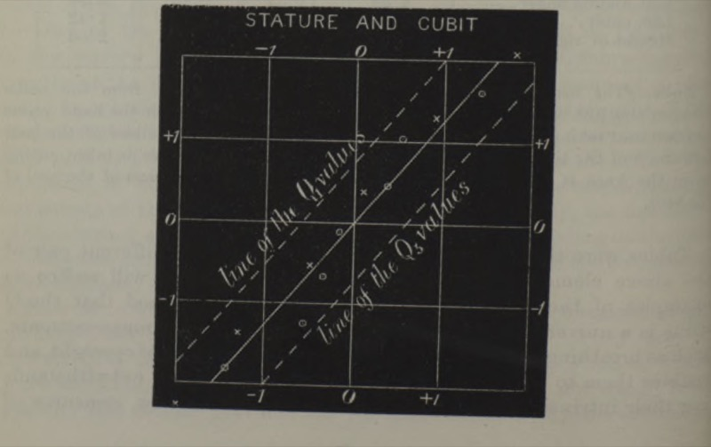
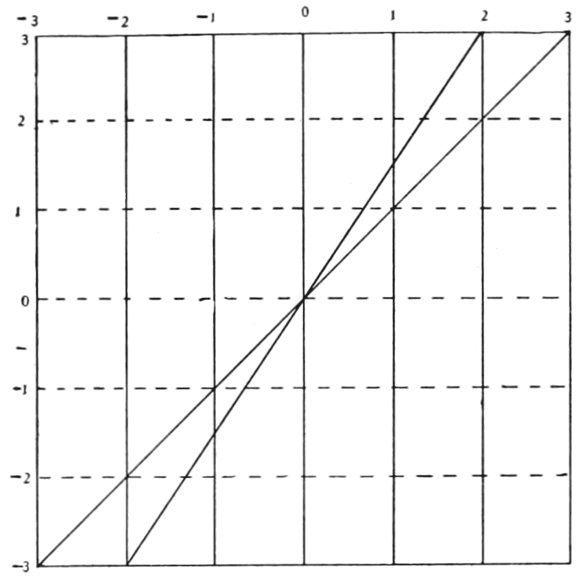
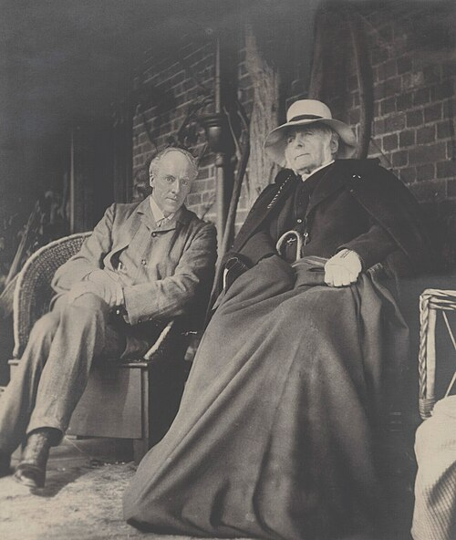
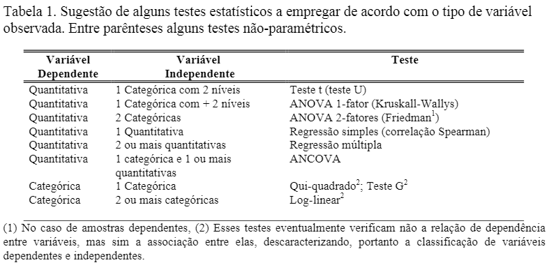
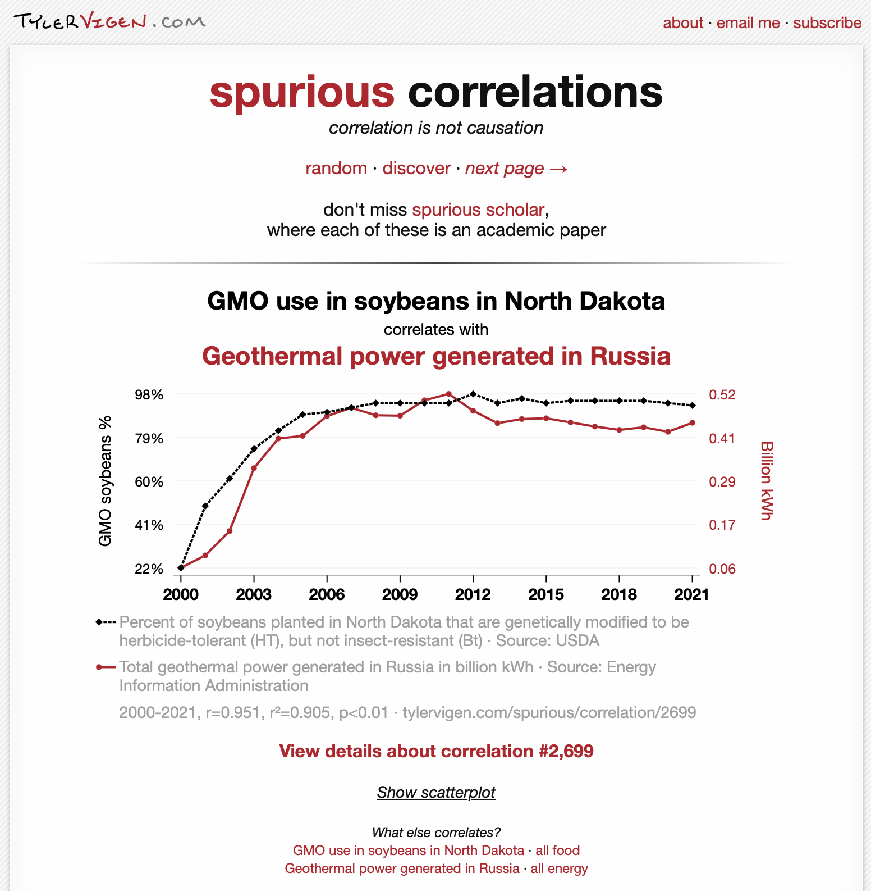
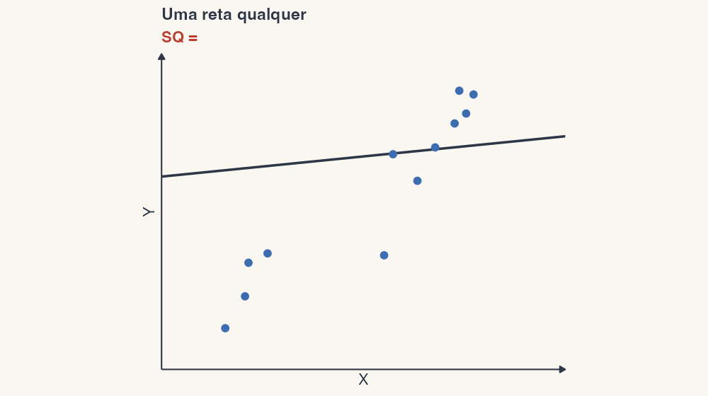
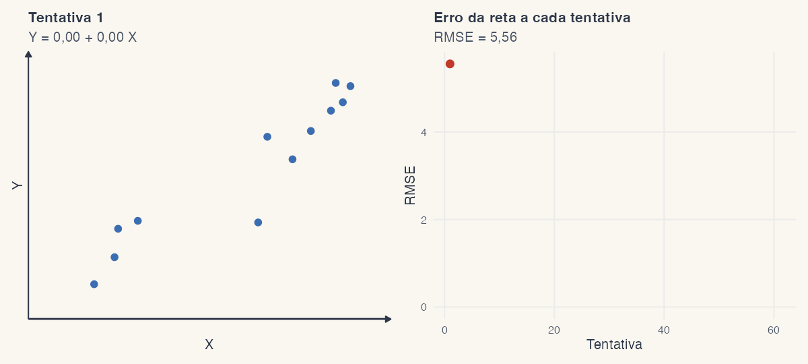

```{r}
#| label: setup
source(here::here("R/ppdac.R"))
source(here::here("R/aula09.R"))
source(here::here("R/idades.R"))
m_galton <- lm(child ~ parent, data = galton)
cf <- summary(m_galton)$coefficients
av <- anova(m_galton)
r2 <- summary(m_galton)$r.squared
r_galton <- cor(galton$parent, galton$child)
n_galton <- nrow(galton)
# número para dentro de $...$: a vírgula decimal precisa de {,} no LaTeX
num_tex <- function(v, d = 2) sub(",", "{,}", num_br(v, d), fixed = TRUE)
```

## Ao final da aula você deverá saber:

1. Breve histórico
2. Introdução aos modelos lineares
3. Equação da regressão linear (*Ordinary Least Squares*, OLS)
   - Parâmetros estimados: intercepto ("a", α, β₀) e inclinação (*slope*: b, β, β₁)
4. Teste de hipótese em regressão
5. Método dos mínimos quadrados (*least squares*)
6. Tabela de ANOVA e coeficiente de determinação (R²)
7. Pressupostos e diagnose dos resíduos (inspeção gráfica)

::: {.nota}
As figuras foram geradas em R: o exemplo de Galton usa os dados originais
de 1886 (domínio público, em
[`data/galton.csv`](https://github.com/diogoprov/bioestatistica/tree/main/data)),
e os demais, dados simulados. O código está em
[`R/`](https://github.com/diogoprov/bioestatistica/tree/main/R).
:::

---

## Onde estamos no ciclo PPDAC

```{r}
#| fig-width: 6.4
#| fig-height: 5.1
#| out-width: "45%"
#| fig-alt: "Ciclo PPDAC com as etapas Análise e Conclusão destacadas nas suas cores; as demais em cinza."
ppdac_plot(destaque = c("Análise", "Conclusão"))
```

Depois de comparar médias (teste *t*), o modelo linear com um preditor
**contínuo**: a regressão.

---

## Aula baseada em

- Triola, M.F. *Introdução à estatística*, cap. 10.
- Vieira, S. *Introdução à bioestatística*, caps. 5 e 6.
- Bussab, W.O. & Morettin, P.A. *Estatística básica*, cap. 16.
- Gotelli, N.J. & Ellison, A.M. *Princípios de estatística em ecologia*,
  cap. 9.
- Gelman, A., Hill, J. & Vehtari, A. 2020. *Regression and other stories*,
  caps. 7 e 8.
- Quinn, G.P. & Keough, M.J. *Experimental design and data analysis for
  biologists*, cap. 6.

# 1. Um pouco de história {.secao}

[Análise]{.ppdac-etapa .analise}

---

## Um pouco de história

:::: {.columns}
::: {.column width="68%"}
- **Francis Galton** (1822–1911): antropólogo inglês, primo de Charles
  Darwin, defendia ideias de eugenia
- Cunhou o termo "regressão" no contexto de estudos de herdabilidade de
  caracteres quantitativos, em 1886
- Mediu a altura de filhos e de seus pais para investigar o padrão de
  herdabilidade desta característica

> "the average regression of the offspring is a constant fraction of their
> respective mid-parental deviations"
:::
::: {.column width="32%"}
{width="80%" fig-alt="Retrato de Francis Galton idoso, de costeletas brancas."}
:::
::::

::: {.ref}
Galton, F. 1886. [Regression towards mediocrity in hereditary stature](https://doi.org/10.2307/2841583). *The Journal of the Anthropological Institute of Great Britain and Ireland* 15:246. Retrato: Eveleen Myers, domínio público, via Wikimedia Commons.
:::

---

## Galton, 1886: a regressão à média

:::: {.columns}
::: {.column width="30%"}
{width="100%" fig-alt="Página de título do artigo Regression towards Mediocrity in Hereditary Stature, de Francis Galton, na seção Anthropological Miscellanea."}

- Os filhos de pais muito altos ou muito baixos ficam, em média, mais
  perto da média da população: a **regressão à média**.
:::
::: {.column width="70%"}
{width="100%" fig-alt="Prancha original de Galton, de 1886. À esquerda, o gráfico Rate of regression in hereditary stature: a altura dos filhos varia menos que a dos pais, e as duas retas mostram que, quando os pais são mais altos que a média, os filhos tendem a ser mais baixos que eles, e vice-versa. À direita, o Forecaster of stature, um aparelho de polias para prever a altura do filho a partir da do pai e da mãe."}
:::
::::

::: {.ref}
Galton, F. 1886. [Regression towards mediocrity in hereditary stature](https://doi.org/10.2307/2841583). *The Journal of the Anthropological Institute of Great Britain and Ireland* 15:246. Digitalização do original, domínio público.
:::

---

## Galton, 1888: estatura e antebraço

:::: {.columns}
::: {.column width="45%"}
{width="100%" fig-alt="Anúncio da sessão de 20 de dezembro de 1888 da Royal Society, com o artigo Co-relations and their Measurement, chiefly from Anthropometric Data, de Francis Galton."}

- Galton mede a estatura e o comprimento do antebraço (*cubit*) das
  mesmas pessoas e descobre que a regressão vale nas duas direções: nasce
  a ideia de **correlação**.
:::
::: {.column width="55%"}
{width="100%" fig-alt="Gráfico original de Galton, Stature and cubit: uma grade com duas retas tracejadas, a linha das estaturas e a linha dos antebraços, cruzando-se no centro."}
:::
::::

::: {.ref}
Galton, F. [Co-relations and their measurement, chiefly from anthropometric data](https://doi.org/10.1098/rspl.1888.0082). *Proceedings of the Royal Society of London* 45:135–145. Digitalizações do original, domínio público.
:::

---

## Os dados de Galton

```{r}
#| fig-width: 7
#| fig-height: 5.6
#| out-width: "55%"
#| fig-alt: "Gráfico de dispersão da altura de 928 filhos contra a média da altura dos pais. A reta de regressão, em vermelho, é menos inclinada que a reta tracejada filho = pais: pais altos têm filhos altos, mas menos altos que eles; pais baixos têm filhos baixos, mas menos baixos."
fig_galton()
```

928 filhos adultos de 205 casais (em polegadas; 1 pol = 2,54 cm).

---

## Breve histórico {.smaller}

:::: {.columns}
::: {.column width="62%"}
- A diferença entre um filho e seus dois pais numa dada característica é
  proporcional ao desvio de seus pais da média da população.
- Por exemplo, se seus pais são, cada um, 2 cm mais altos que a média dos
  homens e mulheres, em média o filho também será mais alto que a média,
  mas menos: cerca de 2/3 desses 2 cm.
- Nos dados de Galton, a altura de uma pessoa ficaria em torno de 2/3 do
  desvio dos pais da média da população (a inclinação da reta é
  `r num_br(cf["parent", "Estimate"], 2)`).
- Logo, a altura dos filhos estaria **regredindo à média**.
- Em seguida, K. Pearson trabalha no problema da correlação e regressão,
  derivando o **coeficiente de correlação** (*r*).
:::
::: {.column width="38%"}
{width="100%" fig-alt="Diagrama antigo em preto e branco com uma grade de −3 a 3 e duas retas que se cruzam na origem: a mais inclinada é a dos pais, e a menos inclinada, a dos filhos, que regridem em direção à média."}
:::
::::

::: {.ref}
Diagrama: C.H. Eigenmann, *Popular Science Monthly* 61 (1902), a partir de Galton; domínio público, via Wikimedia Commons.
:::

::: {.nota}
O fator de encolhimento é a inclinação da reta, e o *r* de Pearson é o coeficiente
de correlação.
:::

---

## Galton e Pearson

:::: {.columns}
::: {.column width="55%"}
- 1888: Galton apresenta à Royal Society "Co-relations and their
  measurement, chiefly from anthropometric data".
- 1896: Karl Pearson (1857–1936) publica a fórmula do coeficiente de
  correlação que usamos até hoje.
:::
::: {.column width="45%"}
{height="340px" fig-alt="Fotografia de Karl Pearson e Francis Galton sentados lado a lado, em 1909; Galton, idoso, coberto por uma manta."}
:::
::::

::: {.ref}
Galton, F. [Co-relations and their measurement, chiefly from anthropometric data](https://doi.org/10.1098/rspl.1888.0082). *Proceedings of the Royal Society of London* 45:135–145. Pearson, K. 1896. [Mathematical contributions to the theory of evolution. III. Regression, heredity, and panmixia](https://doi.org/10.1098/rsta.1896.0007). *Philosophical Transactions of the Royal Society of London A*, 253–318. Fotografia: domínio público, via Wikimedia Commons.
:::

---

## Qual teste usar?

{width="88%" fig-align="center" fig-alt="Tabela 1 da apostila de Paglia e De Marco, com sugestões de testes estatísticos conforme o tipo de variável dependente e independente: teste t, ANOVA de um e dois fatores, regressão simples e múltipla, ANCOVA, qui-quadrado, teste G e log-linear, com os equivalentes não paramétricos entre parênteses."}

::: {.ref}
Tabela 1 de Paglia & De Marco, [*Apostila de estatística*](https://files.cercomp.ufg.br/weby/up/85/o/Apostila_de_estat%C3%ADstica.pdf) (UFG). Reproduzida com crédito.
:::

# 2. Correlação linear {.secao}

[Análise]{.ppdac-etapa .analise}

---

## Correlação linear

Relação linear entre duas variáveis, mas **sem assumir uma dependência
funcional** entre as duas.

$$r_{Y_1Y_2} = \frac{\sum_{i=1}^{n} \left[(y_{i1} - \bar{y}_1)(y_{i2} - \bar{y}_2)\right]}{\sqrt{\sum_{i=1}^{n} (y_{i1} - \bar{y}_1)^2 \sum_{i=1}^{n} (y_{i2} - \bar{y}_2)^2}}$$

- **Numerador:** soma dos produtos cruzados (covariância). Pode ser
  positivo ou negativo; se o numerador for negativo, o *r* será negativo,
  e vice-versa.
- **Denominador:** produto dos desvios-padrão das duas variáveis. Sempre
  positivo.
- $-1 \leq r \leq 1$

::: {.nota}
A soma dos produtos cruzados depende da escala das variáveis, por isso
temos de dividir pelos desvios-padrão.
:::

---

## Quatro padrões de correlação

```{r}
#| fig-width: 12
#| fig-height: 3.8
#| fig-alt: "Quatro gráficos de dispersão simulados: relação linear positiva (r perto de 0,87), negativa (r perto de −0,74), sem relação (r perto de 0) e uma relação curva em forma de arco, que tem r baixo apesar de forte."
fig_correlacoes()
```

O último painel mostra uma relação forte, mas **não linear**: o *r* não a
detecta.

::: {.ref}
Inspirado em figura de Quinn & Keough 2002; dados simulados.
:::

---

## Quarteto de Anscombe

**Sempre inspecione seus dados antes de fazer qualquer análise!!**

```{r}
#| fig-width: 12
#| fig-height: 3.8
#| fig-alt: "Os quatro conjuntos do quarteto de Anscombe, cada um com a mesma reta de regressão: o primeiro é uma nuvem linear, o segundo uma curva, o terceiro uma reta perfeita com um ponto fora, e o quarto tem todos os pontos no mesmo X menos um."
fig_anscombe()
```

Todos esses plots têm o mesmo coeficiente de correlação: *r* = 0,816.

::: {.ref}
Anscombe, F.J. 1973. [Graphs in statistical analysis](https://doi.org/10.1080/00031305.1973.10478966). *The American Statistician* 27:17–21. Dados do objeto `anscombe` do R. Uma versão animada, com um dinossauro: [Same Stats, Different Graphs](https://www.autodeskresearch.com/publications/samestats) (Matejka & Fitzmaurice 2017).
:::

---

## Pergunta para a turma

::: {.atividade}
**Quatro conjuntos de dados têm a mesma média de X, a mesma média de Y e
o mesmo *r* = 0,816. O que podemos concluir?**

A. Os quatro conjuntos têm a mesma relação entre X e Y.

B. Em todos eles, Y aumenta linearmente com X.

C. Nada sobre a forma da relação: é preciso olhar o gráfico de cada um.

D. Como *r* é alto, a regressão linear é adequada para os quatro.
:::

Votem sozinhos (A, B, C ou D, com a mão ou com cartões). Depois discutam
com quem está ao lado por 2 minutos e votem de novo.

::: {.fragment}
::: {.definicao}
**C.** É o quarteto de Anscombe: o mesmo *r* esconde uma nuvem linear, uma
curva, um ponto discrepante e um único ponto que cria a correlação. Os
números resumem; só o gráfico mostra a forma.
:::
:::

---

## Correlação não implica causalidade

:::: {.columns}
::: {.column width="55%"}
```{r}
#| fig-width: 7
#| fig-height: 5
#| fig-alt: "Gráfico de dispersão fictício: países que consomem mais chocolate têm mais prêmios Nobel por 10 milhões de habitantes, com r perto de 0,85."
fig_chocolate()
```
:::
::: {.column width="45%"}
- Países mais ricos consomem mais chocolate **e** investem mais em
  ciência: uma terceira variável explica as duas.
- Uma correlação alta não diz qual variável causa a outra, nem se alguma
  causa.

{width="100%" fig-alt="Tirinha xkcd em três quadros. Um homem diz: eu achava que correlação implicava causalidade. Depois fiz um curso de estatística e agora não acho mais. A mulher responde: parece que o curso ajudou. Ele: bem, talvez."}
:::
::::

::: {.ref}
Inspirado em Messerli, F.H. 2012. [Chocolate consumption, cognitive function, and Nobel laureates](https://doi.org/10.1056/NEJMon1211064). *New England Journal of Medicine* 367:1562–1564; dados fictícios. Tirinha: Randall Munroe, [xkcd 552, "Correlation"](https://xkcd.com/552/), CC BY-NC 2.5.
:::

---

## Correlações espúrias

{height="520px" fig-align="center" fig-alt="Página do site Spurious Correlations: o uso de soja transgênica em Dakota do Norte acompanha a geração de energia geotérmica na Rússia entre 2000 e 2021."}

::: {.ref}
Tyler Vigen, [*Spurious correlations*](https://www.tylervigen.com/spurious-correlations), CC BY 4.0.
:::

---

## Teste de hipótese do *r* de Pearson

- Utiliza um teste *t* de uma amostra:

$$t = \frac{r}{s_r}, \qquad s_r = \sqrt{\frac{1 - r^2}{n - 2}} \quad (\text{erro padrão do } r)$$

- Testa a hipótese nula de que $\rho = 0$ (não há correlação na
  população).
- Nos dados de Galton: $r = `r num_tex(r_galton, 3)`$, com
  $n = `r n_galton`$.

::: {.nota}
A hipótese é sobre o parâmetro ρ da população, não sobre a estatística
*t*.
:::

# 3. Regressão linear simples {.secao}

[Análise]{.ppdac-etapa .analise}

---

## Objetivo de uma regressão linear

- Analisar a *relação* entre duas variáveis contínuas
  - Qual a forma desta relação? Qual o grau de relação entre as variáveis?
- Variável preditora (X) e uma variável resposta (Y), ambas contínuas
- *Predizer* um valor da variável resposta com base na variável preditora
- Modelo linear
  - Um dado valor da variável resposta é descrito por uma combinação linear
    de um conjunto de parâmetros (inclinação e intercepto), no qual nenhum
    deles aparece como um expoente ou é multiplicado por outro parâmetro

---

## Equação da regressão linear passo a passo

$$\text{Variável resposta} = \text{modelo} + \text{erro}$$

::: {.fragment}
$$y_i = \underbrace{\alpha + \beta x_i}_{\text{modelo}} + \underbrace{\varepsilon_i}_{\text{erro}}$$
:::

::: {.fragment}
$$\underbrace{y_i}_{\text{variável resposta}} = \underbrace{\alpha}_{\text{intercepto}} + \underbrace{\beta}_{\text{inclinação (slope)}}\; \underbrace{x_i}_{\text{variável preditora}} + \varepsilon_i$$
:::

---

## Exemplo e parâmetros do modelo

$$\text{Altura dos filhos} = \alpha + \beta \times \text{altura dos pais} + \text{resíduos}$$

- **Intercepto** = valor médio da variável resposta quando a variável
  preditora é zero
- **Inclinação** (*slope*) = inclinação da reta predita pelo modelo. Mede o
  quanto a variável resposta muda em função do aumento da variável
  preditora.
  - Pode-se calcular o IC95% para o *slope*

---

## Gráfico de dispersão

```{r}
#| fig-width: 7
#| fig-height: 5
#| out-width: "55%"
#| fig-alt: "Eixos vazios: variável preditora X na horizontal, variável resposta Y na vertical."
fig_dispersao(1)
```

---

## Gráfico de dispersão

```{r}
#| fig-width: 7
#| fig-height: 5
#| out-width: "55%"
#| fig-alt: "Os mesmos eixos com 12 pontos azuis: Y tende a aumentar com X."
fig_dispersao(2)
```

---

## Gráfico de dispersão

```{r}
#| fig-width: 7
#| fig-height: 5
#| out-width: "55%"
#| fig-alt: "Os 12 pontos com a reta de regressão em vermelho passando no meio deles."
fig_dispersao(3)
```

---

## A distribuição de Y para cada valor de X

:::: {.columns}
::: {.column width="62%"}
```{r}
#| fig-width: 8
#| fig-height: 5.5
#| fig-alt: "Reta de regressão vermelha com três curvas normais deitadas, uma em cada um de três valores de X: cada curva está centrada na reta e todas têm a mesma largura."
fig_normal_x()
```
:::
::: {.column width="38%"}
- A população de valores de Y para cada valor de $x_i$ tem uma
  **distribuição normal, com a mesma variância**.
- Isso será importante no cálculo dos intervalos de confiança destes
  parâmetros e no teste de hipótese.
:::
::::

::: {.ref}
Inspirado na Figura 4.1 de Quinn & Keough.
:::

---

## Teste de hipótese

- A hipótese nula que é testada na regressão linear é a de que o *slope*
  é igual a zero; a alternativa, a de que ele é diferente de zero:

$$H_0: \beta = 0 \qquad H_1: \beta \neq 0$$

- Mas o que diabos isso significa?
  - Se não há relação entre Y e X, a reta da regressão não deve ter
    inclinação, ou seja, à medida que o X muda, o valor de Y permanece o
    mesmo.

---

## Hipótese nula e alternativas

```{r}
#| fig-width: 12
#| fig-height: 4.2
#| fig-alt: "Três gráficos. Hipótese nula: uma reta horizontal na altura alfa, beta igual a zero. Hipótese alternativa: uma reta crescente, beta maior que zero. Outra hipótese alternativa: uma reta decrescente, beta menor que zero."
fig_hipoteses_slope()
```

# 4. O método dos mínimos quadrados {.secao}

[Análise]{.ppdac-etapa .analise}

---

## Como funciona o método dos mínimos quadrados

- Método para estimar os parâmetros do modelo que minimiza o desvio entre
  os dados observados e o predito
- Calcula a distância entre uma observação e o predito pelo modelo
- Minimiza a distância entre o ponto e a reta do modelo
- Essa distância é o **resíduo**

---

## A reta passa pelas médias

:::: {.columns}
::: {.column width="60%"}
```{r}
#| fig-width: 7
#| fig-height: 5
#| fig-alt: "Os 12 pontos com a reta de regressão. Linhas tracejadas marcam a média de X e a média de Y; a reta passa exatamente pelo ponto onde elas se cruzam. Um segmento verde mostra o resíduo de um ponto: a distância vertical entre o ponto e a reta."
fig_media_ponto()
```
:::
::: {.column width="40%"}
- A melhor estimativa de y e de x são as suas respectivas médias.
- É por onde a reta de regressão vai passar.
:::
::::

::: {.ref}
Inspirado na Figura 5.6 de Quinn & Keough.
:::

---

## Resíduo = observado − predito

```{r}
#| fig-width: 7
#| fig-height: 5
#| out-width: "55%"
#| fig-alt: "Os 12 pontos e a reta de regressão, com um dos pontos circulado em verde: uma observação."
fig_residuo_obs(0)
```

---

## Resíduo = observado − predito

```{r}
#| fig-width: 7
#| fig-height: 5
#| out-width: "55%"
#| fig-alt: "O mesmo gráfico com uma linha tracejada verde ligando um ponto à reta: o resíduo, observado menos predito."
fig_residuo_obs(1)
```

Assume que o erro de medida está na variável resposta (Y).

---

## Resíduo = observado − predito

```{r}
#| fig-width: 7
#| fig-height: 5
#| out-width: "55%"
#| fig-alt: "O resíduo de outro ponto, abaixo da reta."
fig_residuo_obs(2)
```

---

## Resíduo = observado − predito

```{r}
#| fig-width: 7
#| fig-height: 5
#| out-width: "55%"
#| fig-alt: "O resíduo de um terceiro ponto, à esquerda."
fig_residuo_obs(3)
```

---

## Somando os resíduos ao quadrado

{height="540px" fig-align="center" fig-alt="Animação em duas partes com os mesmos 12 pontos. Primeiro, numa reta quase horizontal, os resíduos d1 a d12 aparecem um por um como linhas tracejadas, cada um com o seu quadrado em vermelho, e a soma SQ cresce até 62,2. Depois, na reta de mínimos quadrados, os quadrados são bem menores e a soma termina em 7,6."}

::: {.ref}
Animação feita em R com dados simulados ([`R/animacoes.R`](https://github.com/diogoprov/bioestatistica/blob/main/R/animacoes.R)). Inspirada na animação de [*Linear regression: an overview*](https://medium.com/@novus_afk/linear-regression-an-overview-13d37a6bc4dd).
:::

---

## Soma de quadrados dos resíduos

$$d_i^2 = (Y_i - \hat{Y}_i)^2 \qquad\qquad RSS = \sum_{i=1}^{n} (Y_i - \hat{Y}_i)^2$$

Critério de otimização (estimador) para ajuste da reta de regressão
(**mínimos quadrados**): a reta escolhida é a que deixa a menor soma.

```{r}
#| fig-width: 12
#| fig-height: 4.4
#| out-width: "72%"
#| fig-alt: "Dois painéis com os mesmos pontos. À esquerda, uma reta quase horizontal, mal ajustada: os quadrados dos resíduos, desenhados em vermelho, são enormes e somam 62,2. À direita, a reta de mínimos quadrados: os quadrados são pequenos e somam 7,6."
fig_quadrados()
```

::: {.ref}
Simulação interativa: [*Ordinary least squares regression*](https://setosa.io/ev/ordinary-least-squares-regression/), Setosa.
:::

---

## O ajuste da reta, passo a passo

{width="88%" fig-align="center" fig-alt="Animação em dois painéis. À esquerda, os mesmos 12 pontos e a reta testada em cada tentativa do otimizador: ela começa horizontal, gira e se desloca, deixando um rastro cinza das tentativas anteriores, até se ajustar aos pontos (Y = 0,24 + 0,80 X). À direita, o erro de cada tentativa (RMSE, a raiz da média dos resíduos ao quadrado) despenca de cerca de 5 para 0,8 e se estabiliza."}

::: {.ref}
Animação de Diogo B. Provete, feita em R com `optim()` ([`R/animacoes.R`](https://github.com/diogoprov/bioestatistica/blob/main/R/animacoes.R)), a partir do script `animate-lm-optimization.R`; dados simulados.
:::

---

## Outras formas de medir os resíduos

:::: {.columns}
::: {.column width="55%"}
```{r}
#| fig-width: 7
#| fig-height: 5
#| fig-alt: "Uma reta e um ponto acima dela. Três distâncias: 1, a vertical (mínimos quadrados, OLS); 2, a perpendicular à reta (eixo maior, MA); 3, a área do triângulo formado pelas distâncias vertical e horizontal (eixo maior reduzido, RMA)."
fig_ols_ma_rma()
```
:::
::: {.column width="45%"}
- **1. OLS** (mínimos quadrados): distância vertical; assume X sem erro.
- **2. MA** (eixo maior) e **3. RMA** (eixo maior reduzido): usados quando
  X e Y têm erro de medida (regressão do **modelo II**).
:::
::::

::: {.nota}
Não confunda com os tipos de soma de quadrados, que são outra coisa (aparecem na ANOVA com vários
fatores); aqui se trata de regressão do modelo II.
:::

::: {.ref}
Inspirado na Figura 5.12 de Quinn & Keough (p. 100).
:::

---

## Estimando os parâmetros {.medio}

| Parâmetro | Estimativa OLS | Erro padrão |
|---|---|---|
| $\beta_1$ (*slope*) | $b_1 = \dfrac{\sum_{i=1}^{n} \left[(x_i - \bar{x})(y_i - \bar{y})\right]}{\sum_{i=1}^{n} (x_i - \bar{x})^2}$ | $s_{b_1} = \sqrt{\dfrac{MS_{Residual}}{\sum_{i=1}^{n} (x_i - \bar{x})^2}}$ |
| $\beta_0$ (intercepto) | $b_0 = \bar{y} - b_1 \bar{x}$ | $s_{b_0} = \sqrt{MS_{Residual} \left[\dfrac{1}{n} + \dfrac{\bar{x}^2}{\sum_{i=1}^{n} (x_i - \bar{x})^2}\right]}$ |
| $\varepsilon_i$ (resíduo) | $e_i = y_i - \hat{y}_i$ | $\sqrt{MS_{Residual}}$ (aprox.) |

- **Numerador de $b_1$:** diferença entre cada x e a sua média vezes a
  diferença entre cada y e a sua média. **Denominador:** diferença entre
  cada x e a sua média, ao quadrado.
- **$b_0$:** média de Y menos o *slope* vezes a média de X.
- **$e_i$:** cada valor individual de Y menos o valor predito pelo modelo
  (a reta).

::: {.ref}
Inspirado na Tabela 5.2 de Quinn & Keough 2002.
:::

---

## Estimando os parâmetros: os dados de Galton

```{r}
xb <- mean(galton$parent); yb <- mean(galton$child)
```

| Parâmetro | Estimativa OLS | Erro padrão |
|---|---|---|
| $\beta_1$ | $b_1 = `r num_tex(cf["parent", "Estimate"], 5)`$ | $s_{b_1} = `r num_tex(cf["parent", "Std. Error"], 5)`$ |
| $\beta_0$ | $b_0 = `r num_tex(yb, 2)` - `r num_tex(cf["parent", "Estimate"], 4)` \times `r num_tex(xb, 2)` = `r num_tex(cf["(Intercept)", "Estimate"], 5)`$ | $s_{b_0} = `r num_tex(cf["(Intercept)", "Std. Error"], 5)`$ |
| $\varepsilon_i$ | um resíduo para cada observação | $`r num_tex(summary(m_galton)$sigma, 3)`$ |

```{r}
#| echo: true
#| class-output: codigo-compacto
modelo <- lm(child ~ parent, data = galton)
coef(modelo)
```

---

## Teste de hipótese

- Estatística do teste (teste *t* para uma amostra), usada para testar a
  hipótese nula de que β = 0:

$$t = \frac{b - 0}{\text{erro padrão de } b}$$

```{r}
#| fig-width: 10
#| fig-height: 3.1
#| out-width: "70%"
#| fig-alt: "Distribuição t com 926 graus de liberdade, com as regiões críticas além de ±1,96. A estatística t do slope de Galton, 15,711, fica muito além, perto da borda direita do gráfico."
fig_t_galton()
```

Valor para o conjunto de dados original de Galton: $t = `r num_tex(cf["parent", "t value"], 3)`$; *P* < 0,001.

# 5. Tabela de ANOVA e R² {.secao}

[Análise]{.ppdac-etapa .analise} → [Conclusão]{.ppdac-etapa .conclusao}

---

## Tabela de análise de variância

Particionando a variância total em componentes explicados e residuais.

::: {.tabela-grande}
| Fonte de variação | Soma de quadrados | Graus de liberdade | Quadrado médio |
|---|---|---|---|
| Explicada pela combinação linear dos preditores | $SS_{Explicada}$ | $gl_{Explicada}$ | $MS_{Explicada}$ |
| Não explicada, residual ou erro | $SS_{Residual}$ | $gl_{Residual}$ | $MS_{Residual}$ |
| Total | $SS_{Total}$ | $gl_{Total}$ | |
:::

::: {.ref}
Tabela de ANOVA generalizada para modelos lineares; inspirada na Tabela
4.2 de Quinn & Keough 2023.
:::

---

## Particionando a variância numa regressão

- Como todo modelo linear, numa regressão também é possível particionar a
  variância total (soma de quadrados) num componente explicado pelo(s)
  preditor(es) e num erro
- Chamamos isso de **tabela de ANOVA**
- Aqui, ao invés de testar a hipótese nula utilizando um teste *t* de um
  parâmetro, usamos o **teste F** com os mesmos graus de liberdade
  - O teste F neste caso compara um modelo utilizado a um em que só o
    intercepto é incluído
  - $F = t^2$
- Numa regressão, isso é feito particionando a soma de quadrados:
  - $SQ_{total} = SQ_{regressão} + SQ_{resíduos}$
  - $GL_{total} = GL_{regressão} + GL_{resíduos}$

---

## Particionando a variância numa regressão

- No entanto, a SQ é dependente do número de observações, e aumenta com o
  aumento das observações
- Logo, precisamos de uma medida de variabilidade *independente* do número
  de observações
  - Este é o **quadrado médio** (*mean squares*)
- Porém, o quadrado médio (QM) não tem a mesma propriedade aditiva, como a
  SQ
  - $QM_{regressão} + QM_{resíduos} \neq QM_{total}$
- O $QM_{resíduos}$ estima a variância do erro ($\sigma^2_\varepsilon$)

---

## Tabela de ANOVA para a regressão linear simples

| Fonte de variação | SQ | gl | QM | QM esperado |
|---|---|---|---|---|
| Regressão | $\sum_{i=1}^{n} (\hat{y}_i - \bar{y})^2$ | 1 | $\dfrac{\sum (\hat{y}_i - \bar{y})^2}{1}$ | $\sigma^2_\varepsilon + \beta_1^2 \sum (x_i - \bar{x})^2$ |
| Residual | $\sum_{i=1}^{n} (y_i - \hat{y}_i)^2$ | $n - 2$ | $\dfrac{\sum (y_i - \hat{y}_i)^2}{n - 2}$ | $\sigma^2_\varepsilon$ |
| Total | $\sum_{i=1}^{n} (y_i - \bar{y})^2$ | $n - 1$ | | |

**Nos dados de Galton:**

| Fonte de variação | SQ | gl | QM | F |
|---|---|---|---|---|
| Regressão | `r num_br(av["parent", "Sum Sq"], 1)` | 1 | `r num_br(av["parent", "Mean Sq"], 2)` | `r num_br(av["parent", "F value"], 2)` |
| Residual | `r num_br(av["Residuals", "Sum Sq"], 1)` | `r av["Residuals", "Df"]` | `r num_br(av["Residuals", "Mean Sq"], 2)` | |
| Total | `r num_br(sum(av[["Sum Sq"]]), 1)` | `r sum(av[["Df"]])` | | |

::: {.ref}
Inspirado na Tabela 5.3 de Quinn & Keough. F = `r num_br(av["parent", "F value"], 2)` = *t*².
:::

---

## Coeficiente de determinação

$$r^2 = \frac{SS_{Regression}}{SS_{Total}} = 1 - \frac{SS_{Residual}}{SS_{Total}} \qquad 0 \leq r^2 \leq 1$$

- Nos dados de Galton: $r^2 = `r num_tex(av["parent", "Sum Sq"], 1)` / `r num_tex(sum(av[["Sum Sq"]]), 1)` = 1 - `r num_tex(av["Residuals", "Sum Sq"], 1)` / `r num_tex(sum(av[["Sum Sq"]]), 1)` = `r num_tex(r2, 4)`$
- $r^2$ = *r* de Pearson ao quadrado ($`r num_tex(r_galton, 3)`^2$)

::: {.definicao}
A variação na altura dos pais explicou cerca de 21% da variação da altura
dos filhos. Os outros 79% são devidos a outros fatores (nutrição,
aleatoriedade, genética não mendeliana simples etc.) que não medimos.
:::

---

## Interpretação do R²

```{r}
#| fig-width: 8
#| fig-height: 4.8
#| out-width: "62%"
#| fig-alt: "Gráfico de pizza: 21% da variação da altura dos filhos é explicada pela altura dos pais (fatia verde) e 79% não é explicada (cinza)."
fig_r2_pizza()
```

---

## Pergunta para a turma

::: {.atividade}
**Na regressão da altura dos filhos pela altura dos pais, R² = 0,21. Isso
significa que:**

A. a altura dos pais explica 21% da variação na altura dos filhos.

B. 21% dos filhos têm exatamente a altura prevista pela reta.

C. a correlação entre as alturas é de 0,21.

D. o modelo está errado, porque explica menos da metade da variação.
:::

Votem sozinhos (A, B, C ou D, com a mão ou com cartões). Depois discutam
com quem está ao lado por 2 minutos e votem de novo.

::: {.fragment}
::: {.definicao}
**A.** O R² é a fração da soma de quadrados total explicada pelo modelo. A
correlação é a raiz: *r* = 0,46 (C). Um R² baixo não torna o modelo
errado (D): a relação é real (*P* < 0,001), só que muita coisa além dos
pais influencia a altura.
:::
:::

---

## Cuidado com o R² baixo

Num gráfico com R² = 0,06, é mais fácil achar constelações nos pontos do
que adivinhar a direção da reta. Antes de interpretar uma regressão, olhe
o gráfico e o R².

::: {.ref}
xkcd 1725, [*Linear regression*](https://xkcd.com/1725/), de Randall Munroe; explicação em [explainxkcd](https://www.explainxkcd.com/wiki/index.php/1725:_Linear_Regression).
:::

## De volta às idades: a regressão dos palpites

:::: {.columns}
::: {.column width="52%"}
```{r}
#| fig-width: 5.6
#| fig-height: 5
#| fig-alt: "Gráfico de dispersão da idade estimada contra a idade real em 100 palpites simulados, com a reta 1:1 tracejada e a reta ajustada, menos inclinada: acima da 1:1 nos jovens e abaixo dela nos idosos."
fig_idades_regressao()
coef_idades <- coef(lm(idade_estimada ~ idade_real, data = idades_simuladas()))
```
:::
::: {.column width="48%"}
::: {.atividade}
Com os dados da turma, ajustem
`lm(idade_estimada ~ idade_real)`. Se a turma acertasse sempre, a reta
seria a 1:1 ($a = 0$, $b = 1$). Qual é a inclinação da turma? O que ela
quer dizer?
:::

::: {.fragment}
::: {.definicao}
Nos dados simulados, $b$ = `r format(round(coef_idades[2], 2), nsmall = 2)`:
a turma puxa os palpites para o meio, superestimando os jovens e
subestimando os idosos.
:::
:::
:::
::::

::: {.ref}
Dados simulados. Atividade de Gelman, A. & Nolan, D. 2002. *Teaching statistics: a bag of tricks*. Oxford University Press, seção 2.1.
:::

# 6. Pressupostos e diagnóstico {.secao}

[Análise]{.ppdac-etapa .analise}

---

## Pressupostos dos modelos lineares

- Variâncias homogêneas dos resíduos
- Relação entre X e Y é linear
- Variável preditora (X) é medida sem erros (regressão do **modelo I**)
- Resíduos independentes e identicamente distribuídos (i.i.d.)
  - Seguem uma distribuição normal
  - $E[e] = 0$ e $\text{Var}[e] = \sigma^2$
- Independência das unidades amostrais
  - Pseudorréplicas, lembram da Aula 2?

::: {.nota}
"X medido sem erro" define a regressão do modelo I (em contraste com o modelo II, de MA e
RMA).
:::

::: {.ref}
Gotelli & Ellison, p. 275–277; Zar, p. 360–361; Quinn & Keough, p. 92–93.
:::

---

## Diagnósticos dos resíduos

O que se verifica nos quatro gráficos de diagnóstico:

:::: {.columns}
::: {.column width="50%"}
::: {.definicao}
**Homogeneidade de variância**
:::
::: {.definicao}
**Homogeneidade de variância** (com resíduos padronizados)
:::
:::
::: {.column width="50%"}
::: {.definicao}
**Normalidade**
:::
::: {.definicao}
**Valores extremos** (*outliers*)
:::
:::
::::

::: {.ref}
Quinn & Keough, p. 94–96.
:::

---

## Diagnóstico no R: os dados de Galton

:::: {.columns}
::: {.column width="68%"}
```{r}
#| fig-width: 8
#| fig-height: 6.2
#| fig-alt: "Os quatro gráficos de diagnóstico do R para a regressão de Galton: resíduos contra ajustados, sem padrão; gráfico quantil-quantil quase sobre a reta; scale-location sem tendência; resíduos contra alavancagem, sem pontos influentes."
par(mfrow = c(2, 2), mar = c(4, 4, 2, 1))
plot(modelo)
```
:::
::: {.column width="32%"}
No R:

```r
par(mfrow = c(2, 2))
plot(modelo)
```
:::
::::

---

## Padrões nos resíduos

```{r}
#| fig-width: 12
#| fig-height: 3.8
#| fig-alt: "Quatro gráficos de resíduos contra valores ajustados. A, normal: nuvem sem padrão em torno de zero. B, não linear: os resíduos caem nas pontas. C, quadrático: os resíduos formam um U. D, heterogeneidade de variância: a dispersão aumenta com os valores ajustados, em forma de funil."
fig_padroes_residuos()
```

::: {.ref}
Inspirado na Figura 9.5 de Gotelli & Ellison; dados simulados.
:::

---

## Pergunta para a turma

::: {.atividade}
**Num gráfico de resíduos contra valores ajustados, os resíduos se
espalham cada vez mais à medida que o valor ajustado aumenta (forma de
funil). Que pressuposto está sendo violado?**

A. Normalidade dos resíduos.

B. Homogeneidade de variância.

C. Relação linear entre X e Y.

D. Independência das unidades amostrais.
:::

Votem sozinhos (A, B, C ou D, com a mão ou com cartões). Depois discutam
com quem está ao lado por 2 minutos e votem de novo.

::: {.fragment}
::: {.definicao}
**B.** O funil é o sinal clássico de heterogeneidade de variância (painel
D do slide anterior). Uma curva ou um U indicariam relação não linear (C);
a normalidade se vê melhor no gráfico quantil-quantil.
:::
:::

# 7. Outras formas de regressão {.secao}

[Análise]{.ppdac-etapa .analise}

---

## Outras formas de regressão {.medio}

- Não linear simples (relação entre Y e X dada por um parâmetro elevado a
  alguma potência)
  - Quadrática, polinomial, exponencial
- Linear múltipla ($Y \sim X_1 + X_2 + \ldots + X_n$)
- Logística
- (Semi)parcial: particiona a variação em termos dos preditores isolados e
  em conjunto
- Ponderada (*weighted regression*)
- Robusta
- De quantis (ajusta uma reta para cada parte dos dados)
- *Stepwise regression*: utiliza um critério de seleção para
  incluir/remover preditores
- Árvore de regressão (*regression tree*)
- Análise de rotas (*path analysis*): diagrama de relação entre as
  variáveis
- Partição hierárquica

---

## Regressão múltipla

- Relaciona vários preditores à variável resposta
- Coeficientes de regressão parcial (padronizados): influência de cada
  preditor na resposta
- Problema com **multicolinearidade**
  - Como diagnosticar? *Variance Inflation Factor* (VIF)
- O modelo fica mais complicado à medida que se adicionam preditores
- Normalmente se usa o **R² ajustado**, que leva em conta o número de
  variáveis e de unidades amostrais:

$$R^2_{ajustado} = 1 - \frac{SS_{Residual} / [n - (p + 1)]}{SS_{Total} / (n - 1)}$$

---

## Regressão múltipla: um exemplo

Riqueza e abundância de uma comunidade em função da temperatura do ar e da
precipitação (12 áreas):

- **Abundância:** r² = 0,516; F~2,9~ = 4,811; *P* = `r num_br(pf(4.811, 2, 9, lower.tail = FALSE), 3)`
- **Riqueza:** r² = 0,823; F~2,9~ = 21,05; *P* < 0,001
- A temperatura do ar afetou a riqueza.

::: {.nota}
Os valores de *P* foram calculados a partir de F e dos graus de
liberdade.
:::

---

## Regressão polinomial

:::: {.columns}
::: {.column width="58%"}
```{r}
#| fig-width: 7
#| fig-height: 5
#| fig-alt: "Riqueza local contra riqueza regional de espécies, com uma reta (linear) e uma curva tracejada (quadrática) que acompanha melhor os pontos."
fig_polinomial()
```
:::
::: {.column width="42%"}
$$y_i = \beta_0 + \beta_1 x_{i1} + \beta_2 x_{i1}^2 + \varepsilon_i$$

Continua sendo um modelo **linear** nos parâmetros: o termo ao quadrado é
só mais um preditor.
:::
::::

::: {.ref}
Inspirado na Figura 6.5 de Quinn & Keough; dados simulados.
:::

---

## Árvore de regressão

```{r}
#| fig-width: 9
#| fig-height: 4.6
#| out-width: "70%"
#| fig-alt: "Árvore de regressão: a primeira divisão separa áreas pelo pastoreio; as áreas com pastoreio baixo são divididas de novo pelo tamanho do fragmento. Cada folha mostra a abundância média de aves e o número de áreas."
fig_arvore()
```

Uma boa alternativa para a regressão múltipla: divide os dados em grupos
cada vez mais homogêneos.

::: {.ref}
Inspirado na Figura 6.7 de Quinn & Keough (dados de Loyn 1987); valores
fictícios.
:::

---

## Análise de rota (*path analysis*)

```{r}
#| fig-width: 9
#| fig-height: 5
#| out-width: "70%"
#| fig-alt: "Diagrama de rota: três preditores (log10 da área do fragmento, pastoreio e anos desde o isolamento), ligados entre si por arcos de duas pontas (correlações), apontam para a abundância de aves florestais; uma caixa U, a variação não explicada, também aponta para a resposta."
fig_rota()
```

::: {.ref}
Inspirado na Figura 6.9 de Quinn & Keough (dados de Loyn 1987).
:::

---

## Recapitulando

- Correlação linear mede o grau de associação entre duas variáveis
  contínuas
  - *r* de Pearson varia de −1 a 1, sendo que 0 significa ausência de
    relação linear
- Regressão linear é um modelo linear em que o preditor é uma variável
  contínua
- É possível particionar a variância num componente explicado pelo modelo
  e num resíduo
  - R² mede o quanto o(s) preditor(es) explicam a variável resposta
- **Atenção para os pressupostos!**

---

## Kahoot! {.secao}

[Kahoot: Correlação, regressão e armadilhas na análise de dados](https://create.kahoot.it/details/747d4b86-8cb4-4d54-93af-6aba4f7c3a0d)

---

## Referências {.medio}

::: {.nota}
- Anscombe, F.J. 1973. [Graphs in statistical analysis](https://doi.org/10.1080/00031305.1973.10478966). *The American Statistician* 27:17–21.
- Bussab, W.O. & Morettin, P.A. *Estatística básica*.
- Galton, F. 1886. [Regression towards mediocrity in hereditary stature](https://doi.org/10.2307/2841583). *The Journal of the Anthropological Institute of Great Britain and Ireland* 15:246.
- Galton, F. [Co-relations and their measurement, chiefly from anthropometric data](https://doi.org/10.1098/rspl.1888.0082). *Proceedings of the Royal Society of London* 45:135–145.
- Gelman, A., Hill, J. & Vehtari, A. 2020. [*Regression and other stories*](https://doi.org/10.1017/9781139161879). Cambridge University Press.
- Gotelli, N.J. & Ellison, A.M. *Princípios de estatística em ecologia*.
- Matejka, J. & Fitzmaurice, G. 2017. [Same stats, different graphs](https://doi.org/10.1145/3025453.3025912). *Proceedings of the 2017 CHI Conference on Human Factors in Computing Systems*, 1290–1294.
- Messerli, F.H. 2012. [Chocolate consumption, cognitive function, and Nobel laureates](https://doi.org/10.1056/NEJMon1211064). *New England Journal of Medicine* 367:1562–1564.
- Paglia & De Marco. Apostila de estatística (Tabela 1).
- Pearson, K. 1896. [Mathematical contributions to the theory of evolution. III. Regression, heredity, and panmixia](https://doi.org/10.1098/rsta.1896.0007). *Philosophical Transactions of the Royal Society of London A*, 253–318.
- Quinn, G.P. & Keough, M.J. *Experimental design and data analysis for biologists*. Cambridge University Press.
- Triola, M.F. 2024. *Introdução à estatística*. LTC.
- Vieira, S. *Introdução à bioestatística*.
- Zar, J.H. *Biostatistical analysis*.
:::
