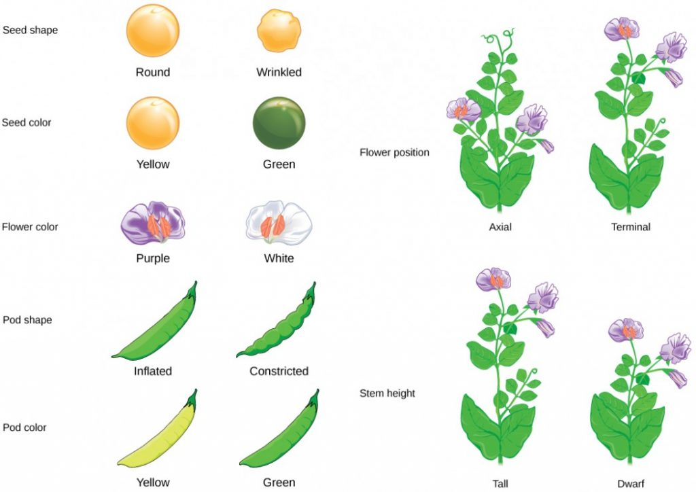

```{r}
#| label: setup
source(here::here("R/ppdac.R"))
source(here::here("R/aula10.R"))
# número para dentro de $...$: a vírgula decimal precisa de {,} no LaTeX
num_tex <- function(v, d = 2) sub(",", "{,}", num_br(v, d), fixed = TRUE)
q_mendel <- chisq.test(mendel, p = mendel_p)
q_mm <- chisq.test(mm$observado, p = mm$prop)
q_plantas <- chisq.test(plantas, correct = FALSE)
q_vacina <- chisq.test(vacina, correct = FALSE)
f_germ <- fisher.test(germinacao)
```

## Ao final da aula você será capaz de:

- Identificar quando o teste de qui-quadrado é apropriado (dados
  categóricos).
- Diferenciar os dois principais tipos de teste de qui-quadrado:
  **aderência** (*goodness-of-fit*) e **independência/associação**.
- Formular hipóteses nula (H₀) e alternativa (H₁) para ambos os testes.
- Calcular as frequências esperadas e a estatística χ² para problemas
  biológicos simples.
- Interpretar o resultado do teste com base no valor de *P* e nos graus de
  liberdade para tirar conclusões biológicas.

::: {.nota}
**Leituras:** Vieira, *Introdução à bioestatística*, cap. 12; Triola,
*Introdução à estatística*, cap. 11; Bussab & Morettin, *Estatística
básica*, cap. 14; Gotelli & Ellison, *Princípios de estatística em
ecologia*, cap. 11. As figuras foram geradas em R; o código está em
[`R/`](https://github.com/diogoprov/bioestatistica/tree/main/R).
:::

---

## Onde estamos no ciclo PPDAC

```{r}
#| fig-width: 6.4
#| fig-height: 5.1
#| out-width: "45%"
#| fig-alt: "Ciclo PPDAC com as etapas Análise e Conclusão destacadas nas suas cores; as demais em cinza."
ppdac_plot(destaque = c("Análise", "Conclusão"))
```

Quando a variável resposta é uma **contagem** em categorias, a
**Análise** muda de ferramenta.

---

## Cenário biológico

:::: {.columns}
::: {.column width="65%"}
- Imaginem que vocês são biólogos de campo estudando a **preferência de
  habitat** de uma espécie de anfíbio em uma reserva com **três tipos de
  vegetação**: mata ciliar, campo e cerrado.
- Vocês **contaram quantos indivíduos foram encontrados em cada
  ambiente**.
- A pergunta é: essa espécie se distribui aleatoriamente pelo espaço ou
  **ela prefere um tipo de vegetação**? Como podemos testar isso com
  confiança?
:::
::: {.column width="35%"}
{width="80%" fig-alt="Silhueta de uma rã."}

::: {.nota}
Silhueta de *Leptodactylus melanonotus* por Jose Carlos Arenas-Monroy, via
PhyloPic, CC0 1.0.
:::
:::
::::

---

## Atividade 1: geração de hipóteses (10 min)

::: {.atividade}
Desenhem no quadro uma **tabela de contingência** mostrando como seria uma
distribuição "sem preferência" (uniforme) versus uma com "preferência
absoluta".

| | Mata ciliar | Campo | Cerrado |
|---|---|---|---|
| Sem preferência | ? | ? | ? |
| Preferência absoluta | ? | ? | ? |
:::

# 1. O teste de qui-quadrado {.secao}

[Análise]{.ppdac-etapa .analise}

---

## Papel do teste de qui-quadrado

- Muitos dados em biologia não são contínuos (como altura ou peso), mas
  sim **categóricos** ou qualitativos. Os dados do nosso exemplo são as
  contagens de animais em diferentes categorias de habitat.
- O **teste de qui-quadrado** (χ²) é usado para analisar esse tipo de
  dado. O teste compara o que você observou no campo com o que você
  esperaria se não houvesse nenhum padrão.
  - **Teste de aderência** (*goodness-of-fit*): os nossos dados se
    ajustam a uma teoria?
  - **Teste de independência**: duas variáveis categóricas estão
    associadas?

---

## Karl Pearson, 1900

:::: {.columns}
::: {.column width="30%"}
{width="85%" fig-alt="Retrato de Karl Pearson, de bigode, em fotogravura."}
:::
::: {.column width="70%"}
Pearson propôs o teste de qui-quadrado em 1900, num artigo sobre como
decidir se um sistema de desvios observados poderia ter surgido por
amostragem aleatória.
:::
::::

::: {.ref}
Pearson, K. 1900. [On the criterion that a given system of deviations from the probable in the case of a correlated system of variables is such that it can be reasonably supposed to have arisen from random sampling](https://doi.org/10.1080/14786440009463897). *Philosophical Magazine* 50:157–175. Retrato: domínio público, via Wikimedia Commons.
:::

# 2. Teste de aderência {.secao}

[Análise]{.ppdac-etapa .analise}

---

## Teste de aderência (*goodness-of-fit*)

- **Conceito:** o teste de aderência é usado para verificar se a
  distribuição de frequência de uma variável categórica numa amostra se
  ajusta a uma distribuição teórica ou esperada.
- **Frequências observadas (O):** o que você *realmente* contou no seu
  estudo. Os dados brutos.
- **Frequências esperadas (E):** o que você *esperaria* contar se sua
  hipótese nula fosse verdadeira.
- **Hipótese nula (H₀):** não há diferença significativa entre as
  frequências observadas e as esperadas. No nosso exemplo do anfíbio, H₀
  seria: "A espécie não tem preferência de habitat e se distribui de
  forma uniforme entre os três ambientes".

---

## Anatomia do χ²

- Cálculo das frequências esperadas (para distribuição uniforme):

$$E = \frac{\text{Tamanho total da amostra } (n)}{\text{Número de categorias } (k)}$$

- Fórmula do qui-quadrado:

$$\chi^2 = \sum \frac{(O - E)^2}{E}$$

---

## Componentes da fórmula

- **(O − E):** mede a diferença (desvio) para cada categoria.
- **(O − E)²:** eleva ao quadrado para que os desvios não se anulem e para
  dar mais peso a grandes desvios.
- **(…)²/E:** padroniza o desvio em relação ao que era esperado. Uma
  diferença de 10 é mais importante se você esperava 5 do que se esperava
  100.
- **∑:** soma os desvios padronizados de todas as categorias para obter
  uma medida total de "desajuste".

---

## Interpretação

- Um valor de χ² **próximo de zero** significa que seus dados observados se
  ajustam muito bem ao esperado (você provavelmente **não rejeitará**
  H₀).
- Um valor **grande** de χ² significa um grande desajuste (você
  provavelmente **rejeitará** H₀).

---

## Exemplo biológico: genética mendeliana {.medio}

:::: {.columns}
::: {.column width="55%"}
- Um cruzamento de duplos heterozigotos de ervilhas (amarelas/lisas com
  verdes/rugosas) deve, teoricamente, produzir uma prole na proporção
  fenotípica de **9:3:3:1** (amarela/lisa : amarela/rugosa : verde/lisa :
  verde/rugosa).
- Um botânico realizou o cruzamento e obteve 500 sementes com os
  seguintes resultados:
  - 290 amarelas/lisas
  - 88 amarelas/rugosas
  - 95 verdes/lisas
  - 27 verdes/rugosas
- **H₀:** os resultados observados se ajustam à proporção esperada de
  9:3:3:1.
:::
::: {.column width="45%"}
{width="100%" fig-alt="Ilustração das características das ervilhas estudadas por Mendel: forma e cor da semente, cor da flor, forma e cor da vagem, posição da flor e altura do caule."}

::: {.nota}
Ilustração de [*Introductory Biology*](https://pressbooks.umn.edu/introbio/chapter/inheritancemendel/) (University of Minnesota), CC BY.
:::
:::
::::

---

## Cálculo passo a passo {.medio}

**Calcular as frequências esperadas (E):** total da prole = 500;
proporção total = 9 + 3 + 3 + 1 = 16.

- E (amarela/lisa) = (9/16) × 500 = 281,25
- E (amarela/rugosa) = (3/16) × 500 = 93,75
- E (verde/lisa) = (3/16) × 500 = 93,75
- E (verde/rugosa) = (1/16) × 500 = 31,25

**Calcular o χ²:**

$$\chi^2 = \frac{(290 - 281{,}25)^2}{281{,}25} + \frac{(88 - 93{,}75)^2}{93{,}75} + \frac{(95 - 93{,}75)^2}{93{,}75} + \frac{(27 - 31{,}25)^2}{31{,}25}$$

$$\chi^2 = 0{,}27 + 0{,}35 + 0{,}02 + 0{,}58 = 1{,}22$$

**Graus de liberdade (gl):** k − 1 = 4 − 1 = 3

---

## Decisão: método do valor crítico

:::: {.columns}
::: {.column width="45%"}
- Compare o χ² calculado (1,22) com o valor crítico da tabela para gl = 3
  e α = 0,05 (que é 7,81).
- Como 1,22 < 7,81, **não rejeitamos H₀**.
- "Os dados são consistentes com a teoria de Mendel."
:::
::: {.column width="55%"}
```{r}
tab <- data.frame(gl = 1:6,
                  `10%` = num_br(qchisq(.90, 1:6), 2),
                  `5%` = num_br(qchisq(.95, 1:6), 2),
                  `1%` = num_br(qchisq(.99, 1:6), 2), check.names = FALSE)
knitr::kable(tab, align = "c", col.names = c("Graus de liberdade", "α = 10%", "α = 5%", "α = 1%"))
```
:::
::::

::: {.ref}
Valores críticos de χ² segundo os graus de liberdade e o valor de α
(calculados com `qchisq()`; tabela no apêndice de Vieira).
:::

---

## A decisão na distribuição χ²

```{r}
#| fig-alt: "Distribuição qui-quadrado com 3 graus de liberdade. A região crítica começa em 7,81. A seta vermelha do χ² calculado, 1,22, fica bem à esquerda, perto do pico da curva: não se rejeita H0."
fig_qui_quadrado(gl = 3, obs = unname(q_mendel$statistic))
```

$P = `r num_tex(q_mendel$p.value, 2)`$, muito maior que 0,05.

---

## A ecologia das balas (15 min) {.smaller}

::: {.atividade}
**Formem 5 grupos.**

**Cenário:** a empresa Mars, Inc. afirma que a distribuição de cores dos
M&M's em um pacote é: 24% azul, 20% laranja, 16% verde, 14% amarelo, 13%
vermelho e 13% marrom. Um biólogo desconfiado comprou um pacote grande
com 150 balas e encontrou as seguintes contagens: 30 azuis, 25 laranjas,
28 verdes, 20 amarelos, 25 vermelhos, 22 marrons.

**Tarefa do grupo:**

1. Formulem a hipótese nula (H₀).
2. Calculem as frequências esperadas (E) para cada cor em uma amostra de
   150 balas.
3. Calculem o valor da estatística χ².
4. Determinem os graus de liberdade.
5. Perguntem para mim qual é o valor crítico.
6. Tomem uma decisão: os dados dão motivos para duvidar da afirmação da
   empresa?

**Debriefing (5 min):** um ou dois grupos compartilham resultados e
conclusão.
:::

---

## A ecologia das balas: resultado

```{r}
#| fig-width: 10
#| fig-height: 3.8
#| out-width: "80%"
#| fig-alt: "Barras lado a lado com as contagens esperadas (cinza) e observadas (azul) de cada cor de bala: azul 36 esperadas e 30 observadas; laranja 30 e 25; verde 24 e 28; amarelo 21 e 20; vermelho 19,5 e 25; marrom 19,5 e 22."
fig_mm()
```

::: {.fragment}
::: {.definicao}
H₀: as proporções de cores são as afirmadas pela empresa. Esperadas: 36;
30; 24; 21; 19,5; 19,5. χ² = `r num_br(q_mm$statistic, 2)`, com
gl = 6 − 1 = 5; valor crítico = `r num_br(qchisq(.95, 5), 2)`. Como
`r num_br(q_mm$statistic, 2)` < `r num_br(qchisq(.95, 5), 2)`
(*P* = `r num_br(q_mm$p.value, 2)`), **não há motivo para duvidar da
empresa**.
:::
:::

# 3. Teste de associação (independência) {.secao}

[Análise]{.ppdac-etapa .analise}

---

## Teste de associação

- Usamos este teste quando temos **duas variáveis categóricas** para cada
  indivíduo da amostra e queremos saber se elas são associadas ou
  independentes.
- **Tabelas de contingência:** os dados são organizados em uma tabela de
  dupla entrada, também chamada de tabela de contingência. As linhas
  representam as categorias de uma variável e as colunas as da outra.
- **Hipótese nula (H₀):** as duas variáveis são independentes. Não existe
  associação entre elas.

---

## Cálculo das frequências esperadas

A lógica aqui é um pouco diferente. Se as variáveis são independentes, a
frequência em cada célula deve ser proporcional aos totais de sua linha e
coluna:

$$E = \frac{(\text{Total da linha}) \times (\text{Total da coluna})}{\text{Total geral}}$$

$$\text{graus de liberdade } (\nu) = (\text{número de linhas} - 1) \times (\text{número de colunas} - 1)$$

---

## Tabela de contingência

:::: {.columns}
::: {.column width="50%"}
```{r}
#| fig-width: 7
#| fig-height: 5.4
#| fig-alt: "Gráfico de mosaico: a coluna das terras protegidas é mais larga (40 populações) que a das desprotegidas (33). Entre as desprotegidas, as populações em declínio (18) ocupam mais da metade da coluna; entre as protegidas, só 8 de 40 estão em declínio."
fig_mosaico()
```
:::
::: {.column width="50%"}
Status de populações de plantas raras em terras protegidas e
desprotegidas.

| Status | Desprotegidas | Protegidas | Total |
|---|---|---|---|
| Em declínio | 18 | 8 | 26 |
| Estável ou aumentando | 15 | 32 | 47 |
| Total | 33 | 40 | 73 |

A largura de cada coluna do mosaico é proporcional ao seu total; a altura
de cada retângulo, à frequência dentro da coluna.
:::
::::

::: {.ref}
Dados e gráfico de mosaico da Tabela 11.2 e da Figura 11.1 de Gotelli &
Ellison (dados de Farnsworth 2004), redesenhados.
:::

---

## Frequências esperadas e o χ²

| Status | Desprotegidas | Protegidas | Total |
|---|---|---|---|
| Em declínio | 26 × 33 / 73 = 11,75 | 26 × 40 / 73 = 14,25 | 26 |
| Estável ou aumentando | 47 × 33 / 73 = 21,25 | 47 × 40 / 73 = 25,75 | 47 |
| Total | 33 | 40 | 73 |

$$\chi^2_{Pearson} = \frac{(18 - 11{,}75)^2}{11{,}75} + \frac{(8 - 14{,}25)^2}{14{,}25} + \frac{(15 - 21{,}25)^2}{21{,}25} + \frac{(32 - 25{,}75)^2}{25{,}75}$$

$$= 3{,}32 + 2{,}74 + 1{,}84 + 1{,}52 = 9{,}42$$

Com gl = (2 − 1) × (2 − 1) = 1 e valor crítico 3,84, **rejeitamos H₀**:
o status da população está associado à proteção das terras
(*P* = `r num_br(q_plantas$p.value, 3)`).

::: {.ref}
Gotelli & Ellison, Tabelas 11.2 e 11.3.
:::

---

## Exemplo: vacinas e autismo

| | Não vacinado | Vacinado | Total |
|---|---|---|---|
| Com autismo | 25 | 64 | 89 |
| Sem autismo | 362 | 1427 | 1789 |
| Total | 387 | 1491 | 1878 |

**H₀:** a ocorrência de autismo é independente do status de vacinação com a
vacina tríplice viral.

::: {.ref}
Resultados de um estudo sobre a vacina tríplice viral (MMR) e o autismo;
Tabela 11-1 de Triola 2024, cap. 11.
:::

---

## Cálculo das frequências esperadas (E)

- E (autismo, não vacinado) = (89 × 387) / 1878 = 18,34
- E (autismo, vacinado) = (89 × 1491) / 1878 = 70,66
- Os totais de linha e coluna permanecem os mesmos
- χ² = `r num_br(q_vacina$statistic, 3)`
- Graus de liberdade: gl = (nº de linhas − 1) × (nº de colunas − 1) =
  (2 − 1) × (2 − 1) = 1

---

## Conclusão

:::: {.columns}
::: {.column width="45%"}
- O valor crítico para gl = 1 e α = 0,05 é 3,841. Como nosso χ²
  calculado (3,198) é menor que o crítico, **não rejeitamos H₀**.
  - "Com base nestes dados, não há evidência estatística de uma associação
    entre a vacina MMR e o autismo."
:::
::: {.column width="55%"}
```{r}
#| fig-width: 8
#| fig-height: 5
#| fig-alt: "Fluxograma: compare os valores observados com os esperados. Se estão próximos, o χ² é pequeno e o P grande: não se rejeita H0, bom ajuste. Se estão distantes, o χ² é grande e o P pequeno: rejeita-se H0, mau ajuste."
fig_fluxo_qui2()
```
:::
::::

::: {.ref}
Fluxograma inspirado na Figura 11-1 de Triola 2024.
:::

# 4. O qui-quadrado como um modelo log-linear {.secao}

[Análise]{.ppdac-etapa .analise}

---

## Modelos lineares vs. log-lineares

- **Conceito:** vocês lembram que testamos diferenças de médias usando
  $y = \alpha + \beta x$? O teste *t* e a ANOVA são apenas formas chiques de
  desenhar uma reta.
- **O problema:** mas e quando **contamos** coisas (frequências)? Por
  exemplo, contar quantos alunos preferem "Estatística" vs. "Cálculo".
  Contagens não funcionam bem em linhas retas porque não podem ser
  negativas e muitas vezes os efeitos se **multiplicam**, não se somam.
- Para transformar contagens (que são multiplicativas) em algo linear
  (aditivo), usamos **logaritmos**.

---

## Modelos log-lineares

- **O modelo linear:** a contagem esperada numa célula ($N_{ij}$) da
  tabela de contingência pode ser prevista sabendo a qual linha e a qual
  coluna ela pertence:

$$\log(N_{ij}) = \alpha + \beta_{linha} + \beta_{coluna}$$

- α: a média geral (em log) das contagens.
- $\beta_{linha}$: o efeito de estar na linha *i* (ex.: ser do curso de
  Biologia).
- $\beta_{coluna}$: o efeito de estar na coluna *j* (ex.: preferir campo a
  laboratório).

---

## Qui-quadrado e modelos log-lineares

- Se as variáveis forem independentes, esse modelo simples (apenas
  somando efeitos de linha e coluna) prediz os dados perfeitamente.
- Se houver associação (dependência), esse modelo falha. Precisaríamos de
  um termo de "interação" (assim como na ANOVA fatorial).
- **O teste χ²:** ele mede o quanto os dados reais ("observados") se
  desviam desse modelo linear simples ("esperados").

---

## Comparação entre ANOVA e qui-quadrado

::: {.tabela-grande}
| Conceito | Teste tradicional (ANOVA) | Teste qui-quadrado (log-linear) |
|---|---|---|
| O que medimos? | Médias de uma variável contínua | Contagens (frequências) |
| O problema | Diferença entre grupos | Diferença entre proporções |
| A "mágica" | Variáveis *dummy* (0 ou 1) | Logaritmos + *dummy* |
| O modelo | $y = \alpha + \beta x$ | $\log(y) = \alpha + \beta x$ |
| Interpretação | Efeito aditivo na média | Efeito multiplicativo na chance (*odds*) |
:::

---

## Qui-quadrado e ANOVA

::: {.definicao}
Portanto, o qui-quadrado não é um teste completamente diferente. Ele é
apenas uma ANOVA que usa logaritmos para lidar com contagens. Quando
calculamos (O − E)²/E, estamos basicamente perguntando: "O quanto nosso
modelo linear simples falhou em prever essas contagens?"
:::

---

## Resumo e principais cuidados

- **Aderência:** uma variável, compara com uma teoria/distribuição
  conhecida.
- **Independência:** duas variáveis, verifica se há associação entre elas.
- **Restrições e pressupostos do teste:**
  - Os dados devem ser **contagens** (frequências), não porcentagens ou
    proporções.
  - As observações devem ser **independentes** (a escolha de um indivíduo
    não influencia a de outro).
  - As frequências esperadas (E) não devem ser muito pequenas.
    - Uma regra é que E deve ser ≥ 5 em todas as células.
    - Se isso não for atendido, outros testes, como o teste exato de
      Fisher, são mais apropriados.
  - A população deve ter, no mínimo, 10 vezes o tamanho da amostra.

# 5. Alternativas: teste exato de Fisher e teste G {.secao}

[Análise]{.ppdac-etapa .analise}

---

## Teste exato de Fisher

- Calcula a probabilidade **exata** de observar a distribuição dos dados
  sob a hipótese nula
- Pensado para uma tabela de contingência 2 × 2
- **Principal indicação:** amostras pequenas (*n* < 50).
- Use quando o tamanho total da amostra é pequeno ou quando os valores
  esperados em qualquer célula de uma tabela de contingência são menores
  que 5.
- **Poder estatístico:** embora exato, o teste pode ser "conservador"
  (difícil de rejeitar H₀) em amostras extremamente pequenas.

---

## Teste exato de Fisher

O teste calcula a probabilidade *p* de obter a combinação observada de
frequências, dado que as margens são fixas:

$$p = \frac{\dbinom{a + b}{a} \dbinom{c + d}{c}}{\dbinom{n}{a + c}}$$

- **Hipótese nula (H₀):** não há associação entre as variáveis (as
  proporções são as mesmas).
- **Hipótese alternativa (Hₐ):** existe uma associação significativa.

---

## Teste exato de Fisher: exemplo

**Exemplo:** um botânico quer testar se um hormônio vegetal aumenta a taxa
de germinação de uma espécie rara de orquídea.

| | Germinou | Não germinou | Total |
|---|---|---|---|
| Hormônio | 4 (a) | 2 (b) | 6 |
| Controle | 1 (c) | 5 (d) | 6 |
| Total | 5 | 7 | 12 (*n*) |

Substituindo os valores do exemplo, a probabilidade desta tabela é

$$p = \frac{6!\,6!\,5!\,7!}{12!\,4!\,2!\,1!\,5!} = `r num_tex(dhyper(4, 6, 6, 5), 3)`$$

O valor de *P* bicaudal soma essa probabilidade com a de todas as tabelas
igualmente ou menos prováveis: ***P* = `r num_br(f_germ$p.value, 2)`**.

::: {.nota}
`r num_br(dhyper(4, 6, 6, 5), 3)` é só a probabilidade da tabela
observada; o *P* bicaudal, pelo `fisher.test()`, é
`r num_br(f_germ$p.value, 3)`.
:::

---

## Interpretação biológica

:::: {.columns}
::: {.column width="50%"}
- **Hipótese nula (H₀):** o hormônio não afeta a germinação (a proporção é
  a mesma).
- **Resultado:** como *P* > 0,05, **não rejeitamos H₀**.
- **Discussão:** mesmo que 4 germinações pareçam muito mais que 1, com uma
  amostra de apenas 12 sementes, o acaso ainda é uma explicação
  plausível.
:::
::: {.column width="50%"}
```{r}
#| fig-width: 7
#| fig-height: 5
#| fig-alt: "Barras da porcentagem de sementes que germinaram e que não germinaram: no grupo com hormônio, 4 de 6 germinaram; no controle, só 1 de 6."
fig_germinacao()
```
:::
::::

O gráfico parece mostrar uma diferença enorme entre as barras verdes
(germinação). Porém, o teste de Fisher nos deu *P* = `r num_br(f_germ$p.value, 2)`.
A intuição visual pode enganar quando a amostra é pequena, o que mostra a
importância do **poder do teste**.

---

## Teste G

- **O que é:** um teste estatístico usado para verificar a aderência (se
  os dados seguem uma proporção esperada) ou a independência (associação
  entre variáveis).
- **Fundamento:** baseia-se na **razão de verossimilhança** (*likelihood
  ratio*). Ele pergunta: "Quão mais provável é que meus dados tenham vindo
  de um modelo real em comparação ao modelo da hipótese nula?"
- **Relação com o qui-quadrado:** ambos testam as mesmas hipóteses e, com
  amostras grandes, dão resultados quase idênticos.
- **Aditividade:** esta é a maior vantagem para biólogos. Em experimentos
  complexos (com múltiplos fatores ou subgrupos), os valores de G podem
  ser somados ou decompostos matematicamente.

---

## Teste G

Diferente do qui-quadrado, que usa a diferença quadrada, o teste G utiliza
o logaritmo natural:

$$G = 2 \sum_i O_i \times \ln\left(\frac{O_i}{E_i}\right)$$

Onde:

- $O_i$: frequência **observada** na categoria *i*.
- $E_i$: frequência **esperada** na categoria *i*.
- ln: logaritmo natural.

---

## Teste G: proporções em ervilhas

Vamos testar se a descendência de um cruzamento segue a proporção
esperada de Mendel (3:1 para dominante vs. recessivo).

- **Dados observados:** fenótipo dominante (semente lisa): 753; fenótipo
  recessivo (semente rugosa): 247; total (*n*): 1000.
- **Hipótese nula (H₀):** os dados seguem a razão 3:1 (75% lisas, 25%
  rugosas).
- Esperado lisa ($E_1$): 1000 × 0,75 = 750
- Esperado rugosa ($E_2$): 1000 × 0,25 = 250

```{r}
#| echo: true
#| class-output: codigo-compacto
O <- c(753, 247); E <- c(750, 250)
G <- 2 * sum(O * log(O / E))
c(G = G, P = pchisq(G, df = 1, lower.tail = FALSE))
```

Logo, os dados observados não divergem significativamente das leis de
Mendel.

---

## Revisão: quando usar cada teste?

::: {.tabela-grande}
| Teste | Melhor uso | Limitação |
|---|---|---|
| Fisher | Amostras muito pequenas, tabelas 2 × 2. | Computacionalmente caro para amostras grandes. |
| Qui-quadrado | Uso geral, amostras grandes, intuitivo. | Não é aditivo; ruim para células com valores < 5. |
| Teste G | Experimentos complexos, aditividade necessária. | Menos familiar para alguns revisores de periódicos. |
:::

Em grandes amostras, a escolha entre G e χ² é mais uma questão de
preferência, mas o G é teoricamente mais sólido.

---

## Atividade 3: "O revisor de periódico"

::: {.atividade}
- Dividam a turma em 2 grupos.
- Um grupo defende o uso do qui-quadrado e outro, o teste de Fisher, para
  o exemplo da germinação (*n* = 12).
- **Discussão:** por que a intuição visual no gráfico de barras pode ser
  perigosa em amostras pequenas?
:::

---

## De volta ao cenário inicial da aula

:::: {.columns}
::: {.column width="65%"}
- A pergunta é: essa espécie de anfíbio se distribui aleatoriamente pelo
  espaço ou **ela prefere um tipo de vegetação**?
- Como podemos testar esta hipótese?
- Agora vocês já sabem responder a essa pergunta! **Teste de
  qui-quadrado** (de aderência).
:::
::: {.column width="35%"}
{width="80%" fig-alt="Silhueta de uma rã."}
:::
::::

---

## Para saber mais: e quando a resposta é uma contagem?

O qui-quadrado compara **contagens** entre categorias. A mesma pergunta
pode ser feita como um **modelo**, com o mesmo preditor linear das Aulas
8, 9 e 11, desde que a resposta tenha a distribuição certa:

- **contagens** (número de girinos, de visitas a flores): GLM de
  **Poisson**;
- **presença ou ausência**, **vivo ou morto**: GLM **binomial**
  (regressão logística);
- unidades agrupadas (parcelas dentro de lagoas, medidas repetidas): GLM
  **misto** (GLMM).

Não é matéria desta disciplina, mas é o próximo passo natural:

- [Distribuições de probabilidade e a família exponencial](https://provetelab.org/analise-dados-univariados-2026-2/slides/e04.html),
  [GLM I: binomial e Poisson](https://provetelab.org/analise-dados-univariados-2026-2/slides/e05.html) e
  [GLMM I: por que efeitos aleatórios](https://provetelab.org/analise-dados-univariados-2026-2/slides/e07.html), do curso de pós
  Análise de Dados Univariados
- [GLMM Analyzer](https://tpavlic.github.io/topic_visualizers/glmm_analyzer/glmm_analyzer.html),
  de T. Pavlic: ajuste GLMs e GLMMs no navegador e veja o que muda

---

## Kahoot! {.secao}

[Kahoot: Qui-quadrado e Teste G](https://create.kahoot.it/details/24e6dd0f-ab42-4583-9b42-602515a0843c)

---

## Referências

::: {.nota}
- Bussab, W.O. & Morettin, P.A. *Estatística básica*.
- Gotelli, N.J. & Ellison, A.M. *Princípios de estatística em ecologia*.
- Pearson, K. 1900. [On the criterion that a given system of deviations from the probable in the case of a correlated system of variables is such that it can be reasonably supposed to have arisen from random sampling](https://doi.org/10.1080/14786440009463897). *Philosophical Magazine* 50:157–175.
- Triola, M.F. 2024. *Introdução à estatística*. LTC.
- Vieira, S. *Introdução à bioestatística*.
:::
